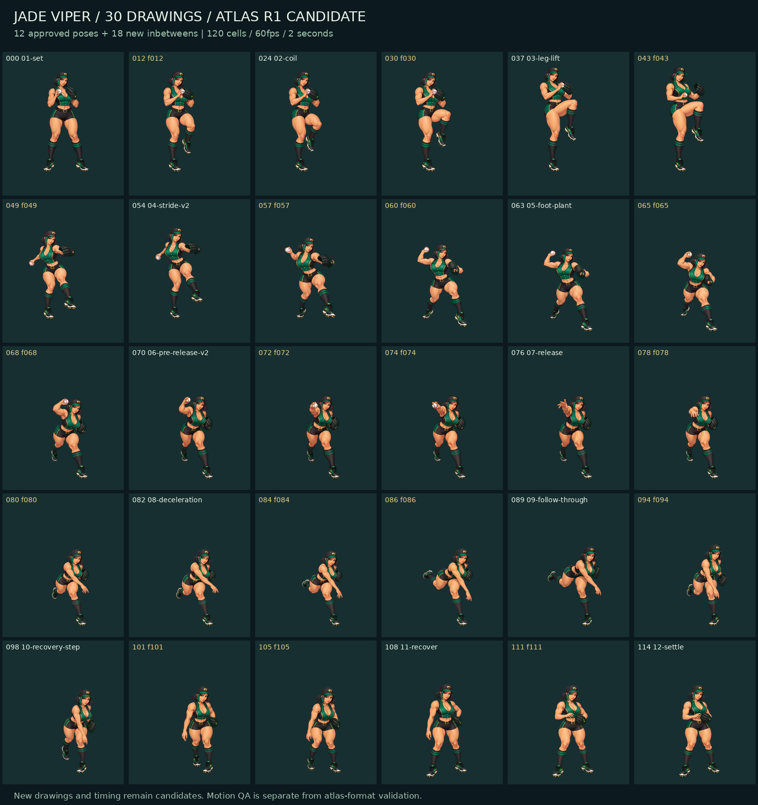

# Jade Viper / 청옥 바이퍼 — Atlas R1 candidate

28세 성인 여성 우완 투수. 오른손 투구·왼손 글러브, 포수 뒤 고정 카메라를 향한 전신 동작이다. 승인된 Motion R1의 12개 PNG를 보존하고 새 연결 그림 18개를 더한 **브랜치 검수 후보**다.

**게임에 연결되지 않았다.** 새 연결 그림과 새 2초 타이밍은 아직 시각 승인을 받지 않았다. 포장·재생 검사의 통과는 완성 모션 판정을 뜻하지 않는다.



## 보기와 규격

- [오프라인 재생 HTML](previews/jade-viper-atlas-r1.html): 내려받아 브라우저에서 열기. 12포즈와 30포즈를 동일한 2초 타이밍으로 비교하며 재생·일시정지·이전/다음 그림·프레임 이동·릴리스 보기를 제공한다. 마지막 프레임에서 정지한다.
- [120셀 투명 아틀라스](atlases/jade-viper-pitch-120-atlas.png): 셀 256×256, 10열×12행, 전체 2560×3072 RGBA, 60fps·2초.
- [manifest](jade-viper-manifest.json), [소스 배치](source/pose-map.json), [원화 R2](source/jade-viper-portrait.png).
- 실제 별도 그림은 **30개**다. 90개 셀은 유지용 반복이며 전체 그림 회전·매 프레임 이동·크로스페이드·관절 모핑으로 고유 프레임 수를 늘리지 않았다. 그림별 고정 균등 축소와 위치 등록만 한다.
- 릴리스는 **0부터 센 76번 셀**(1266.67ms)이다. 75번까지 공을 오른손에 유지하고 76번부터 비운다. 게임의 릴리스 이벤트를 수정했다는 뜻은 아니다.
- 이전 승인 영상은 3.07초다. 왼쪽 비교 영상도 이번 2초 타이밍으로 재배치했으며 이전 영상의 원래 속도를 그대로 보여주지 않는다.

## 승인과 원본

- 원화 R2와 Camera R1 승인 후 12포즈 Motion R1을 제시했다. Camera R1: 2026-10-13 17:07:29 KST, “좋아”.
- Motion R1: 2026-10-13 19:56:18 KST, “음 좋인”. 해당 미리보기와 아틀라스 진행 확인에 대한 답변이다. [현재 승인 기록](approval.json).
- 당시 배포한 manifest와 승인 전 상태 표기는 `approved/motion-r1/`에 역사적 원본 그대로 보존했다. 이후 승인은 루트 `approval.json`이 기록한다.
- 승인된 12개 원본은 `source/keys/`, `source/bridges/`에서 SHA-256 일치를 검증했다. 6키와 6브리지 투명 3×2 시트도 제공한다.
- 새 그림 생성 21회 중 18개를 선택했다. 초기 f043(너무 이른 보폭), f060(추가 다리), f086(과도한 뒷다리 경로)은 `source/rejected/`에 보존했다. f043-r2·f060-r2·f078-r2를 포함한다. 실제 프롬프트·입력·시간은 [생성 기록](source/generation-records/atlas-generation.json)에 있다.
- 시각 비교 후 일부 그림의 사용 시점을 옮겼다. `generationId`와 `selectedCellStart`를 구별하며 원래 생성 목적을 덮어쓰지 않는다. 프레임 80/84/86은 원래 f078/f080/f084 그림, 101/105는 원래 f105/f101 그림이다.

## 근거와 한계

- 참고 방식: **verified_cache**. 신규 검색·영상 재생·새 클립 채택은 0회다.
- 기존 분석 기록: `assets/pitcher-study-copper-sirocco/v2/references.json`, 브랜치 `codex/pitcher-copper-sirocco-20261011`. 원출처: https://www.mlb.com/video/ump-cam-views-from-the-2024-all-star-game . 비교 키: `url:mlb.com/video/ump-cam-views-from-the-2024-all-star-game`; 공식 clip ID는 unknown. 기존 기록의 미디어 basename은 `2d3011e5-df7c816d-7e263c16-csvm-diamondx64-asset`이다.
- 과거 관찰 노트의 0초 디딤/착지, 0.5초 팔 가속·릴리스 부근, 1–1.5초 앞발 지지·팔로스루를 제한적으로 참고했다. 이번에 다시 관찰하거나 정밀 시간·관절 궤적을 측정한 것은 아니다. 전체 와인드업·정확한 릴리스 역학은 미검증이다. 새 영상 사용 이력으로 등록하지 않는다.
- 카메라 크기 근거는 이전 실제 412×915 게임 캡처다. 출처는 manifest에 기록했다. 166.390625px 표시 상자는 축소 판독성 비교용이며 새 게임 합성 화면이 아니다. 첫 카메라 정지 비교판보다 약 15% 작다.
- 모자 폭과 발 접점은 수동 근사치다. 실제 리그나 생체역학 좌표가 아니다. 별도 생성 그림 사이의 머리 높이·비례·발 경로, 빠른 회복 타이밍은 추가 시각 검수 대상이다.
- 독립 검토는 초안 PR 게시 가능으로 판정했으며 완성 모션으로는 승인하지 않았다. 43→49→54의 높이 변화와 78→80의 빠른 상체 접힘이 남아 있다. 새 105번 그림은 원본과 모자 폭 추정값188을 보존하면서 고정 균등 배율을 약5% 높여 회복 구간의 역방향 높이 변화를 줄였다. 발 접점은 유지했고 override를 명시했다.
- 프리미엄 픽셀 그리드 마감, 경기장/VFX 통합, 모바일 가로·PC 실제 게임 배치 합격을 주장하지 않는다.
- 로스터, HP/밸런스, 저장 데이터, 게임 입력/CSS, 런타임 연결, main 병합, 배포는 변경 범위 밖이다.

## 재현과 실제 검증

저장소 루트에서 Python 3 + Pillow, Node.js로 실행한다.

```bash
python scripts/build-jade-viper.py
python scripts/test-jade-viper.py
node scripts/test-jade-viper-preview.cjs
```

- 포장 검사: 120셀 매핑, 30개 실제 픽셀 그림, 12개 원본 해시, 투명 배경/시트, 릴리스 메타데이터. [결과](qa/asset-check.json).
- 재생 검사: 실제 HTML 스크립트를 Node VM과 DOM/canvas 스텁에서 실행해 조작·속도·정지·재시작을 확인했다. **실제 브라우저 렌더링 자동화는 아니다.** [결과](qa/player-check.json).
- [사전 9축 영향도](qa/impact-analysis.md), [독립 시각 검토](qa/motion-review.json). 게임 회귀·smoke·production build는 PR Verify CI에서 확인한다. 이 후보의 수동 게임 플레이 검증은 실시하지 않았다.

채팅용 비교 영상 재현(1배 2초 + 0.5배 4초, FFmpeg 필요):

```bash
python scripts/build-jade-viper.py --video-frames
ffmpeg -v error -framerate 60 -i assets/pitcher-study-jade-viper/previews/rendered/fast-%03d.png -framerate 30 -i assets/pitcher-study-jade-viper/previews/rendered/slow-%03d.png -filter_complex '[0:v]setpts=PTS-STARTPTS,setsar=1[a];[1:v]fps=60,setpts=PTS-STARTPTS,setsar=1[b];[a][b]concat=n=2:v=1:a=0,format=yuv420p[v]' -map '[v]' -c:v libx264 -crf 18 -preset medium -r 60 -movflags +faststart /tmp/jade-viper-atlas-r1.mp4
```

렌더링 중간 프레임은 gitignore 대상이다. 생성 시간과 저장 크기는 [작업 계수](qa/stage-metrics.json)에 실제 측정 범위만 기록한다.
