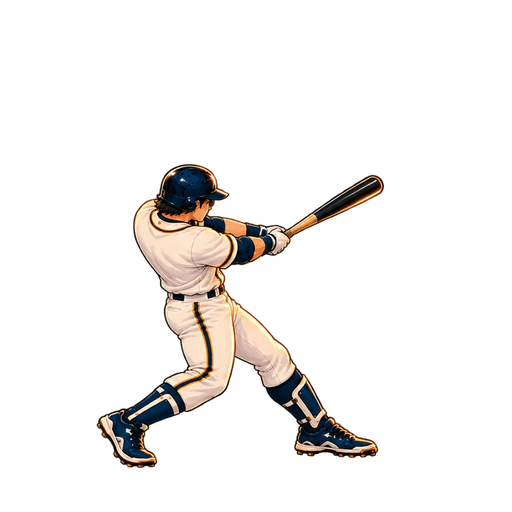

# Batter follow candidate — HELD

New whole-body image_gen drawings between original keys9 and10. Existing14keys/contact freeze/events unchanged. Two newly authored drawings, not120independentframes. Global batch scale0.8/translation(-22,53) only; no limb warp. Sources, exactruntimeWebPs and sole registration are retained.

This is a short motion segment, not a complete loop. Local processing only split/normalized/packed/generated previews. Original source outputs retained. Actual0.5×runtime paints both new poses. See docs/qa/sequential-polish-20261108/round3.md. Two blind rounds improved motion legibility but only3of8axes; NOT_IMPROVED under repository gate. Draft branch only; no main adoption.
