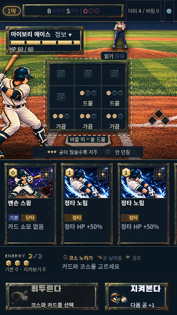
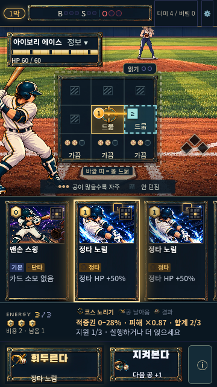
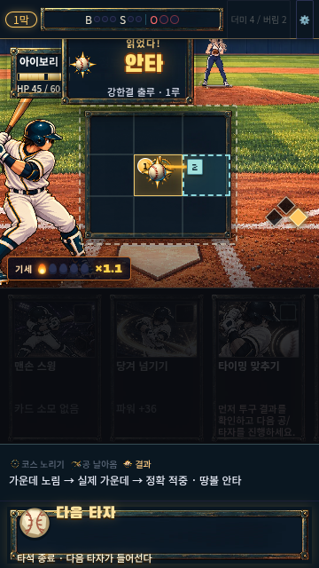

# Asset-led main battle

Baseline: `e2040ba` on `main`. Work branch: `codex/asset-led-battle`.
User direction: let game assets do as much of the visual communication as possible,
while retaining the deckbuilding game. This is an integrated battle presentation,
not a static mockup or a replacement engine.

## What changes for the player

- The normal battle uses original brass/teal panel art and a four-symbol action
  atlas. Swing, watch, aim and exact contact have distinct illustrations. Preparing
  a card uses an energy token; continuing uses an ordinary baseball.
- Low-reading courses combine one/two/three lit baseball marks with short visible
  words. A hatch means an unused course, with a compact legend. Main/support
  selections retain the words while their aim/order symbols take priority. Earned
  ranges, exact percentages and confirmed clues remain text.
- The main aim has a gold sight. Support has a dashed cyan shape and its own square
  order token. Both shape and color convey the difference; card/zone selection,
  swiping and stack rules are unchanged.
- The hand stays visible. The action caption retains the selected card name, even
  when its card is scrolled away. Cost medallions have a blank center for live
  numerals; energy uses a different token to avoid confusing numbers with artwork.
- Ordinary pitch results show a plain baseball. Only an actual exact main hit gets
  the star seal and “읽었다!”. Simple results sit beneath the board; existing runner
  move summaries and full homer/knockout cinematics retain their space.
- Motion reduction disables the new contact animation. Result placement uses one
  translation so reducing motion cannot shift the banner away from the board.

The existing stadium, card illustrations, V15 batter, 120-frame pitchers, Pixi
effects and campaign renderer are retained. Original UI art and runtime metadata
are in [`assets/production-art/asset-led-battle-v1`](../../assets/production-art/asset-led-battle-v1/README.md).
The two raster runtime files total 153,186 bytes. Generated source PNGs are preserved
without being imported into the game build.

## Impact analysis recorded before implementation

| Axis | Impact / mitigation |
| --- | --- |
| UI / layout | Affects main `BallparkBattle`; explicit `.bp-asset-led` scope, original five screen regions. Keep hand, 64px plan and action positions; increase zone hit area. |
| Input / gestures | Same native buttons, handlers, keyboard and swipe. Artwork is noninteractive. Visible focus and minimum touch targets checked. |
| Logic / balance | No engine changes. Marks receive only `cellFace` public words; heat is quantized to those words. Pending pitch and exact probability do not choose low-reading art. |
| Save / load | No schema or persistence change; resume and practice transition regressions required. |
| Mobile viewport | 360×640, 375×667, 390×844, 412×743 and PC portrait iframe. Same-state touch rotation stays in the existing flow check. |
| Scroll / overflow | No page/global selector or scroll owner changed. Hand swipe and map native scroll retained. |
| Existing flow | Title → map → battle → reward → facility → next map → resume. Defense lab and old autobattle use their original presentation. |
| Tests / regression | New tests for hidden-pitch independence, public reading tiers, aim/support order, result gate and experiment isolation. Browser checks for frames, signals, touch targets, selected caption and motion reduction. |
| Build / deployment | No dependencies. Main Pages base build and 60MB budget; existing runtime optimization retained. PR/CI and exact deployed file verification before reporting public release. |

## Verification

The full suite passes **183 files / 1,143 tests**. Production build is **58.6MB /
60MB**. Production browser checks: asset interaction **84/84**, first practice **65/65**,
existing campaign flow **53/53**, native map scrolling **8/8**, screenshot/layout
checks **24/24**. Includes actual mobile input, PC iframe and reduced motion.
Independent source review found no blockers. A fresh-context blind comparison
against the project target scored **2.69 → 3.00 (+0.31)**, with four axes improved
and none lower: **IMPROVED, not BAR_MET**. See [recorded scores](asset-led-battle/visual-review.json).
Character presence, lighting integration and composition remain below the target;
this UI pass does not establish finished commercial art quality. Deployment
evidence is recorded in the PR.

The existing screenshot checker now waits for the result's finite entrance
animation before measuring it. A fixed 3.5-second delay occasionally measured a
fully transparent 2.4× animation frame as covering the pitcher. Independent tracing
found 0 visible overlaps ≥35% in 210 frames. Hidden HUD elements are excluded from
the geometry check. The first-practice checker also waits for title rendering
inside the PC iframe before counting entries.

Automated checks establish behavior and layout, not commercial quality or human
understanding. The next human test remains: “첫 30초에 뭘 해야 할지 알았나?” Compare
time to first aim/swing and ask what the course symbols mean without prompting.

## Screenshots

| Planning | Main + support | Actual exact hit |
| --- | --- | --- |
|  |  |  |
