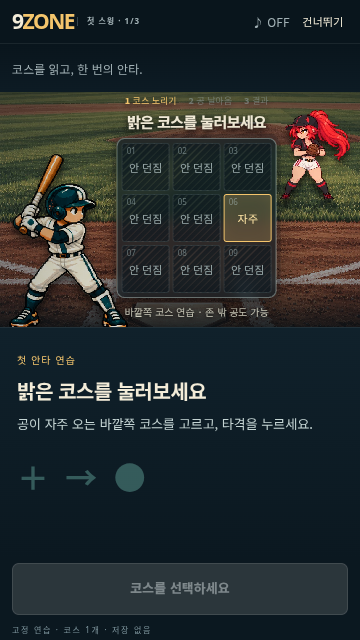
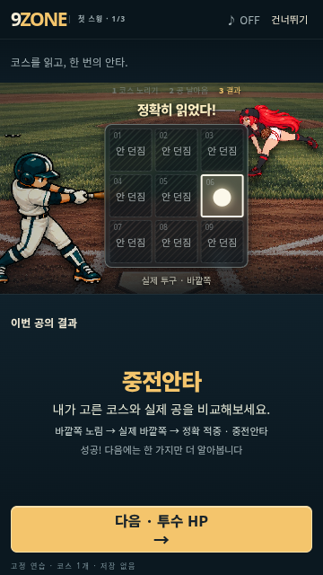
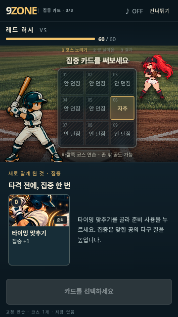

# First experience and persistent-hand battle preview

User-authorized scope: retain deckbuilding; keep the hand visible throughout planning;
allow cards and zones in either order; keep attention around the board; give truthful, proportionate feedback on results.
This is an isolated playable battle study, not a replacement for the main game.

## Impact analysis (before implementation)

| Axis | Assessment | Response |
| --- | --- | --- |
| UI / layout | Impact | New `?showcase=zone-first` entry and separately scoped `.zf-preview` styles; no edits to BallparkBattle or its styles. Keep board and action dock stationary. |
| Input / gestures | Impact | Hand is visible immediately and remains mounted during selection, swapping and support mode. Support placement is explicit and cancellable. Keep horizontal card scrolling, keyboard buttons, and take/basic actions. |
| Logic / balance | Check required | Call existing engine functions for costs, prerequisites, preparation, stacks, public information, results and advancement. Never alter odds, rewards or hidden pitches. Near-miss interpretation only after actual reveal and only for a grid-adjacent miss. |
| Save / load | No impact | Preview state is in React memory. Never read/write production saves. Reload resets the study. |
| Mobile viewport | Check required | Verify 360/375/390px portrait, short landscape, desktop, safe areas and reduced motion. Preview owns a scrollable shell, without changing global layout mode. |
| Scroll / overflow | Check required | Scope all new CSS; allow short-height vertical scroll and independent hand swipe. No body/html/root overflow edits. |
| Existing flow | Check required | Default entry remains Duel; verify title/map scroll/battle/card-stack/pitch/HP/reward/facility/next route/resume/rotation using existing browser regression. Preview terminates at battle completion with replay. |
| Tests / regression | Impact | Add interaction tests for both selection orders, direct swapping, persistent hand, actual starter decks, preparation feedback, re-aim, support, locked pitch and true result feedback; run full existing suite and smoke report. |
| Build / deploy | Check required | Lazy-load preview from main entry; reuse shipped art. Build and size gate; push branch and use existing isolated Pages preview workflow. Do not merge to main. |

## First experience (2026-10-23)

The preview now opens a skippable, three-part practice. Each part starts the same
independent practice pitch: **zone + swing → HP → concentration**. This introduces
one concept at a time without adding a hand-reveal step to normal deckbuilding.

- First practice shows nine zones and a single attack action. Basic swing is already selected; aim is not.
- A real hit opens the HP lesson. A miss explains the actual result and offers the same practice again.
- The third lesson offers only the real `setup` card. The player must select and use it before swinging; preparation remains in the planning step. Concentration improves the quality of a hit, not the chance to cover a wrong zone.
- Each new concept has a brief inline explanation and an immediate action. There is no extra dismiss/confirm popup.
- Practice configuration is explicit: fixed seed `20261023`, one in-zone course with outside balls still possible, a one-card practice deck. These are set **before** `enterV10Node` deals the pitch. No pending pitch, random roll, damage or verdict is replaced. On this repeatable opening, selecting the bright course produces a real hit through the existing engine.
- First-lesson HP, counts and cards are absent from the DOM. HP appears in lesson two; counts and the full actual starter hand appear on entering normal battle. Secondary combat details remain in the information dialog.
- Skip is available even during a pitch. A keyed remount cancels the old timer; completion and skip start a fresh normal battle. Sound preference survives the transition. “처음부터 배우기” in battle information starts practice again.
- `?showcase=zone-first&learn=0` enters normal battle directly. Progress is memory-only; refreshing opens practice again. Production saves remain untouched.
- The three-step indicator follows actual plan/flight/result state. Preparation does not advance it. During flight controls are locked and the choice area dims.
- After impact, one line compares the chosen course, actual course and real verdict. A missed swing is never called a ball. Support coverage and a taken outside ball have distinct explanations.
- Exact main-aim hits alone receive the extra zone glow, short slowdown and optional ascending cue. Covered hits and support hits keep their own normal feedback. Reduced motion suppresses animation. Near misses still require actual grid adjacency to the full coverage.

This is a first-experience slice, not campaign-wide per-match unlock persistence.
AI demonstrations, new pitcher habits, daily scenarios and a manager replacement
cutscene remain outside this change. The first playtest question is:
**“첫 30초에 뭘 해야 할지 알았나?”** Record time to first aim/attack/hit, retry,
and skip separately; automated checks do not measure player understanding.

Additional impact analysis before this change: shared preview rendering and input
are affected; remount boundaries isolate lesson timers. Practice-only initial
conditions affect the sandbox but not the shared engine or normal balance. Memory
state avoids save migration. Step labels replace the old prompt label to retain
mobile geometry. Scoped CSS, existing atlases and lazy routing avoid global layout
and asset-size changes. New lesson tests and browser checks cover completion,
miss/retry, skip in flight, preparation, result timing and reduced motion alongside
the full normal-battle regression.

## Normal battle interaction contract

- After practice or direct entry, initial state shows nine zones and the actual hand. No hand reveal, folding, returning or card-switch button is required. Basic swing is an always-visible zero-cost selection button beside take and execute; it no longer occupies a hand slot.
- Choose a card or zone first. Both directly update the same board; an attack requires an actual aim. No range, odds or arbitrary center appears before aiming.
- Selecting or swapping a card keeps the hand visible and mounted. Selection is marked on the card, range on the board, cost on the execution button. The fixed toolbar retains the selected name, core effect, conditions and draw limitations while the hand scrolls. The execution button shows total cost / available energy; the toolbar keeps the support control.
- Cards show their cost, range/role, core effect and applicable conditions. Long descriptions, pile counts and extended combat details remain in the information dialog.
- Support mode keeps all cards visible. Ineligible cards show the real engine reason. Choose a support card and its zone; tap an existing support card to remove it. Cancel or Escape preserves the main aim and existing supports. Replacing the main card explicitly announces how many supports were cleared. Attacks remain disabled until support placement is complete or cancelled.
- Preparation requires one explicit use action and works without an aim. Actual draw capacity and retained preparation effects use production helpers. The hand remains available afterward.
- Pitching keeps the hand visible but disables all planning controls. HP/count remain unchanged until actual impact. The result replaces the hand area; the next pitch immediately restores the new hand. Board and action positions stay fixed.
- Audio is opt-in; respect reduced motion and public information boundaries. Near-miss language requires an actually adjacent miss after reveal.
- Information dialog offers the actual three starter decks: **한 방 승부 / 연결 야구 / 버티기**. Each button explicitly starts a fresh study battle. Replay preserves the chosen deck.
- State stays in React memory. Reload resets the study; production saves are never read or written.

## Validation

- Full Vitest suite: **180 files / 1,130 tests passed**, including **38** preview and learning tests.
- First-experience production browser QA: **184/184 checks passed**. Covers all three lessons, failure/retry, skip during flight, replay, mobile rotation, reduced motion, result timing and clipping.
- Existing game browser regression: **53/53** checks passed (title/map/battle/card-stack/pitch/HP/reward/facility/next route/resume/rotation).
- Built preview browser QA: **276/276** checks passed on 360×640, 375×667, 390×844 and 1440×900, 1440×750, 700×741 and 700×690, plus reduced motion and touch rotation. Includes immediate hand visibility, both selection orders, direct swaps, basic selection without pitching, persistent selected effects while cards scroll offscreen, minimum 44px action targets, hand locking during flight, real CDP touch swipes on phones, horizontal wheel on PC, board-coordinate invariance, support controls, HP staging and no failed resources.
- All three real starter hands checked at 360px for clipped card names, effects and conditions, and every playable card checked for selected-toolbar fit; preparation before aim and retained power bonus checked in the production browser.
- Production main route/start flow and native map scrolling: **8/8** checks passed.
- Smoke: `node scripts/zone-report.js 10` completed. Engine, balance, card data and preparation helpers match the merged `origin/main` (`91cd80e`); shared engine and normal balance are unchanged; the explicit practice config is isolated in the preview model.
- Production build with exact branch Pages base path passed. Shipped size: **58.5 MB / 60 MB**.
- Independent review covers information boundaries, basic selection, persistent selected effects, support cancellation/removal, preparation, flight locking and mobile layout. Duplicate-condition regression coverage is retained.

The review references inform a UX hypothesis: keeping essential choices visible while reducing secondary details should reduce scanning and extra actions. Automated tests establish behavior and regressions; they do not establish commercial quality or enjoyment. Compare the three decks in actual phone play before replacing the main battle screen or broadening into asset and replayability work.

## Preview scope and access

Branch: `codex/zone-first-preview`. Entry: `?showcase=zone-first`.
The root route continues to open the original game. The existing Pages workflow
builds production from main and this branch into its own preview directory; no main
merge is part of this change. Remote deployment and live-site verification are recorded
in the pull request after the workflow finishes.

Preview URL: https://jbseo-commits.github.io/9-baseball/previews/codex-zone-first-preview/?showcase=zone-first

After the short practice, the preview uses the actual nine-card starter decks and a real seeded opponent. It supports basic swings, taking, preparation, support placement,
removal, re-aiming and consecutive pitches/batters. It ends at defeat or pitcher
knockout with replay; reward/map progression belongs to the unchanged original game.
It does not persist state. Audio is opt-in synthesized feedback, not final production sound.

## Built mobile screenshots

| Initial hand | Zone selected | Ready | Result |
| --- | --- | --- | --- |
|  |  |  |  |

Card-first selection before choosing a zone:

## Built first-experience screenshots

| First aim | Real result | Concentration lesson |
| --- | --- | --- |
|  |  |  |
