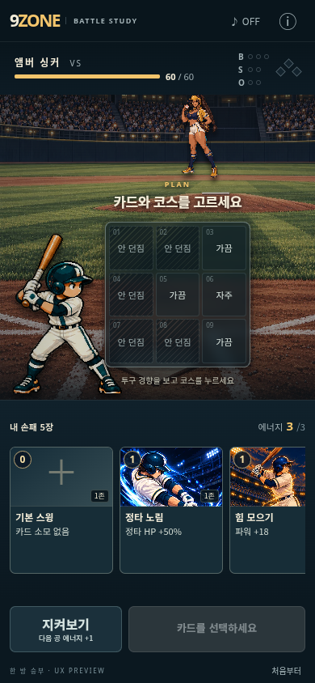
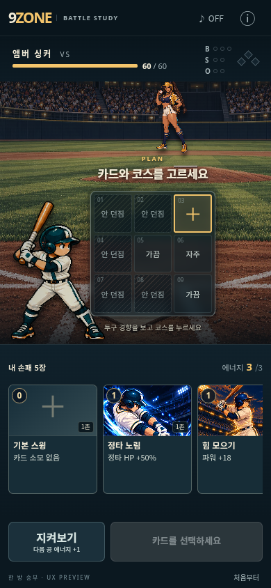
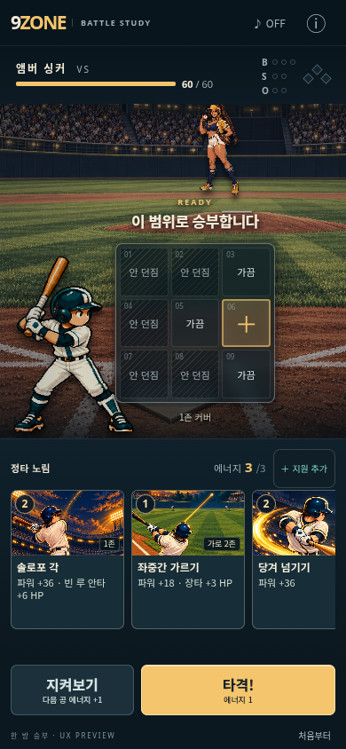
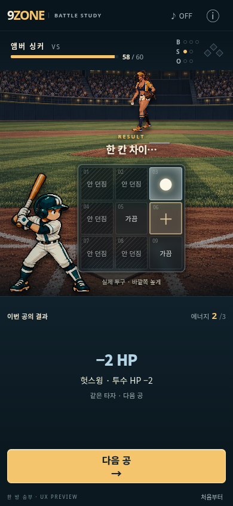
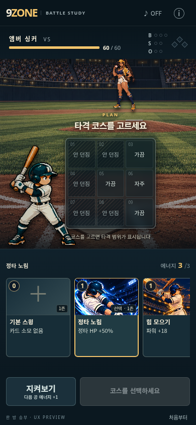

# Persistent-hand battle preview

User-authorized scope: retain deckbuilding; keep the hand visible throughout planning;
allow cards and zones in either order; keep attention around the board; give truthful, proportionate feedback on results.
This is an isolated playable battle study, not a replacement for the main game.

## Impact analysis (before implementation)

| Axis | Assessment | Response |
| --- | --- | --- |
| UI / layout | Impact | New `?showcase=zone-first` entry and separately scoped `.zf-preview` styles; no edits to BallparkBattle or its styles. Keep board and action dock stationary. |
| Input / gestures | Impact | Hand is visible immediately and remains mounted during selection, swapping and support mode. Support placement is explicit and cancellable. Keep horizontal card scrolling, keyboard buttons, and take/basic actions. |
| Logic / balance | Check required | Call existing engine functions for costs, prerequisites, preparation, stacks, public information, results and advancement. Never alter odds, rewards or hidden pitches. Near-miss interpretation only after actual reveal and only for a grid-adjacent miss. |
| Save / load | No impact | Preview state is in React memory. Never read/write production saves. Reload resets the study. |
| Mobile viewport | Check required | Verify 360/375/390px portrait, short landscape, desktop, safe areas and reduced motion. Preview owns a scrollable shell, without changing global layout mode. |
| Scroll / overflow | Check required | Scope all new CSS; allow short-height vertical scroll and independent hand swipe. No body/html/root overflow edits. |
| Existing flow | Check required | Default entry remains Duel; verify title/map scroll/battle/card-stack/pitch/HP/reward/facility/next route/resume/rotation using existing browser regression. Preview terminates at battle completion with replay. |
| Tests / regression | Impact | Add interaction tests for both selection orders, direct swapping, persistent hand, actual starter decks, preparation feedback, re-aim, support, locked pitch and true result feedback; run full existing suite and smoke report. |
| Build / deploy | Check required | Lazy-load preview from main entry; reuse shipped art. Build and size gate; push branch and use existing isolated Pages preview workflow. Do not merge to main. |

## Interaction contract

- Initial state shows nine zones and the actual hand. No hand reveal, folding, returning or card-switch button is required. The default basic swing is a zero-cost card alongside the hand.
- Choose a card or zone first. Both directly update the same board; an attack requires an actual aim. No range, odds or arbitrary center appears before aiming.
- Selecting or swapping a card keeps the hand visible and mounted. Selection is marked on the card, range on the board, cost on the execution button. The fixed toolbar shows the selected name, energy and support control.
- Cards show their cost, range/role, core effect and applicable conditions. Long descriptions, pile counts and extended combat details remain in the information dialog.
- Support mode keeps all cards visible. Ineligible cards show the real engine reason. Choose a support card and its zone; tap an existing support card to remove it. Cancel or Escape preserves the main aim and existing supports. Attacks remain disabled until support placement is complete or cancelled.
- Preparation requires one explicit use action and works without an aim. Actual draw capacity and retained preparation effects use production helpers. The hand remains available afterward.
- Pitching keeps the hand visible but disables all planning controls. HP/count remain unchanged until actual impact. The result replaces the hand area; the next pitch immediately restores the new hand. Board and action positions stay fixed.
- Audio is opt-in; respect reduced motion and public information boundaries. Near-miss language requires an actually adjacent miss after reveal.
- Information dialog offers the actual three starter decks: **한 방 승부 / 연결 야구 / 버티기**. Each button explicitly starts a fresh study battle. Replay preserves the chosen deck.
- State stays in React memory. Reload resets the study; production saves are never read or written.

## Validation

- Full Vitest suite: **175 files / 1,068 tests passed**, including **28** preview tests.
- Existing game browser regression: **53/53** checks passed (title/map/battle/card-stack/pitch/HP/reward/facility/next route/resume/rotation).
- Built preview browser QA: **234/234** checks passed on 360×640, 375×667, 390×844 and 1440×900, 1440×750, 700×741 and 700×690, plus reduced motion and touch rotation. Includes immediate hand visibility, both selection orders, direct swaps, hand locking during flight, real CDP touch swipes on phones, horizontal wheel on PC, board-coordinate invariance, support controls, HP staging and no failed resources.
- All three real starter hands checked at 360px for clipped card names, effects and conditions; preparation before aim and retained power bonus checked in the production browser.
- Production main route/start flow and native map scrolling: **8/8** checks passed.
- Smoke: `node scripts/zone-report.js 10` completed. Engine, balance, card data and preparation helpers match the merged `origin/main` (`9fe86cb`); this preview adds presentation only.
- Production build with exact branch Pages base path passed. Shipped size: **58.4 MB / 60 MB**.
- Independent review covers information boundaries, support cancellation/removal, preparation, flight locking and mobile layout. Duplicate-condition regression coverage is retained.

The review references inform a UX hypothesis: keeping essential choices visible while reducing secondary details should reduce scanning and extra actions. Automated tests establish behavior and regressions; they do not establish commercial quality or enjoyment. Compare the three decks in actual phone play before replacing the main battle screen or broadening into asset and replayability work.

## Preview scope and access

Branch: `codex/zone-first-preview`. Entry: `?showcase=zone-first`.
The root route continues to open the original game. The existing Pages workflow
builds production from main and this branch into its own preview directory; no main
merge is part of this change. Remote deployment and live-site verification are recorded
in the pull request after the workflow finishes.

Preview URL: https://jbseo-commits.github.io/9-baseball/previews/codex-zone-first-preview/?showcase=zone-first

The preview uses the actual nine-card starter decks and a real seeded opponent. It supports basic swings, taking, preparation, support placement,
removal, re-aiming and consecutive pitches/batters. It ends at defeat or pitcher
knockout with replay; reward/map progression belongs to the unchanged original game.
It does not persist state. Audio is opt-in synthesized feedback, not final production sound.

## Built mobile screenshots

| Initial hand | Zone selected | Ready | Result |
| --- | --- | --- | --- |
|  |  |  |  |

Card-first selection before choosing a zone:

