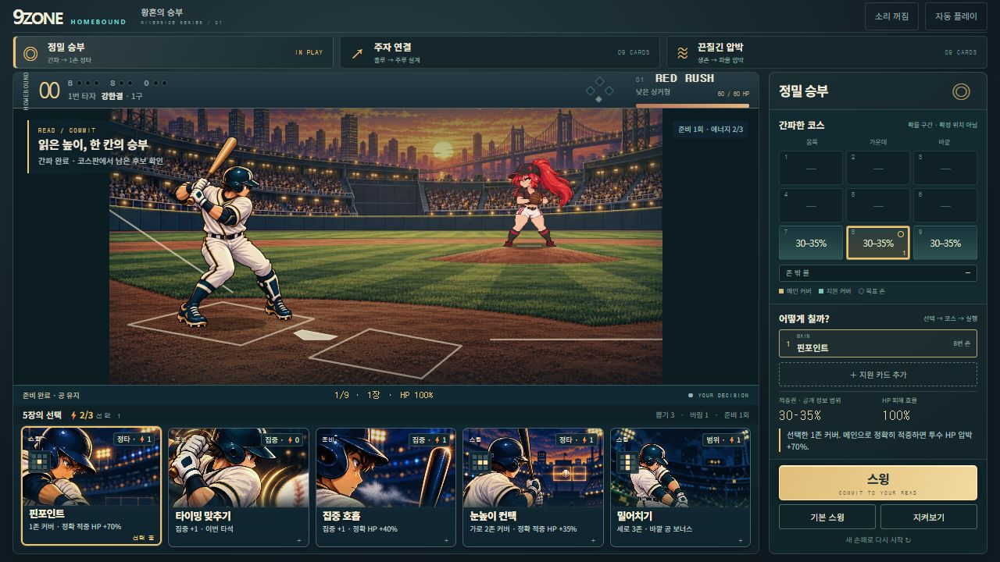
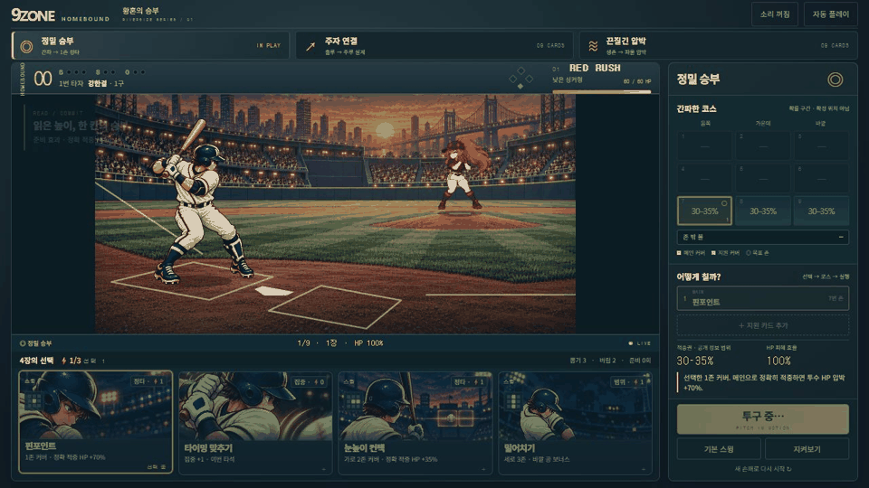

# 9ZONE hybrid battle

A live V10 match combining the existing V15 batter/rig and Red Rush pitching atlas with a clean Riverside stadium and illustrated cards. Open hybrid.html; the original game remains at index.html.

The screen keeps field, hand, selection and commit visible together. The hand scrolls horizontally. On portrait screens the 9-zone board opens as a native modal, labels the edited MAIN or SUPPORT and returns to the hand after a zone choice. The status strip shows coverage, card consumption and damage efficiency (or bunt success and out cost). Energy and selected cost use current engine rules.

Three nine-card packs share only one card per pair, with two complementary opening tools and three shuffled choices. Precision spends energy on information and narrow pressure, relay carries real runners into the next batter's sign/advance play, and grind trades cards for foul survival and damage. Pitch, public probability bounds, HP, runners and card consumption use the real engine. Preparation does not pitch. Results commit at actor contact; duplicate input is locked until settling. Optional spectator decisions use public information only.

The entire 1280×720 field uses one uniform fit and camera transform. A 1280×640 viewing window trims empty sky while retaining full actors, plate and both boxes. Plate/chalk and both actors share a projected ground plane. Tests use opaque shoe pixels and the real bat-barrel contact pixel. Existing per-kind card originals replace the repeated five-panel atlas; common frames and restrained lighting connect the original actors to Riverside.

See [current revision](REVISION-4.md), [QA](QA.md), [art provenance](PROMPTS.md), [impact assessment](IMPACT.md), [composition correction](COMPOSITION-FIX.md) and [card-first correction](PLAY-LOOP-FIX.md). This is a reviewable battle slice, not a declaration that the commercial game is finished.
