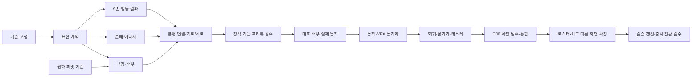

# 9ZONE — 가로 목업을 본게임으로 옮기는 구현 계획

작성일: 2026-10-27 · 대상: `jbseo-commits/9-baseball` · 상태: **계획·작업 지시서, 구현 전**

**목표는 현재 목업의 미감을 실제 덱빌딩 게임의 모든 전투 상태에서도 유지하는 것이다.** 경기장과 인물은 그림으로, 카드 판단과 조작은 읽기 쉬운 실제 UI로 구성한다. 엔진을 새로 만들거나 목업에 본편을 덧붙이는 방식 대신, 본편의 전투 표현층을 교체한다.

“그림이 예쁘다”는 피드백은 이 아트 방향을 이어갈 근거다. 조작 이해도·반복 재미·상업성까지 검증됐다는 의미로 확대하지 않는다. 첫 구현에서는 **같은 규칙·같은 손패로 화면만 달라진 전투**를 비교할 수 있게 한다.

## 1. 기준 자료와 버전

- 본편 기준: [`main f3ec4beef5b245e0e98696d3174d47b6a8b09005`](https://github.com/jbseo-commits/9-baseball/tree/f3ec4beef5b245e0e98696d3174d47b6a8b09005). 작성 시 원격 HEAD를 재확인했다.
- 시각 기준: [휴대폰 가로 실제 화면](reference/shots/phone.png), [PC 실제 화면](reference/shots/desktop.png), [타석·접지 검토](reference/shots/diamond.png), [결과 화면](reference/shots/result.png).
- 원화 4개: `reference/art/`. 선정 버전·해시: [패키지 manifest](PACKAGE-MANIFEST.json).
- 카메라 원본: `reference/scene.js`, `reference/scene.css`. 상세 설계: [CONTRACTS.md](CONTRACTS.md).
- 목업의 과거 타자 이미지나 예전 캡처를 섞지 않는다. 이 패키지의 선정본을 사용한다.
- 개발 시작 때 main이 더 진행됐다면 C00에서 차이를 반영하고 실제 `BASE_SHA`를 다시 기록한다. 오래된 `codex/action-button-layout` 체크아웃을 기준으로 구현하지 않는다.

이 패키지는 자료·지시서다. 별도 목업의 엔진 사본을 포함하지 않으며 실행 앱으로 배포하지 않는다. `/workspace`가 없는 다른 PC에서도 압축을 풀어 참조할 수 있다.

## 2. 유지할 미감과 실제 제품에서의 조정

| 항목 | 고정할 기준 | 실제 구현 원칙 |
|---|---|---|
| 전체 인상 | 노을 구장, 크림색 카드, 짙은 청록 패널, 주황 행동 강조 | 금색 장식 프레임·작은 배지를 다시 늘리지 않는다. |
| 주인공 | 왼쪽 가까운 우타자, 중앙 먼 투수, 하나의 구장 원근 | 배경·배우·그림자에 같은 카메라. UI에 맞춰 발을 옮기지 않는다. |
| 손패 | 항상 보이며 그림과 짧은 차이가 읽힘 | 별도 ‘손패 보기’ 단계 금지. 작은 화면은 가로 스크롤. |
| 에너지 | 손패 바로 위 한 곳 | 실제 현재량·상한·선택 비용을 연결. 기본 2, 조건부 값은 엔진 기준. |
| 결정 영역 | 오른쪽 9존 → 선택 요약 → 행동 | 시선을 크게 옮기지 않고 범위와 비용을 대조한다. |
| 행동 버튼 | 주황색의 명확한 주 행동 | 목업의 두 버튼 대신 본편의 **단일 버튼** 유지. `지켜보기 / 타격 / 준비 사용`으로 표시한다. |
| 확률·예측 | 공개 정보가 같은 9존에 보임 | 목업은 읽기 II 예시다. 읽기 0/I에도 정확한 %를 붙이지 않는다. 피해는 `안타 시 −12~30`처럼 조건을 표시한다. |
| 상태 변화 | 선택 → 공 이동 → 결과가 같은 자리에서 이어짐 | 손패를 감추지 않고 조작만 잠근다. 기본 흐름에 확인 단계나 ‘다음’ 탭을 추가하지 않는다. |

### 화면 방향 결정

이번 계획의 제품 방향은 **PC·휴대폰 가로에서는 목업 배치, 세로에서는 같은 UI의 재배치**다. 휴대폰으로 개발한다는 이유만으로 플레이 화면을 세로에 한정하지 않는다.

본편은 현재 세로 전용이다. PC에서는 `PortraitFrame` iframe, 터치 가로에서는 회전 안내를 쓴다. 따라서 `PORTRAIT_ONLY=false` 한 줄로 끝내지 않는다. C05에서 새 화면 경로와 기존 가로 sidecar를 분리한다. 프리뷰에서는 새 경로만 가로를 허용하고, 기존 기본 경로는 회귀 비교용으로 유지한다. 정식 전환은 C08의 전체 런 검증 뒤에 한다.

가로 전투 외의 지도·보상·시설은 **정상 스크롤 가능한 중앙 패널**로 우선 수용한다. 전투 화면의 `overflow:hidden`을 다른 화면에 적용하지 않는다. 이 작업은 해당 화면의 신규 원화 제작까지 뜻하지 않는다.

## 3. 1차 범위와 후속 범위

**1차: 실제로 플레이 가능한 전투 프리뷰**

- 본편 엔진·세이브·카드 선택·메인/지원·준비·지켜보기·결과·다음 공에 연결한다.
- 새 구장과 대표 배우, 새로운 손패/에너지/결정 영역을 적용한다.
- 읽기 0/I/II, 비용 부족, 지원 선택 중, 준비 사용, 결과, 강판/패배까지 다룬다.
- 기존 첫 타격 연습과 본 런이 같은 조작 언어를 쓰게 한다.
- 지도→전투→보상→시설→다음 지도와 저장 이어하기를 통과한다.
- 첫 게이트는 **정적 원화가 연결된 기능 프리뷰**, 다음 게이트는 **실제 동작 프리뷰**로 명확히 나눈다.

**상업 출시용 완성 범위**

- 대표 배우의 실제 동작 검수 후 전체 실제 투수 로스터로 확장한다.
- 151종 카드가 새 스타일에서 식별되도록 `card kind → art → 작은 카드 검수` 목록을 완성한다. 6칸 시트를 151종 완성으로 계산하지 않는다.
- 타이틀·지도·보상·시설·도감·엔딩의 서체/패널/색상/카드 표현을 통일한다. 신규 전면 원화는 별도 아트 목록으로 발주한다.
- Safari/실기기·로딩·모션·접근성·전체 런 QA를 완료한다.

카드 밸런스, 새 자원, 신규 가족, 풀빌딩 전환, 새 게임 엔진 도입은 이번 이식 범위에 넣지 않는다. 기존 결과 해설·정확 적중·근접 실패·강판·첫 연습은 재사용하고 읽히는 순서를 개선한다.

## 4. Codex와 Claude Code의 역할

| 담당 | 책임 | 인수 결과 |
|---|---|---|
| Codex 총괄 | 기준 화면·계약 고정, 원화/동작 검수, 공통 파일 통합, 독립 리뷰, 인수 판정 | 비교 캡처, 결정 기록, 병합 순서, 결함 목록 |
| Claude Code 구현 | 한 번에 티켓 하나. 지정 컴포넌트·테스트·실행 증거 제작 | 커밋 SHA, diff, 실행 명령/결과, 캡처, 미해결 사항 |
| 아트 제작 | 원본·동작 프레임·피벗/이벤트 metadata·최적화 입력 제작 | [ART.md](ART.md)의 납품 묶음 |
| 독립 검수 | 실제 화면·입력·상태 전이 및 코드 확인 | PASS/FAIL/BLOCKED와 재현 근거 |

**한 번에 코드를 쓰는 담당은 한 명이다.** 다른 PC를 쓰더라도 같은 시점에 같은 목표를 두 세션이 편집하지 않는다. 탐색·원화 검토·읽기 전용 리뷰는 병렬로 할 수 있다. 공통 파일 수정이 필요한 작업은 통합자에게 파일 소유권을 넘긴 뒤 진행한다.

Claude 역할/모델은 저장소 `docs/MODEL-ROUTING.md`를 따른다. 사용 가능한 실제 모델과 advisor 지원을 기록하며, 지원되지 않은 실행을 했다고 보고하지 않는다. 새 상시 루프·예약 실행·중첩 CLI는 만들 필요 없다.

### 공통 파일 독점 소유

`src/main.jsx`, `src/duel/App.jsx`, `BallparkBattle.jsx`, `ZoneFirstPreview.jsx`의 첫 연습 연결, `layout-mode.js`, `PortraitFrame.jsx`, `portrait-lock.css`, 기존 전역 CSS/sidecar, `card-art.js`, `pitcher-visuals.js`, 최적화 스크립트/manifest, 의존성·빌드 설정은 **통합자 소유**다. Claude의 분리 컴포넌트 작업은 이 파일들을 직접 고치지 않고 필요한 연결을 인수 메모에 적는다. 통합 티켓을 Claude에게 맡길 때만 단독 편집권을 명시적으로 넘긴다.

## 5. 실행 순서와 업무 분할

아래 파일명은 **새 구현의 제안 경로**다. C00에서 충돌을 확인하고 C01에서 확정한다. 기존 파일이라고 오인하지 않는다.

| ID / 담당 | 하나의 완료 결과 | 주 수정 영역 | 선행 | 난도 |
|---|---|---|---|---|
| [C00 / Codex](tasks/C00-baseline.md) | 최신 기준·브랜치·현행 실패·화면 증거 고정 | 작업 기록/영향도 문서 | 없음 | 작음 |
| [C01 / Claude](tasks/C01-contract.md) | 표현층 계약·공개 정보 변환·검토용 fixture | `src/duel/battle-vnext/view-model.js`, 계약 테스트 | C00 | 중간 |
| [C02 / Claude](tasks/C02-scene.md) | 실제 원화와 공유 카메라의 Scene | `BattleScene.jsx`, `scene-geometry.js`, `scene.css` | C01, A01 | 중간 |
| [C03 / Claude](tasks/C03-hand.md) | 항상 보이는 손패와 바로 위 에너지 | `HandDock.jsx`, `BattleCard.jsx`, `hand.css` | C01 | 중간 |
| [C04 / Claude](tasks/C04-decision.md) | 9존·상태별 실행·정확한 예측·결과 표시 | `DecisionPanel.jsx`, `BattleHud.jsx`, `ResultReadout.jsx`, `decision.css` | C01 | 중간 |
| [C05 / Codex 통합](tasks/C05-integration.md) | 실제 런에 연결한 가로/세로 프리뷰 | `BattleView.jsx`, `layout.css` 및 독점 공통 파일 | C02–C04 | 큼 |
| [C06 / Claude + 아트](tasks/C06-motion.md) | 엔진 판정과 맞는 실제 투구·타격 동작 | `motion-timeline.js`, `motion.css`, Scene의 지정 부분 | C05, A02 | 큼 |
| [C07 / Claude 수정 + Codex 검수](tasks/C07-validation.md) | 회귀·성능·실기기·사용성 증거 | 관련 테스트/검증 스크립트, 허용된 결함 수정 | C05, 최종은 C06 | 큼 |
| [C08 / Codex](tasks/C08-rollout.md) | 후속 작업 발주·통합 및 출시 전환 묶음 | 카탈로그/다른 화면 연결, 전환 설정, 릴리스 기록 | 착수 C07; G4 완료는 A03·R1–R6 후 | 큼 |

난도는 상대적 분류이며 소요일 약속이 아니다. 특히 모션·로스터 확장은 실제 자산 수와 승인 상태를 세고 별도 추정한다.

분기는 인터페이스상 독립이라는 뜻이다. 실제 코드 편집은 C02→C03→C04 순서로 맡기고, 대기 중에는 다음 티켓의 읽기·아트 작업을 진행한다.

## 6. 단계별 인수 게이트

| 게이트 | 눈으로/실행으로 확인할 것 | 다음 단계 |
|---|---|---|
| G0 기준 | 최신 SHA, 선정 원화 해시, 폰/PC 기준 캡처, 기존 실패 기록 | C01 시작 |
| G1 정적 기능 프리뷰 | 844×390과 1440×900에서 목업 미감 유지. 기본 에너지2·카드/9존/단일 행동·전체 런 연결. 배우가 정지 포즈라는 한계 표시 | 대표 동작 제작 |
| G2 동작 프리뷰 | 발·그립·릴리스·공·배트 접촉이 이어짐. 1회 입력에 1회 판정. 결과 정보가 제때 보임 | 본격 테스터/아트 확장 |
| G3 제품 검수 | 지원 뷰포트, 읽기별 정보, 기존 저장, 전체 런, 실기기, 성능, 전체 테스트/스모크/빌드 | 출시 전환 후보 |
| G4 전환 | 출시 대상 카드/배우의 신구 스타일 혼재 해결, 다른 화면 일관성, 정확한 버전 프리뷰와 롤백 확인 | 승인된 배포 범위 실행 |

배우·카드가 일부만 새 스타일이면 “대표 전투 프리뷰”로 보고한다. 이를 전체 상업 아트 완료라고 부르지 않는다. 코드 통과와 시각 통과는 별도 칸에 기록한다.

## 7. 구현 전 9축 영향도

| 축 | 판정 | 대응 / 인수 책임 |
|---|---|---|
| UI·레이아웃 | 영향 있음 | 새 화면 root 범위 스타일, 겹침·대비·긴 문구 비교 / C02–05 |
| 입력·제스처 | 영향 있음 | 탭/가로 스와이프/지원 선택/키보드/취소/정보창 복귀 / C03–05 |
| 로직·밸런스 | 확인 필요 | 규칙은 유지하지만 연결 오류 가능. 같은 seed/actions의 결과·소비 비교 / C01·05 |
| 저장·불러오기 | 확인 필요 | schema/key 그대로. 프리뷰 fixture와 실제 세이브 격리 / C00·05·07 |
| 모바일 뷰포트 | 영향 있음 | 가로 정책·회전·safe area·짧은 높이·세로 재배치 / C05 |
| 스크롤·오버플로 | 영향 있음 | 전투 내부 제약만 적용. 경로/시설 스크롤 별도 검수 / C05·07 |
| 기존 플로우 | 영향 있음 | 연습·본 런·보상·시설·패배·이어하기 / C05·07 |
| 테스트·회귀 | 영향 있음 | 행동 계약 회귀 추가. 옛 세로전용/DOM 검사 변경은 근거 기록 / C07 |
| 빌드·배포 | 영향 있음 | 실제 WebP 파이프라인·용량 한도·Pages base path·캐시 검수 / C02·07·08 |

## 8. 판단 지표와 중단 기준

- 새 테스터가 첫 30초 안에 코스·카드·행동의 관계를 설명하는지 관찰한다.
- 행동 버튼을 누르기 전에 세 상태의 동작을 맞히는지 본다.
- 정확 적중과 범위 적중, 근접 실패 HP 압박을 구별하는지 본다.
- 원화 호감과 조작 이해도를 따로 기록한다. 같은 seed/손패로 비교하고 제시 순서를 나눈다.
- 조작 오작동, 숨은 정보 노출, 저장 손실, 모션/결과 불일치, 화면 밖 필수 버튼은 출시 차단 결함이다.
- 대표 동작이 불안정하면 로스터 전체 제작을 멈추고 해당 배우의 피벗·프레임·타이밍을 먼저 고친다.

상세 검수표·실행 명령: [QA.md](QA.md). 아트 작업량과 납품 계약: [ART.md](ART.md).

## 9. Claude Code에 전달하는 방법

압축을 풀고 [CLAUDE-START.md](CLAUDE-START.md)의 첫 지시문을 전달한다. C00 기준을 받은 뒤 **C01 한 작업부터** 시작한다. 전체 계획을 한 번에 구현하라는 지시로 사용하지 않는다.

각 인수에는 `BASE_SHA / HEAD_SHA / 티켓 / 파일 / 실제 검증 / 캡처 / 미해결 / 다음 담당`을 남긴다. 휴대폰에서도 이 기록과 프리뷰 URL만으로 현재 상태를 확인할 수 있게 한다. [WORKLOG.md](WORKLOG.md)의 표와 양식을 공통으로 쓴다.
