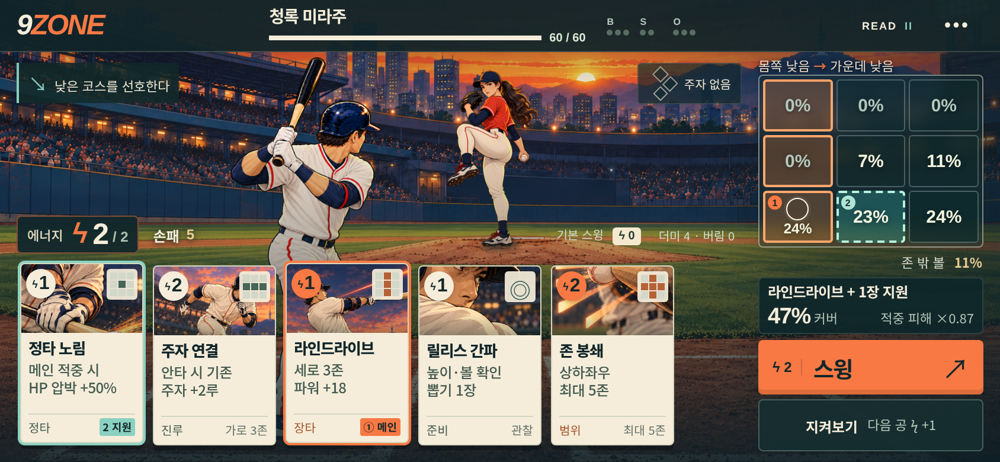

# 9ZONE 목업 구현·Claude Code 협업 패키지

**지금 좋은 평가를 받은 가로 목업을 실제 본게임으로 옮기기 위한 계획서입니다.** 게임 런타임 코드·GitHub Pages 배포를 바꾸지 않는 문서·참조 자료 묶음입니다.

1. 전체 방향과 순서: [PLAN.md](PLAN.md)
2. Claude에 바로 전달할 지시문: [CLAUDE-START.md](CLAUDE-START.md)
3. 게임 데이터·입력·카메라·레이아웃 규칙: [CONTRACTS.md](CONTRACTS.md)
4. 원화와 실제 동작 제작: [ART.md](ART.md)
5. 실제 검증과 인수: [QA.md](QA.md)
6. 작업 상태·교대 양식: [WORKLOG.md](WORKLOG.md)

업무는 C00–C08 **9개**로 나눴습니다. `tasks/`의 각 문서에 담당·선행·수정 허용 파일·금지 범위·인수 조건을 적었습니다. 첫 착수는 최신 기준 C00, 그다음 Claude의 표시 계약 C01입니다.

선정 원화 4개와 실제 화면 캡처를 `reference/`에 동봉했습니다. 이 브랜치를 checkout하거나 패키지를 압축 해제하면 다른 PC에서도 같은 자료로 작업할 수 있습니다. 모든 파일의 해시와 선정 기준은 [PACKAGE-MANIFEST.json](PACKAGE-MANIFEST.json)을 참고하세요.

현재 구현 상태: **계획만 완료**. 정지 원화·카드 샘플 시트를 전체 모션/151종 카드 완성으로 계산하지 않습니다.

이미지는 미감과 배치 기준입니다. 실제 제품에서는 본편의 **한 개 행동 버튼**, 읽기 단계별 공개 정보, 기존 세이브와 런 흐름을 유지합니다.
