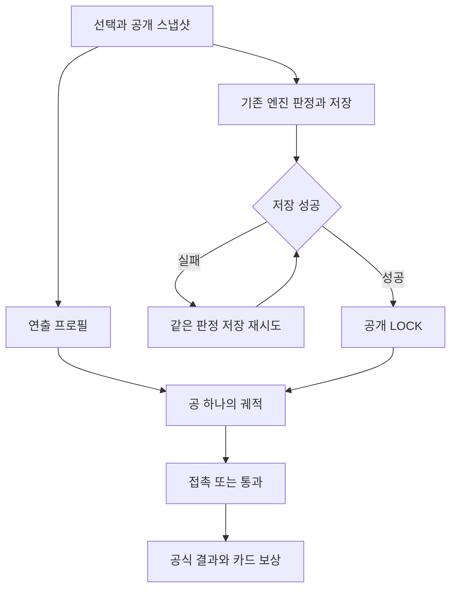

# 구종별 궤적과 타격 연결 — 마스터피스 구현 계획

- 작성: 2026-11-15 (KST)
- 기준 저장소: `jbseo-commits/9-baseball`
- 조사 기준: [main `fb8e7b13f043e2c17376138abe6696f48c2d8022`](https://github.com/jbseo-commits/9-baseball/commit/fb8e7b13f043e2c17376138abe6696f48c2d8022)
- 상태: **계획 검토용. 이 PR은 이 문서만 추가하며, 게임 코드·에셋·판정·저장·배포를 변경하지 않는다.**
- 요청: 모든 투구가 직구처럼 보이는 반복감을 줄이고, 공이 다가오는 긴장부터 타격 보상까지 높은 완성도로 구현할 계획과 PR.
- 목표: **같은 카드 전투에서도 상대의 투구 성격과 내가 성공·실패한 이유가 공의 움직임과 접촉으로 읽힌다.**
- 현재 가로 기본 VNext와 기존 세로/legacy를 기준으로 한다. 과거의 손패 3장·9존 제거 제안을 현행 구현으로 간주하지 않는다.

## 1. 확인된 문제와 판단의 범위

이번 조사는 원격 소스·기존 검수 기록·열린 PR을 읽은 결과다. 이번 세션에서 실제 게임 재생, 실기기 성능, 청취 또는 새 플레이테스트를 수행한 것은 아니다.

| 근거 | 현재 확인한 내용 | 이번 계획에서 해결할 일 |
| --- | --- | --- |
| [scene-effects.js](../../../src/duel/battle-vnext/scene-effects.js), `sceneEffectAt` | VNext의 타격 전 공은 `lerp(R,C,linear²)`. 스윙은 같은 C, 지켜보기는 C+(40,10). 구종 분기 없음 | 공통 접점을 재사용하는 진단과 실제 코스별 연출을 구분하고, 단일 궤적 샘플러 도입 |
| 같은 파일의 착탄 이후 분기 | 헛스윙·통과는 C+결과별 delta에서 시작. 공 크기도 전후에 달라짐 | 위치·크기·회전·잔상이 접점에서 튀는지 검증하고 연속적인 인계 |
| [roster-actor.js](../../../src/duel/battle-vnext/roster-actor.js), [pitcher-sd.js](../../../src/duel/pitcher-sd.js) | 등록된 투수의 도착 시간은 릴리스+`PITCH_FLIGHT_MS=300` | 첫 3종은 기존 도착 시각 유지. 체인지업의 시간 변경은 별도 단계 |
| [motion-timeline.js](../../../src/duel/battle-vnext/motion-timeline.js), [BattleScene.jsx](../../../src/duel/battle-vnext/BattleScene.jsx) | 등록된 기본 contact 하나와 타자 drawing 8 사용. 접촉 VFX·CSS 변수도 고정 contact 투영 | 공·배트·VFX·레이아웃 통지가 같은 물리 접점을 사용하도록 연결 |
| [PITCH-CONTACT-AUDIT](../../qa/masterpiece-gap-20261110/PITCH-CONTACT-AUDIT.md) | UI 9존과 실제 타격 평면은 별개. 20명 릴리스 등록, 일부 배트 좌표는 오차가 있는 추정치 | UI 사각형을 공의 목적지로 복사하지 않고 실제 배트와 맞는 평면 검수 |
| [course-presentation.js](../../../src/duel/battle-vnext/course-presentation.js) | 공개 코스 계약·직선 보간 기반은 존재. `PROPOSED_COURSE_PLANE.approved=false` | 기반을 재사용하되 진단 좌표를 승인된 타격 좌표로 취급하지 않음 |
| [App.jsx](../../../src/duel/App.jsx), `retryAcceptedPitch/startPresentation` | 일반 V10 저장 성공 뒤 재생 시작. 공개 코스 snapshot 전달 기반이 있음 | 저장 실패·재시도·결과 공개 순서를 그대로 보존 |
| [engine.js](../../../src/duel/engine.js), `baseIntent/dealPitch` | intent의 sinker/deep/putaway/fastball 분류와 pending의 zone/roll/powerRoll 구조 | 새 4종을 판정 엔진의 실제 구종으로 꾸며내지 않고 우선 **연출 프로필**로 정의 |

**진단:** VNext의 투구 경로·도착 박자가 획일적이라는 코드 근거가 있다. 이것이 전체 지루함의 주원인이라는 결론은 아직 플레이 비교가 필요하다. 접촉의 부정확함, 배우 포즈의 단절, 화면 정보 과밀도 함께 영향을 줄 수 있으므로 궤적만 추가하고 완성 처리하지 않는다.

## 2. 장면 목표와 구종의 감각

### 한 공의 연출

| 구간 | 플레이어가 보게 될 장면 | 품질 기준 |
| --- | --- | --- |
| 선택 확정 | 고른 카드·노림이 남고 투수가 투구를 준비 | 기존 조작 유지, 추가 확인 클릭 없음 |
| 릴리스 | 던지는 손에서 공 하나가 분리 | 손 속 공과 날아가는 공의 중복·빈 프레임 없음 |
| 접근 | 구종별 곡률·원근 크기·잔상으로 압박 | 공 자체가 가장 잘 보이고, 잔상이 배우·코스 UI를 덮지 않음 |
| 접점 직전 | 꺾임이나 낙차가 읽히고 배트가 그 공간을 통과 | 모든 공에 정지·확대 컷을 넣지 않음 |
| 접촉/통과 | 정타·파울·헛스윙·지켜보기의 물리적 차이 | 타격 소리·충격광은 실제 접촉 프레임에만 발생 |
| 결과/복귀 | 실제 카드 기여와 피해가 읽히며 다음 판단으로 복귀 | 결과를 과장해 바꾸거나, 매 공 회복 시간을 늘리지 않음 |

### 네 연출 프로필

아래 수치 범위는 **첫 비교 후보의 저작 가이드**이며 확정된 물리 모델·성능 측정값·게임 수치가 아니다. 기존 300ms 비행의 첫 3종은 시간을 유지해 궤적 효과를 먼저 비교한다.

| 프로필 | 궤적·속도감 | 잔상·소리·반응 | 피해야 할 결과 |
| --- | --- | --- | --- |
| 직구 | 기준선에 가까운 경로, 원근으로 빠르게 다가오는 압박 | 가장 짧고 선명한 잔상, 짧은 릴리스 소리 | 변화구보다 화려해야 한다는 이유로 모든 공을 발광 탄환화 |
| 슬라이더 | 출발은 직구와 비슷하고 비행 후반 약 55~75% 구간에서 횡변화가 두드러짐. 실제 커브는 부드럽게 연결 | 경로 접선에 따라 휘는 짧은 잔상 | 꺾임 지점에서 순간이동하거나, 좌·우완을 무조건 거울 반전 |
| 커브 | 위쪽 호에서 들어와 아래로 감기는 낙차. 끝점은 해당 코스의 등록점 | 호의 일부만 남겨 낙차를 읽게 함, 접점은 또렷함 | 포물선을 과장해 투수·타자 얼굴이나 HUD를 가로지름 |
| 체인지업 | 직구와 비슷한 출발 인상, 실제 도착 박자 차이는 P5에서 비교 | 갑작스러운 감속·공중 정지 없이 느린 비행과 타자 준비 박자 연결 | 공만 늦고 타격·효과음·결과는 먼저 나옴 |

구종 구분의 우선순위는 **궤적 → 박자 → 잔상 형태 → 보조 색**이다. 무채색·무음에서도 주요 차이가 남아야 한다. 투수의 기존 팔레트와 원화 밀도를 유지한다.

연출 프로필은 적중 확률이나 피해 배율을 추가하지 않는다. 커브가 보였다는 이유로 새 반사신경 입력을 요구하지 않으며, 어떤 카드를 쓰면 무조건 변화구를 이긴다는 새 상성도 만들지 않는다. 실제 구종 상성·신규 카드가 필요해지면 별도 규칙 설계로 분리한다.

## 3. 기존 작업과 합치는 방법

| 작업 | 조사 시점 상태 | 관계와 처리 |
| --- | --- | --- |
| [PR #103](https://github.com/jbseo-commits/9-baseball/pull/103) | 마스터피스 격차와 M22 룰렛 계획을 포함한 열린 PR | 본 계획은 투구 궤적·접촉에 집중한 후속 상세 계획. 시설·전체 UI 개선을 중복 편성하지 않음 |
| [PR #121](https://github.com/jbseo-commits/9-baseball/pull/121) | `d7637030`, Draft. 실제 9존 코스·룰렛·손패 프리뷰. NOT_IMPROVED / NOT BAR_MET 기록 | 코스 평면·타자 등록·LOCK 소비 경로의 후보 소유자. 승인·병합된 전제로 개발하지 않음 |
| #121의 `course-render-model.js / course-scene-effect.js` | 후보 브랜치에 존재 | 궤적 연결 시 재사용/수정 검토 지점. 별도 목적지·샘플러를 하나 더 만들지 않음. 후보의 `previous=c.ball`은 접선 정보로 보완 필요 |
| [PR #115](https://github.com/jbseo-commits/9-baseball/pull/115), [#100](https://github.com/jbseo-commits/9-baseball/pull/100), [#99](https://github.com/jbseo-commits/9-baseball/pull/99) | 타자 자료·타이드 연결 포즈·손패 후보 보류 | 참고 근거만 사용. 코드·원화를 자동 반입하거나 승인된 자산으로 승격하지 않음 |
| [G-020 검수](../../art/quality/pitch-juice-g020/README.md) | 같은 후보의 미감 검수 3/3 실패 기록 | 기존 후보/자산의 시도 횟수와 실패 근거 유지. 새 이름으로 검수 횟수를 초기화하지 않음 |

**의존성 처리:** P1의 순수 궤적 진단은 main에서 독립적으로 만들 수 있다. 실제 9존 비행 연결은 승인된 평면·타자 접촉 자료가 있어야 진행한다. #121이 계속 보류되면 기존 단일 접점의 비교 프리뷰까지 진행하고, 부족한 접촉 작화·공간 등록을 구체적인 미완료 항목으로 남긴다. 곡선 추가를 위해 손패·룰렛 묶음을 통째로 가져오지 않는다.

각 후속 PR 시작 때 main과 #121의 실제 SHA·상태를 다시 확인한다. 구현자는 한 명만 동일 파일을 편집하며, 별도 검토자는 읽기와 검수에 집중한다.

## 4. 구현 계약

### 4.1 공의 위치를 결정하는 주체는 하나

신규 이름은 제안이며 확정된 기존 API가 아니다.

- `pitch-trajectory.js`: 순수 `samplePitchFlight(descriptor, elapsed)`. 위치·접선·반경·회전 위상을 한 번에 반환한다.
- `pitch-presentation-profiles.js`: fastball/slider/curve/changeup의 곡선·박자·잔상 저작값. 엔진 확률과 분리한다.
- `descriptor`: 버전, 공개 스타일, 등록된 릴리스, 공개 허용된 도착점, 릴리스/도착 시각, 시각 seed, 저작 프로필을 가진 불변 재생 데이터. 저장 스키마에 넣지 않는다.
- 기존 `sceneEffectAt/courseFlightAt`는 같은 샘플러를 쓰는 어댑터로 정리한다. 같은 프레임에 두 함수가 공을 각각 그리지 않는다.
- `BattleScene`의 공 sprite, SVG fallback, wake, contact VFX, `--bv-contact-*`, `onLayout`가 동일한 접점/카메라 투영을 사용한다.

정규화 시간 u=(현재 시각−릴리스)/(도착−릴리스)를 [0,1]로 제한한다. 위치는 등록된 R에서 T로 연결하는 cubic Bézier/Hermite 또는 동등한 저작 곡선으로 계산한다. 프로필은 중간 제어점과 단조로운 시간 진행을 바꾸며, R·T를 임의 이동하지 않는다. 깊이/크기 진행과 화면 x/y 경로를 분리해 가짜 역주행·화면 끝 텔레포트를 막는다.

- 릴리스 시 P(0)=R, 도착 시 P(1)=T. 샘플링 fps에 관계없이 끝점 일치.
- 잔상은 같은 곡선의 과거 시각 표본 또는 해석적 접선으로 계산한다. 고정 좌표 간 직선 잔상 금지.
- 명중: 들어온 공과 나가는 타구는 동일한 위치·반경·회전 위상에서 인계한다. 실제 충돌 순간의 방향/속도 변경은 허용한다.
- 헛스윙·지켜보기: 배트와의 충돌이 없으므로 통과 위치·접선·크기가 이어진다. 순간적인 C+delta 이동으로 결과를 표현하지 않는다.
- 9존 밖은 실제 outside 통과점이다. **엔진이 반환하는 존 밖 파울도 별도 접촉 사례로 검수**하며, 존 밖이면 모두 헛스윙으로 그리지 않는다.
- 임의 시각 이동·누락 프레임에서도 올바른 상태를 계산한다. 프레임마다 누적 적분하여 다른 도착점에 이르는 구조를 피한다.

### 4.2 공개 정보와 결과의 경계

`captureExecution`의 기존 공개 snapshot과 저장 성공 장벽을 유지한다. style 선택은 공개된 artId·기존 공개 패턴·공 번호만 이용하는 명시적 표로 시작한다. 숨은 결과에서 “이번에는 커브”를 역산하거나, 실제 투구 RNG를 한 번 더 소비하지 않는다.

| 시점 | 새 연출에서 허용하는 정보 | 금지 |
| --- | --- | --- |
| 선택 전/저장 대기 | 기존 공개 카드·투수 성격·이미 공개된 패턴 | accepted destination, 새 공·결과 큐, 결과에 따른 preload/DOM 차이 |
| 저장 성공 후 LOCK 전 | 공개 입력으로 정한 준비·스타일·박자, 기존 공개 후보 스캔 | 숨은 actualZone/roll/정확 확률을 이용한 궤적·색·음높이·타이밍 |
| LOCK 이후 | 이미 공개된 실제 코스와 선택한 커버의 관계, 그 점으로 향하는 비행 | 정타 등급·타구 종류·실제 보너스·HP·드로우/카운트의 조기 공개 |
| 접촉/통과 이후 | 실제 결과에 해당하는 반응·타구·카드 기여·피해 | 연출이 판정을 다시 계산하거나 피해를 추가 적용 |

main에서 LOCK 화면이 활성화되지 않은 경로는 새 코스 정보를 임의 공개하지 않는다. 승인된 공개 코스 경로가 없는 동안에는 목적지에 의존하지 않는 기존 단일 접점 진단까지만 허용한다.

비공개 상태만 다른 쌍에서 LOCK 전 렌더·소리·ARIA·스타일·시간이 같아야 한다. 코스까지 같고 정타/피해만 다른 쌍에서는 접촉 전 결과 단서도 같아야 한다. 원래 코드의 fallback/fixture 시간은 결과별로 다를 수 있으므로, 새 박자 계산에 그 값을 그대로 넣지 않는다. 지원 조건이 부족한 경로는 명시적으로 새 기능 비활성 상태를 유지한다.

### 4.3 하나의 시계와 실패 처리

- `presentation-clock.js`와 `animation-speed.js`의 .25/.5/.75/1/1.5/2배속을 사용한다. 별도 setTimeout 체인이나 CSS 전용 도착 판정을 만들지 않는다.
- `pitchReleaseAt`는 공 출발, `impactAt`는 접촉/통과다. 기존 `releaseAt`는 접촉 후 연출 단계여서 두 릴리스를 혼동하지 않는다.
- 첫 3종은 300ms 비행을 유지한다. 체인지업은 공개 스타일에서 비행 길이를 정한 뒤 타자 접근, impact, 효과음, freeze, settle, 입력 해제를 함께 파생한다.
- 준비 카드·사격 미스처럼 실제 새 공이 발생하지 않는 행동에 투구를 재생하지 않는다.
- 실패한 저장은 같은 accepted state를 다시 저장한다. 다시 선택·재추첨하지 않는다.
- 중간 reload는 기존의 저장된 결과 복원 규칙을 따른다. 새 세이브 필드 없이 허구의 비행 복원 상태를 만들지 않는다.
- 장면 이탈·회전·탭 복귀 시 token/AbortSignal로 잔상·진동·음성의 중복 재생을 차단한다.
- reduced-motion은 기존 즉시 결과 방식과 정보 경계를 유지한다. 별도 긴 scan/flight를 강제하지 않는다. 음소거는 판정이나 결과 노출 시각을 바꾸지 않는다.
- 자산 로드 지연/실패 시 기존 검증된 fallback 또는 정적인 결과 화면으로 전환한다. 새 곡선의 반만 재생하다 다른 접점으로 바꾸지 않는다.

## 5. 투수 개성과 카드 보상의 연결

먼저 [pitcher-encounters.js](../../../src/duel/pitcher-encounters.js)에 정의된 3명의 기존 성격을 활용한다. 아래 구종 배정은 **시범 연출 제안**이며 기존 로스터/밸런스의 확정 변경이 아니다.

| 대상 | 현재 규칙 근거 | 시범 연출 | 카드 선택의 보상 표현 |
| --- | --- | --- | --- |
| 레드 러시 | 연속 직구, 정타 추가 피해 | 직구의 기준. 짧고 단단한 접근 | 실제 본 카드 정타에만 접촉점 강조 |
| 바이올렛 스팅 | 중단 횡단, 본 카드/지원 커버 차이 | 횡변화 중심 슬라이더 | 어느 카드 커버가 적중했는지 접촉 후 기존 결과와 연결 |
| 타이드 베스퍼 | 높낮이 교대 선호, 지켜본 다음 안타 보너스 | 커브와 직구의 대비 후보 | 지켜보기 후 실제 안타가 나면 기존 보너스 발생과 같은 박자로 반응 |

구종은 코스를 보증하지 않는다. “낮은 코스 선호”를 “반드시 낮은 공”으로 그리거나, 싱커라는 기존 성격을 커브로 이름만 바꾸지 않는다. 시범 3명 이후 오버핸드·사이드암·언더핸드와 실제 손잡이가 다른 대표 배우를 검수하고 나머지 등록 투수로 확장한다.

결과 연출은 기존 `primaryCoverage/supportCoverages`, 실제 파울·헛스윙·안타 결과, 기존 encounter 보너스를 읽는다. 접촉 전 타자 포즈에 비공개 정타 등급을 반영하지 않는다. 명중 예정 공만 준비 자세를 바꾸면 그 자체가 결과 누설이므로 비교 검사에 포함한다.

매 공 설명문·구종 배너를 추가하기보다 움직임으로 차이를 전달한다. 보스의 특수 효과는 기존 기믹이 실제 발동한 경우에만 강해지며, 모든 투구를 홈런급 섬광·진동으로 만들지 않는다.

## 6. 단계별 구현 PR

기간은 원화 재사용 가능성과 실제 모션 검수에 따라 달라진다. 아래 순서와 종료 조건으로 진행하며, 달력상의 확정 완료일은 아직 잡지 않는다.

| 단계 | 만들 것 / 주요 변경 후보 | 통과 조건 | 다음 단계의 전제 |
| --- | --- | --- | --- |
| **P0 기준 고정** | 현재 main·#121 SHA/상태, 동일 seed·입력의 기준 영상/이벤트 기록. 테스트와 자산 목록 | 현재 동작과 기존 실패를 재현해 기록. 실제 재생 전에는 소스 추론으로 표시 | 비교 가능한 기준 확보 |
| **P1 궤적 핵심** | 순수 `pitch-trajectory.js`, 프로필 데이터, 같은 R/T/300ms의 3종 진단 프리뷰 | 끝점·접선·결정성, 6배속에서 같은 정규화 표본. 이미지 크기/타구 연결 규약 | 진단 프리뷰는 실제 9존 완성으로 부르지 않음 |
| **P2 공간·접촉** | #121 등록 후보 검토, 물리 평면/9존+outside, 필요한 타자 포즈. `BattleScene/ContactPixelFx/motion-timeline` | 실제 배트와 접점 일치, 전 투수 릴리스 검수, 타격/통과 인계, 아트 게이트 | 자료가 보류면 필요한 접촉 원화·전환만 남기고 연결 보류 |
| **P3 실제 3종 승부** | `App/captureExecution/course-*` 어댑터와 단일 샘플러, 첫 3명의 프로필 | 저장 성공→공개→투구→접촉→결과가 실제 새 런에서 연결. 엔진/저장 불변 및 정보 경계 | 독립 코드·모션 검수 |
| **P4 결과의 손맛** | 정타/지원 적중/파울/헛스윙/지켜보기, 잔상·소리·카메라 | 실제 카드/결과와 일치, 무음에서도 판독, 접점 가림 없음, 단조로운 최대 효과 반복 없음 | 반복 영상·실제 청취 비교 |
| **P5 박자와 로스터** | 체인지업의 시계 통합, 대표 투구 자세 검수 후 20명 연출 매핑 | 전 배속·취소·fallback 시간 안정성, 초반 3종 대비 읽힘과 흐름 개선 | 지원하지 못한 배우/경로를 완료 목록에 넣지 않음 |
| **P6 완성도 검수** | 동일 조건 A/B, 반복 플레이, 물리 기기 성능, 최종 브랜치 프리뷰 | 아래 기능·시각·사람 플레이 기준을 각각 보고. 실제 변경된 HEAD로 재검증 | 확인된 PR만 병합 대상으로 제시; 배포는 별도 지시 범위 |

첫 검토 산출물은 **실제 기존 배우·같은 코스·같은 결과로 직구/슬라이더/커브를 나란히 재생하는 비교 프리뷰**다. 재생/일시정지, 6배속, 잔상 켜기/끄기, 코스·결과 선택, 프레임 이동을 제공한다. 기본은 깨끗한 플레이 화면이며 좌표·콜라이더·디버그 값은 개발용 검수 패널에서만 표시한다. 기하용 선/점 진단과 완성 그래픽 시안을 명확히 구분한다.

새 배우 원화가 필요하면 [기존 원화·모션 승인 절차](../../art/PITCHER_CHAT_FIRST_CACHE_WORKFLOW.md)를 적용한다. 기존 투수의 얼굴·의상·체형을 구종 추가 이유로 재설계하지 않는다. 타자도 사지를 늘리거나 얼굴 없는 placeholder로 접점을 맞추지 않는다.

## 7. 구현 전 9축 영향도 분석

이번 문서 PR 자체는 실행 파일 변경이 없어 제품 영향이 없다. 아래는 **후속 구현**의 영향도이며, 단계별 PR에서 실제 diff에 맞춰 갱신한다.

| 축 | 판단 | 주요 위험과 대응 |
| --- | --- | --- |
| UI/레이아웃 | 영향 있음 | 공/잔상/LOCK/접촉광의 서로 다른 좌표계, 배우 가림 → 공통 world projection, 실제 접점 소비자 전체 점검 |
| 입력/제스처 | 영향 있음 | 연출 종료와 입력 해제 불일치 → 기존 lock/시계 사용, 탭·드래그·스택·취소 회귀 |
| 로직/밸런스 | 확인 필요 | 판정/밸런스 변경 금지. 추가 RNG·가짜 구종 상성·시각 정보 누설 → 엔진 데이터 동등성·공개 입력 쌍 비교 |
| 저장/불러오기 | 영향 있음 | 저장 전 공개·중복 판정·reload 재추첨 → durable barrier, 같은 accepted job 재시도, schema 유지 |
| 모바일 뷰포트 | 영향 있음 | 작은 가로에서 낙차/잔상이 잘림 → 현재 가로 기본·세로 legacy 각각 검수 |
| 스크롤/오버플로 | 확인 필요 | VFX를 위해 전역 overflow를 잠그는 회귀 → 전투 범위 내 clipping, 지도/시설 스크롤 재검증 |
| 기존 플로우 | 영향 있음 | KO·보상·자동 다음 타자·사격 모드에 투구 중복 → 실제 새 런과 모드별 상태 전이 검수 |
| 테스트/회귀 | 영향 있음 | 단일 C만 검사하거나 원화 검수를 수치 검사로 대체 → 실제 mask/접촉 영상과 계약 검사 분리 |
| 빌드/배포 | 영향 있음 | 원화/잔상 용량·preload·경로/캐시 문제 → 기존 budget 검사, 필요한 자산만 로드, 배포한 경우 실제 URL 확인 |

## 8. 합격 기준과 검수 방법

### A. 기능·기하·공정성

1. **한 공:** 손 분리→접촉/통과→타구/퇴장에 화면상 공 하나. 이전 공의 잔상/음성/token 잔류 없음.
2. **끝점:** R/T 수학적 일치, 프레임 경계 직전/직후의 위치·반경 연속. hit에서 충돌 방향 변경과 miss에서 무충돌 연속을 구분.
3. **타격/헛스윙:** 명중은 실제 프레임의 배트 barrel mask와 공 접촉, 헛스윙은 통과 구간의 실제 배트와 공의 비접촉을 확인. 지켜보기에서 없는 포수/미트에 잡힌 것처럼 공을 지우지 않음. outside 파울은 별도 접촉 증거 필요. 과거 추정 중심선만으로 합격하지 않으며 원화 확대와 축소 영상 모두 확인.
4. **정보 경계:** READ0/1/2, 숨은 roll·피해만 다른 상태, outside·0% 표시·실제 불가능 후보를 구분한 쌍 검사. DOM/ARIA·오디오·preload·타자 준비 포즈까지 포함.
5. **결정성:** 같은 공개 입력·시각 seed·elapsed는 같은 경로. RNG 소비/직렬화 결과/HP/카드/순서/카운트가 궤적 켜기 전후 동일.
6. **시간:** .25/.5/.75/1/1.5/2배속, reduced-motion, mute, 늦은 프레임, 탭 비활성/복귀, 회전, 중도 이탈, 로드 실패·오래된 저장에서 올바른 종료.
7. **결과 범위:** 정타·일반 적중·지원만 적중·내야/외야 타구·홈런·파울·outside 파울·헛스윙·루킹·볼·볼넷·삼진·희생·KO. 실제 엔진에서 발생 가능한 조합만 fixture로 구성.
8. **기하 범위:** 등록 투수 20명 × 코스 0~9 × 프로필 × 배속은 순수 샘플러로 전수 검사. 지원 안 된 프로필/포즈는 별도 명시. 모든 접촉 포즈는 전환 영상으로 검수하고 대표 투구 자세는 실제 런 재생.
9. **경로 범위:** VNext 가로/PC, 세로 legacy, 테스트/프리뷰, 무자산 fallback, 구 버전, 준비 카드, 사격/자동 체험/방어 실험은 지원 또는 기존 동작 유지 상태를 명시.
10. **뷰포트:** 568×320, 667×375, 844×390, 932×430, 1280×720, 1440×900 및 390×844·412×915 세로. UI와 독립 world 좌표를 실제 DOM 투영으로 대조.

관련 기존 검사: `course-presentation`, `course-public-snapshot`, `pitch-save-barrier`, `presentation-clock`, `presentation-snapshot`, `battle-animation-speed`, `battle-vnext-motion/scene`, `vnext-contact-pixelfx`, `pitcher-encounter-resolution`.

실제 엔진에서 같은 공개 입력·코스로 접촉/비접촉이 갈리는 조합이 존재하면, 마지막 접촉 전 프레임까지 동일한 접근을 유지하면서 실제 결과 시점에 자연스럽게 분기할 수 있는지 검수한다. 이를 충족할 포즈/공간 근거가 없으면 해당 조합을 지원 보류로 기록한다. 충돌 순간 공·배트를 순간 이동하거나 섬광으로 가려 해결하지 않는다.

신규 검사는 endpoint/continuity, pre-reveal parity, 공개 프로필 재현성, 실제 모션/VFX의 동일 접점, 재시도·취소 불변식에 집중한다. 구현 함수를 그대로 복사한 기대값이나 테스트 개수 자체로 품질을 주장하지 않는다.

각 코드 PR은 관련 회귀 + 전체 `pnpm test`, `node scripts/zone-report.js 10`의 기준선 대조, `pnpm build`, `pnpm check:dist` 및 실제 타이틀→지도→전투→보상→시설→다음 경로→이어하기를 검증한다. main의 기존 실패가 있으면 원인과 동일 기준선 결과를 기록하며 skip/임계값 완화로 없애지 않는다.

### B. 시각·모션·소리

- [QUALITY-BAR](../../art/QUALITY-BAR.md)의 기존 블라인드 8축 검수를 그대로 적용한다. IMPROVED(평균 +0.25 이상, 4/8축 이상 개선, 한 축 1점 초과 하락 없음)와 BAR_MET(평균 4.3 이상, 전축 4 이상)을 구분한다.
- 정지 캡처는 장면/가독성 판정에만 사용한다. 접점, 박자, 손 분리, 배트 연결은 동일 사건 시점의 연속 영상과 실제 1배속으로 별도 검수한다.
- 같은 seed·입력·코스·결과·화면 크기로 A/B 순서를 가린다. 캡처 SHA·시각·구종·프레임 시점을 함께 남긴다.
- 구종마다 공은 보이고 궤적은 구별돼야 한다. 배경의 밝은/어두운 영역·무채색·무음·움직임 줄이기를 함께 확인한다.
- 릴리스·배트·미트 음을 헤드폰과 휴대폰 스피커로 실제 듣는다. 자동 테스트는 큐 시각만 증명한다.
- 카메라 흔들림/플래시는 접촉을 가리는 해결책으로 쓰지 않는다. reduced-motion에서는 불필요한 흔들림을 제거하고 기존 정보량을 보존한다.
- 보류 후보는 누적 검수 이력을 유지한다. 테스트 통과나 새로운 궤적 이름이 기존 아트의 승인 상태를 바꾸지 않는다.

### C. 성능과 반복 플레이

**성능 목표:** 대표 중급 안드로이드·iOS Safari·데스크톱에서 60fps를 목표로 한다. 후보 수치는 실측 전 예산이다. 1배속 반복 30구에서 프레임 작업 p95 ≤16.7ms를 목표로 측정하고, 평균 fps만으로 합격시키지 않는다. 로딩 구간을 별도 표시하고 baseline 대비 p95/p99, long task, DOM/heap 증가, 자산 크기를 보고한다. 곡선 표본/잔상은 상한을 정하고 프레임마다 새 DOM을 누적하지 않는다. 실기기 미측정을 headless 결과로 대체하지 않는다.

**사람 플레이 계획:** 초기 5~8명은 평가 방법을 다듬는 소규모 파일럿이다. 사용자 동의 없이 모집 메시지·외부 발송을 하지 않는다. 동일 입력의 12구 A/B 감상으로 궤적 구분과 접촉 신뢰를 보고, 실제 전투 두 조건을 순서 교차해 각 30구 정도 플레이한다. 해당 구수·인원은 파일럿 제안이며 상업적 검증 표본으로 해석하지 않는다.

기록할 항목:

- 설명 없이 직구/횡변화/낙차를 구별했는지와 혼동한 쌍
- 공이 실제 배트에 닿거나 비껴갔다고 느끼는지, 이상한 정확한 장면
- 반복 후 지루함·눈 피로·연출 대기감, 카드 판단을 방해한 지점
- 기존/후보 중 다시 플레이하고 싶은 쪽과 그 이유
- 체인지업이 긴장인지 단순한 지연인지, 구종별 차이가 30구 이후에도 남는지

수치 합격선을 결과를 본 뒤 유리하게 정하지 않는다. 파일럿 후 본 비교 기준을 미리 고정하고, 원자료와 반례를 함께 보존한다. 기술 PASS, 시각 IMPROVED, BAR_MET, 사람 선호 개선은 각각 따로 보고한다. **어느 하나도 단독으로 “상업적 마스터피스 완성”을 뜻하지 않는다.**

## 9. 이번 계획 PR의 검증과 다음 실행

- 확인 완료: 기준 SHA, 현재 투구/접촉/공개 코스/시계/저장 연결, 관련 열린 PR 상태, 기존 아트 보류 기록.
- 별도 검토: 계획 전 독립 reviewer가 공개 정보 경계, 단일 sampler, #121 의존성, miss/take 인계, fallback 시간을 점검했고 위 계약에 반영했다.
- 완료 전 독립 검토: 문서 전용 PR 게시 가능 판정. 헛스윙의 실제 비접촉·같은 공개 입력의 마지막 접촉 전 프레임 동등성, 9축 판단 표기, 투수 성격의 원본 링크 보완 의견을 반영했다.
- 이번 변경: 이 Markdown 1개. 실제 게임 코드/이미지 변경 없음.
- 문서 검증: 경로·기존 심볼·PR 템플릿/영향도 계약·변경 파일 범위를 확인한다. 실행 결과는 PR 본문에 기록한다.
- 이번 세션에서 수행하지 않은 것: 새 모션/에셋 생성, 게임 실행·전체 테스트·빌드·실기기 성능·사람 플레이·병합·배포.
- 다음 실행의 첫 작업: **P0 기준 영상 확보 → P1 같은 코스·같은 300ms의 직구/슬라이더/커브 비교 프리뷰.** 새 실행 당시 승인된 접촉 자료를 확인한 뒤 P2/P3에 진입한다.

