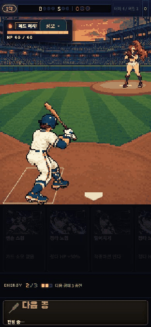
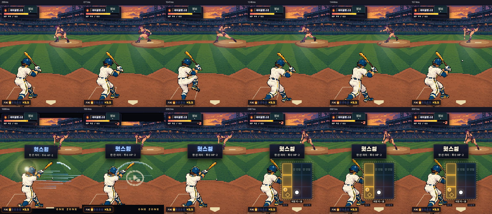
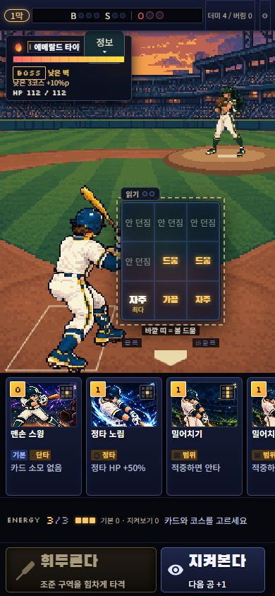

# Original-game pixel umpire scene

2026-10-18. Branch `codex/pixel-umpire-original`. This is an original `BallparkBattle` integration, not the standalone motion-v6 experiment. Main has not been merged.

## Artwork and retained gameplay

Card illustrations, hand/stack/9-zone selection, costs, probabilities, pitcher roster order, engine results and save schema are unchanged. The stadium and rear-view batter are new hard-pixel assets. The existing Red Rush character has12 new pixel poses and appears in the original strategy tutorial; she has not been forced into main-run encounters. Other pitchers retain their individual authored atlases, rendered through the same240-pixel-wide world canvas. This does not claim a complete roster redraw.

The batter has18 accepted unique source poses in20 storage slots. Source storage is256×256 with a128×128 logical grid and40 colors per actor. The stadium is256×384 with64 colors. Full prompts, source hashes, curation decisions, limitations and pixel QA are in [the provenance bundle](../../../assets/production-art/pixel-umpire-v1/provenance/README.md). Original generated bitmaps remain preserved in the local art workspace; the repository includes the small runtime derivative and public-safe provenance.

## Presentation contract

- One rear/support foot anchor and a reference body scale per actor keep anatomy stable as the bat or hair changes the frame bounds. The camera looks from behind the right-handed batter; the face is mostly hidden.
- The parent's `playToken`, explicit `impactAt` and `fxStage` remain authoritative. No second game simulation or independent judgement clock exists. Windup cannot reveal contact; impact/slowmo hold the contact pose; the parent release event starts follow-through and return within its existing tail.
- Red Rush plays coil, knee lift, stride, cock, release, follow and return. Release is drive/2, with an empty throwing hand. The ball starts from that frame's authored hand point.
- The nine-zone board is a magnified tactical input panel. Its cells are projected onto a small physical strike plane at the wooden barrel:±3 logical pixels along the bat and±1 across it. The outside band is5 logical pixels along the barrel, allowing the engine's outside foul case. A miss uses the same incoming path for the same zone/action and passes through without a contact pose.
- The field and ImpactFx share the physical contact coordinate. The field owns the single baseball; old DOM flight and duplicate ImpactFx outgoing balls are suppressed only while the new scene is ready. The tactical result marker still belongs to the original board.
- The tactical board clears only during the locked windup/impact/slowmo/release, exposing the hands and ball. It returns during settle/selection. Card input and layout remain the original ones.
- KO preserves the existing delayed, grounded lowering/rotation and parent700ms tail. Identity-specific gimmick effects follow the new mound/actor coordinates.
- Canvas/image failures and context loss return to the original actors. Idle, hidden, inspected and reduced-motion states do not run a continuous animation loop. Resize/listeners/RAF are cleaned up on replacement and unmount.

## Verification

- Final local Vitest:174 files,1,036 tests passed. New coverage includes stage freeze, release order, exact outgoing origin, shared contact coordinates, null context/image errors/context loss, atlas replacement, full-cell aspect and cleanup.
- Four existing smoke reports passed: zone10, V9 main-run30, growth2, deck1. These are termination/regression checks, not evidence of fun or commercial art quality.
- Production build passed. Dist58.6MB against the unchanged60MB budget. The three new runtime PNGs total about260KB.
- Pixel QA:30 accepted actor drawings, hard alpha,40-color actor palettes, exact2×2 storage grid,≥8px margin, opaque anchors and atlas/curated-cell equality.
- Offline painted-wood audit: all20 swing/bunt contact endpoints lie on wood; ten-zone whiff samples every1ms across±100ms have zero overlap after the tight-plane correction. The minimum measured swing gap is2.236 native pixels at the390×844 fixture. This is geometry verification, not live60fps or anatomical mocap.
- Real browser UI: new game/start pack/map/battle; card/9-zone selection; preparation card consumption; actual hit, foul, outside foul, whiff, strikeout and defeat; automatic next pitch/batter; save/reload/continue; inspector closes with the plan preserved. Violet and new Red Rush were recorded continuously; Emerald Tyrant's gimmick alignment was inspected.
- Responsive inspection:390×844 and360×640 portrait retain the action buttons and no page overflow. Desktop1280×720 retains the original portrait frame. The existing568×320 fine-pointer portrait frame is too narrow and scrolls; this pre-existing portrait-only layout limitation was not redesigned. Real coarse-pointer device rotation/browser bars remain human QA.
- Reward/facility/next-route paths are covered by the unchanged UI/engine regression suites; this session's manual main run ended in defeat, so it does not claim a manual winning run through those screens.
- Independent final reviewer found no remaining blocking regression after the contact, KO and gimmick alignment fixes.

## Recorded gameplay

Images below are actual browser captures, not generated gameplay mockups. GIF intervals use capture timestamps; they are not advertised as60fps. Board labels are wall-clock milliseconds after clicking swing, including the original commit beat.

## Preview review

The branch Pages workflow builds production root from main, preserves the pinned reviewed v5/v6 previews, and builds this original game under `/9-baseball/previews/codex-pixel-umpire-original/`. It does not merge this branch into main. To see the new Red Rush in a public build, use Settings → 전략 → 자동전투 체험; normal new games keep their original shuffled opponents. Local developer-only `?previewPitcher=<existing-art-id>` enters an isolated real-engine battle without writing the player's save.
