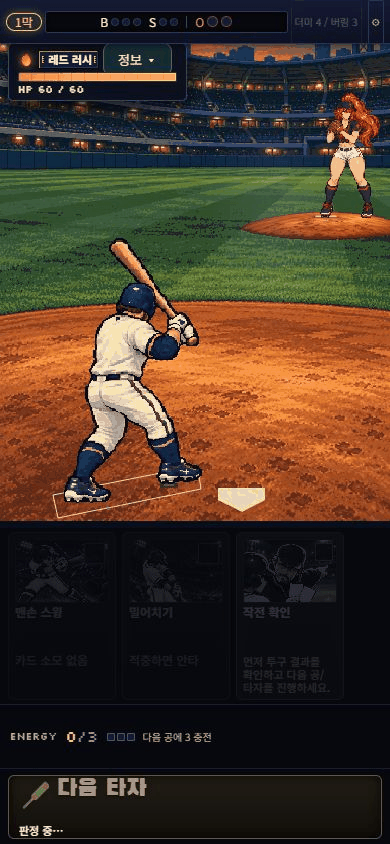
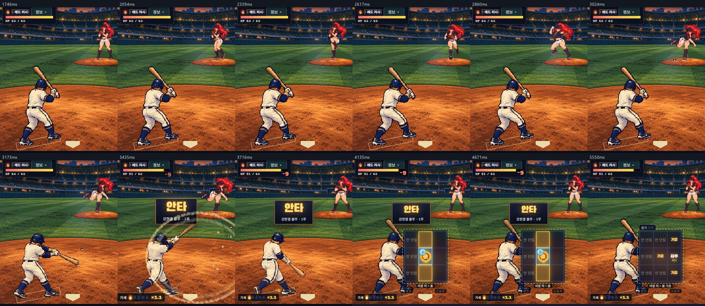
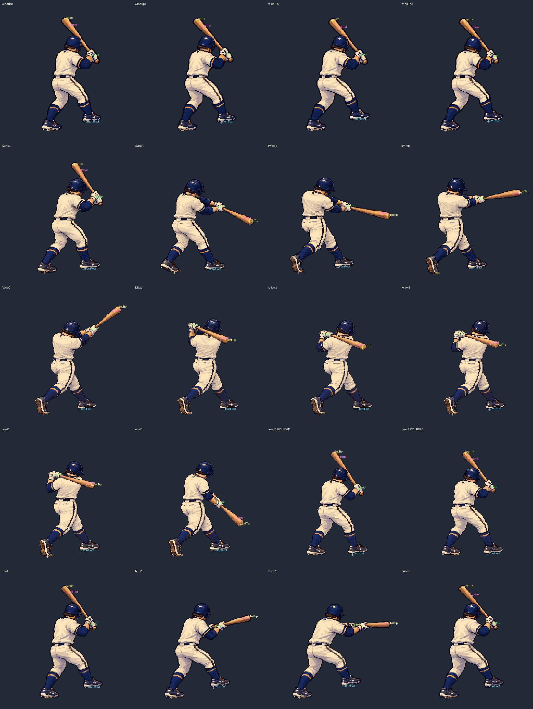
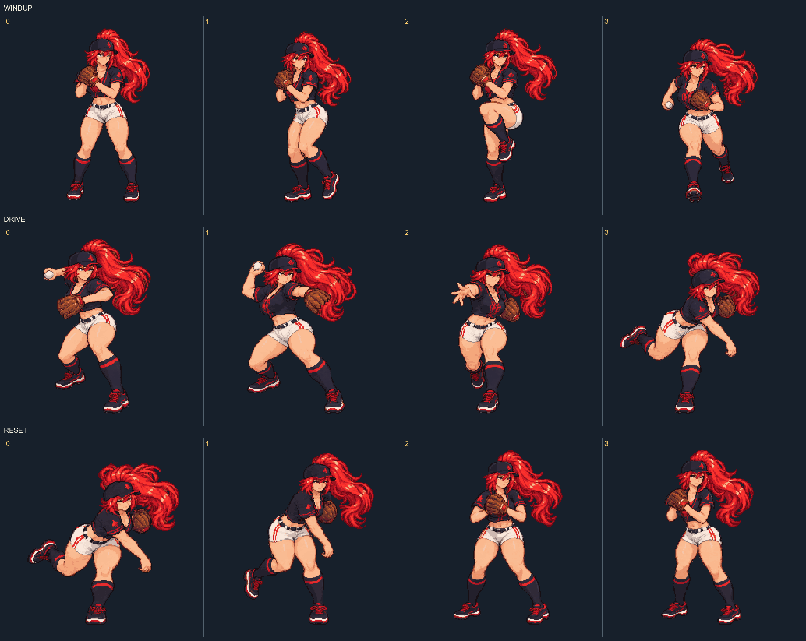
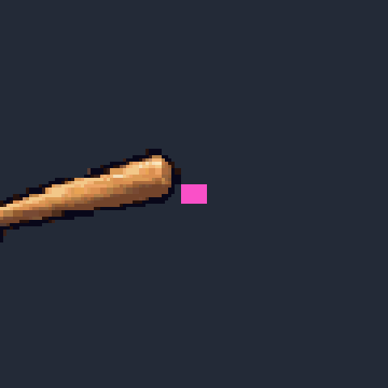
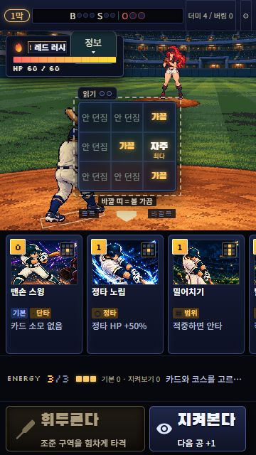
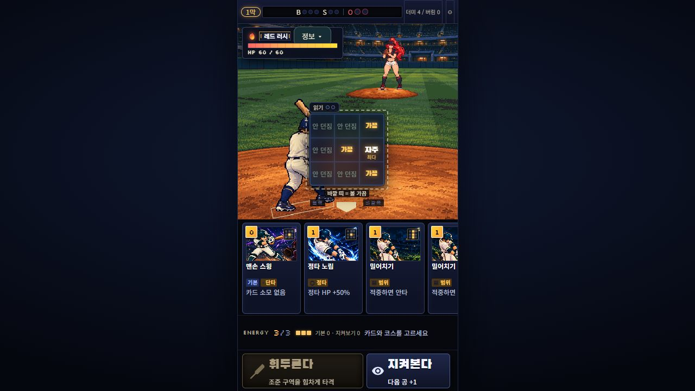

# Original-game pixel umpire scene V2

기존 카드 일러스트와 9존 입력 위에 후면 타자, Red Rush, 야간 구장과 흙 마운드를 연결한 플레이 검토용 브랜치다. 타자 얼굴은 거의 보이지 않는 심판캠이며 투구, 스윙, 체중 이동, 감속과 준비 자세 복귀가 실제 전투의 한 타이밍을 공유한다.

[브랜치 프리뷰](https://jbseo-commits.github.io/9-baseball/previews/codex-pixel-umpire-art-v2/) · [기존 V1](https://jbseo-commits.github.io/9-baseball/previews/codex-pixel-umpire-original/)

프리뷰는 원래 게임으로 시작한다. Red Rush 연출을 바로 확인하려면 설정의 **전략 → 자동 전투 체험**을 사용한다. 공개 프리뷰의 `previewPitcher` 개발 전용 query는 동작하지 않는다.

## 실제 플레이

아래 GIF는 390×844 브라우저에서 원래 게임을 직접 조작한 화면이다. 세 카드 조합이 적중해 HP60→51, 1루 진루, 카드 소비와 다음 공 준비까지 이어졌다. 재생 속도는 실제 캡처 간격을 사용하며, 연속 스크린샷 녹화이므로60fps 측정 자료는 아니다. 카드 실행 앞부분을 잘라 투구부터 복귀까지 보여준다.

## 변경과 아트 규격

- 타자: 256×256 셀, 4열×5행,20셀 보존. state table에 허용한 후보는18장이고, 현재 시간표가 실제 선택하는 고유 그림은17장이다. follow3는 후보로만 남는다. reset2/3는 발 깊이 연속성 때문에 제외하고 reset은 `[12,13,1,0]`으로 검수한 gather/ready를 재사용한다. 원본 packet의 `runtimeUniqueSourceCount:18`은 state-table 합집합이며 실제 재생 수로 해석하지 않는다.
- Red Rush: 256×256 셀, 4열×3행. reset 마지막은 같은 ready0으로 돌아간다. 다른 투수의 기존120프레임 atlas와 이름·로스터는 유지한다.
- 배우64색, 구장384×576/96색, 투명 마운드192×64/48색. 실제 장면 버퍼는384px 폭이며 CSS 레이아웃과 공의 화면 크기는 기존 계약을 유지한다.
- contact6/bunt18의 목재점, Red Rush release6의 실제 손끝(69,72), 각 프레임의 지지발을 새 최종 atlas에서 측정했다. 마운드의 고무판(95,21)을 투수 발에 놓고, 타격 박스는 ready 두 발의 실제 투영을 따른다.
- 새 아트에 맞춰 extension→rising→finish 순서를 선택한다. 결과, 카드 소비, 피해, 실제 존, 저장 형식, 부모의 hit-stop/tail은 기존 전투가 소유한다.

원본 생성과 수정은 **built-in image_gen**을 사용했다. CLI/API 생성은 사용하지 않았다. 고해상도 생성 원본은 정확한 정수 확대 도트 격자가 아니며, 최종 셀에는 기존 sprite-gen component extraction, 축소, 팔레트 감소, hard-alpha와 공식 curation transform을 적용했다. 모두 손실 변환이며 손으로 제작한 네이티브 도트 원본이라고 주장하지 않는다.

[Dimraeth 공식 화면](https://store.steampowered.com/app/2402680/Dimraeth/)과 [Holstin 공식 화면](https://www.team17.com/games/holstin)은 재질·빛·후면 실루엣의 품질 기준으로 참고했다. 셀 크기나 테스트 수로 해당 게임과 동등한 상업 완성도를 입증했다고 간주하지 않는다.

최종 atlas, 승인된 raw, base, 수치 요청, curation, 실제 프롬프트와 해시는 [에셋 provenance](../../../assets/production-art/pixel-umpire-v2/provenance/source-copy-index.json)에 있다. Runtime은 `runtime/`만 소비하며 provenance와 이 문서의 미디어는 Vite 배포 번들에 포함하지 않는다. 재처리용 canonical 폴더에는 palette.lock도 보존했다. 생성 원본 재생성과 component 후처리는 구별한다.

## 검증

| 항목 | 결과 |
| --- | --- |
| 전체 테스트 |174파일 /1,043테스트 통과, exit0 |
| smoke |zone10 /V9-30 /growth2 /deck1 모두 exit0 |
| production build |현재 브랜치 base로 exit0, dist59.0/60MB |
| 코드 검토 |독립 검토에서 release anchor 누락을 발견·수정한 뒤 추가 P1/P2 없음 |
| 실제 브라우저 |390×844 안타·헛스윙·소비·주자·자동 복귀,360×640 지켜보기→충전·새 카드,1280×720 기존 세로 프레임 |
| 기존 투수 |Violet 표시와 기본 스윙을 새 타자/구장 위에서 확인 |
| 실제 좌표 검사 |20 contact점 모두 목재 위,2action×10zone×201ms=4,020샘플에서 공과 배트 공유 픽셀0 |

번트 준비 자세는 어두운 공 외곽 모서리가 목재 모서리에 닿는 샘플2개가 있으며 공유 픽셀은0이다. 흰 공 본체의 최소 간격은2.828native px이다. 따라서 모든 브라우저 래스터에서1px 여유가 있다고 일반화하지 않는다. 결과별로 투구 경로나 착탄점을 임의 이동하지 않았다. 자세한 숫자는 [실측 보고](../../../assets/production-art/pixel-umpire-v2/provenance/reports/live-wood-contact-and-whiff.json)에 있다.

360×640과 PC 선택 화면에서는 기존 9존 패널이 타자 일부를 가린다. 실제 투구 중에는 패널이 숨겨져 전체 동작이 보이며, 이는 원래 선택 UI를 유지한 결과다.

568×320 fine-pointer 환경의 너무 좁은 세로 프레임/스크롤은 [V1에도 기록된 기존 제한](../pixel-umpire-v1/README.md)이며 이번 아트 작업에서 전역 화면 정책은 바꾸지 않았다. 실제 coarse-pointer 휴대폰 회전·브라우저바·롱프레스 조합, 번트의 수동 실전, 승리→보상→시설→다음 경로 수동 완주는 별도 사람 검수다. 해당 전투/저장/흐름의 자동 회귀 테스트는 전체 검사에 포함됐다.

공개 배포 확인 결과는 PR에 추가한다. 메인 병합은 하지 않는 검토용 프리뷰다.
