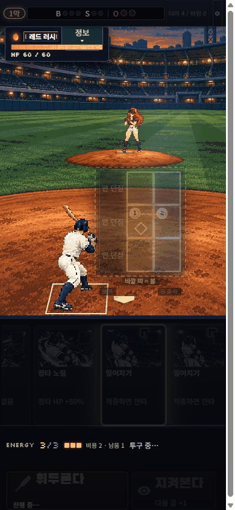
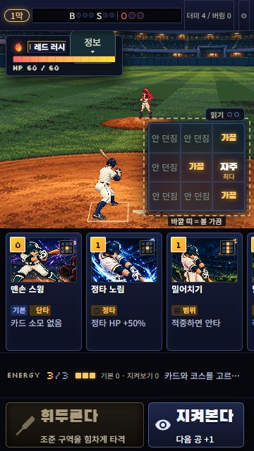

# Original-game pixel umpire scene V3

이 문서는 `803d248`의 V3 기록이다. 공용 브랜치 프리뷰는 현재 [V4 복귀·광원 후보](../pixel-umpire-v4/README.md)를 표시하며 아래 녹화/수치는 당시 버전의 근거다.

타자의 후면 원화·스윙·복귀를 교체하고, 홈플레이트·배터박스·투수·마운드를 하나의 필드 카메라에 맞췄다. 원래 카드 일러스트와 카드/9존 선택 방식, 전투 판정과 저장 형식은 유지한다. 이 결과는 플레이 검토용이며 Dimraeth·Holstin과 동급이라는 판정이 아니다.

[브랜치 프리뷰](https://jbseo-commits.github.io/9-baseball/previews/codex-pixel-umpire-art-v2/) · [Draft PR #49](https://github.com/jbseo-commits/9-baseball/pull/49) · [실제 참고 화면과 아트 판단](ART-COMPARISON.md)

## 실제 플레이

아래는 원래 게임의 카드와 코스를 브라우저에서 직접 선택한 녹화다. 별도 연출 재생기나 강제 결과가 아니다. 타격은 390×844, 번트는 360×640에서 실행했다. 캡처 간격으로 GIF 시간을 계산했으며 60fps 측정은 아니다. 원래 게임의 준비·판정 대기 시간도 포함한다.

밀어치기 두 장을 가운데/바깥쪽에 선택해 HP60→50, 1루 진루, 카드 소비와 다음 공 준비를 확인했다. 이어 맨손 스윙을 던지지 않는 코스에 선택해 스트라이크 증가와 복귀를 확인했다. 이때 HP50→49의 기존 엔진 효과도 그대로 적용됐다.

[헛스윙 실제 녹화](whiff-actual-play.gif) · [번트 실제 녹화](bunt-actual-play.gif) · [타격 연속 캡처](hit-actual-contact-sheet.png) · [번트 연속 캡처](bunt-actual-contact-sheet.png)

번트는 개발 서버의 `previewPitcher=regular-01-red-rush&previewCard=bunt` fixture로 실제 손패 한 장만 바꿔 테스트했다. 희생 번트 실행 후 HP60→56, 아웃1과 준비 자세 복귀를 확인했다. 이어 지켜보기에서 에너지3→4, 카드 추가와 다음 공 준비를 확인했다. 이 fixture는 DEV에서만 동작하고 저장하지 않으며 공개 배포에서는 무시된다. 공개 프리뷰는 원래 게임으로 시작하며 설정의 전략→자동 전투 체험을 통해 전투를 확인할 수 있다.

## 배치와 동작

- 홈플레이트17in, 간격6in, 배터박스4×6ft와 rubber60ft6in을 같은 월드 좌표로 투영한다. 플레이트의 뾰족한 끝은 포수 쪽이다.
- 타자 실제 밑창의 접점을 기준으로 준비/스트라이드는 뒷발, 타격/복귀는 디딘 앞발을 고정한다. 그림마다 몸통을 늘이거나 다리를 비틀지 않는다.
- 고해상도 생성 원본에서 추출한36셀 중30개의 원화를 시간표에서 선별한다. 정상 타격과 번트의 접촉 그림은 실제 접촉 결과에서만 보인다. 타격 전 hit/whiff 자세와 궤도는 같다.
- 50ms 시각 접촉 정지는 타자와 공에 같이 적용하며 엔진 판정 시간은 바꾸지 않는다. 다음 공 준비가 시작돼도 복귀가 끝나도록 연결한다.
- 짧은 장면은 필드·선수·공을 같은 비율로 축소하고 기존9존판만 오른쪽으로 옮긴다. React 화면 재진입 후에도 배치 표식이 유지된다.

[390×844 선택 화면](ready-390x844-selected.png) · [1280×720 PC 화면](ready-pc-1280x720.png) · [변경 전 V2 실제 화면](before-v2-live.png)

PC의 실제 게임 영역은 기존 PortraitFrame405×720이다. 기존 바이올렛 스팅120프레임 atlas도 새 배치에서 표시되는지 확인했다. 새 투수 원화를 전부 제작했다는 뜻은 아니다.

## 검증과 남은 한계

2026-10-18 기준 전체174파일/1067테스트 통과. zone10·v9 30·growth2·deck1의 네 smoke 모두 종료코드0. 프리뷰 base로 production build 통과, dist59.0MB/60MB. 독립 코드 검토에서 최종 responsive/DEV fixture 경로의 P1/P2는 발견되지 않았다.

[3규격 모션 진단](motion-qa/README.md)은 원화·helper 좌표를 이용한 분석이며 실제 브라우저 녹화와 구별한다. 12,060시점 중 번트의 사전 목재 겹침은0건이다. 정상 스윙은390×844에서0건, 짧은 PC에서2건,360×640에서12건의 impact−4..−1ms 겹침이 남는다. 휴대폰 한 사례는 흰 중심3native px도 겹친다. 모든 규격 무충돌이라고 주장하지 않는다.

복귀19→33의 손 이동은 아직 약43storage px다. 생성 원본은 수작업 native pixel art가 아니며96색·hard alpha·128logical/256storage의2배 격자로 손실 변환한 결과다. 셔츠의 작은 질감과 환경 광원 통일은 추가 아트 작업이 필요하다. 테스트 수나 원화 수가 자연스러운 움직임·상업 완성도를 증명하지 않는다.

실기기 주소창 변화·회전·터치 장기 플레이, 보상/시설을 거치는 수동 완주는 이번 검증에서 수행하지 않았다. 녹화 초반의 일시적인 페이지 스크롤바도 기록에 보존했으며, 전체 UI의 모든 상태에서 무스크롤을 보증하지 않는다.

## 원본 보존

[Provenance](../../../assets/production-art/pixel-umpire-v3/provenance/README.md)에 생성 원본10개(타자 기준1+선택한9행), 전체16회 생성의 prompt/source hash, 기존 추출·row curation·팔레트 자료를 보존한다. 기각된6개 raw 원본은 로컬에 보존하고 기록만 공개한다. `source-copy-index.json`은 복사된99파일의 SHA256을 고정한다. 기존 V2 파일과 새 import packet은 변경하지 않고 최종 접촉점/시간표 차이는 [대조 자료](motion-qa/installed-packet-data-diff.json)에 분리한다. 제3자 게임·MLB 화면은 게임 에셋에 포함하지 않는다.
