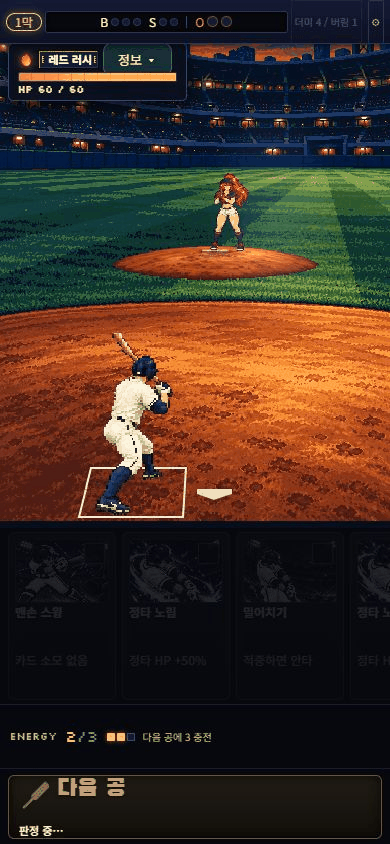

# 심판캠 V4 — 복귀·조명 검증 기록

카드 이미지를 그대로 사용하면서, 타격 뒤 손/배트의 머리 위 재그립을 몸통 앞의 내림과 재준비 원화로 교체했다. 경기장 광원을 다시 그리고 배우의 명암·바닥 그림자를 연결했다. 엔진 확률/피해/저장/카드 입력은 변경하지 않았다. 변경 전 분석은 [영향 분석](../PIXEL-UMPIRE-V4-IMPACT.md), 원본/프롬프트는 [아트 패킷](../../../assets/production-art/pixel-umpire-v4/README.md)에 있다.

## 실제 화면

아래 GIF는 최종 두 발 그림자 수정을 포함한 실제390×844 게임을 카드/코스로 조작해 캡처한 화면이다. 첫 공은 파울로 HP60→58, 스트라이크0→1이 됐다. 약6.5초 동안170장을 얻었고, 공개 GIF는 실제 시각 간격을 보존해63장으로 간추렸다. 60fps 원화 또는 영상이라고 주장하지 않는다. 느린 GIF는 동일 캡처의 복귀 구간을3배 느리게 보여주는 진단용이다. 보조 PC/번트/바이올렛 PNG는 마지막 그림자 바닥선 수정 전의 입력·포즈 호환성 캡처다.

[복귀3배 느린 재생](qa/actual-recovery-slow.gif) · [연속 프레임 보드](qa/actual-recovery-board.png) · [캡처 시각](qa/capture.json)

직접 확인:390×844 파울/복귀,360×640 잘못 노린 기본 스윙/복귀(S1→2,HP58→57),PC1280×720의405×720 내부 화면에서 지켜보기(S0→1,HP60 유지/에너지3→4),번트(아웃0→1,HP60→56),기존 바이올렛 투수의120셀 투구/복귀와 명암 처리. 확인한 시나리오의 브라우저 경고/오류는0건이다. 카드 선택/9존 탭과 다음 공 입력을 실제로 사용했다. 보상→시설→다음 경로의 이번 변경 회귀는 자동검사 근거이며 이번 세션에서 사람이 수동 완주한 것은 아니다.

## 좌표와 회귀

최종 설치된 manifest와 helper를 [재현 스크립트](qa/verify-runtime.mjs)로 읽었다. 저장소 루트에서 `node docs/design/pixel-umpire-v4/qa/verify-runtime.mjs`로 다시 확인할 수 있다. [최종 보고서](qa/final-runtime-audit-v4.json)는23,028시점에서 실제 사용 원화37개와 타격 전 hit/whiff 포즈 차이0건을 기록한다. 정상8/번트26의60개 접촉점과 변환은 V3와 동일하다. 기존36셀 RGBA도 동일하다.

|화면|native canvas|발끝/바닥선의 최소 배터박스 여유|
|---|---|---|
|390×844|384×477|0.273ft|
|360×640|384×299|0.305ft|
|PC1280×720,내부405×720|384×341|0.311ft|

전체 복귀 순서의 앞/뒷발 바닥선 끝점을 검사했다. 끝점은 수동으로 관찰했으며 가려진 먼 발의 접촉에는 오차가 있다. 발이 화면에서 높다는 이유만으로 공중에 떠 있다고 판단하지 않는다. 심판캠의 원근으로 앞발과 뒷발은 서로 다른 y에 놓인다.

390화면에서 문제가 있던44→45는 head3.2/hip1/손7.1native px,앞발0/뒷발2px 이동으로 조정했다. 마지막43→0은 손8.25/뒷발9.85px,앞발0이다. 이 점검은 순간적인 전신 밀림을 줄였다는 근거이며 모든 관절의 자연스러움을 승인하는 수치는 아니다. 36→52의 손은 몸통에 가려져 추정좌표59.5native px 차이가 난다. 실제 보이는 손이59.5px 순간 이동한다고 판정할 수도, 완벽히 이어진다고 판정할 수도 없다.

전체174파일/1,076테스트, 관련56테스트,zone10/v9-30/growth2/deck1 smoke,production build와dist59.1/60MB 검사를 통과했다. 마지막 타자 그림자는 양발 바닥선과 draw anchor의 차이를 보존하도록 수정했고, 두 발 접지·들린 발 제외·거의 수직인 바닥선의 fallback3개 회귀 검사를 추가했다. 수정 전 두 발 접지 검사가 실패하는 것도 확인했다. 독립 검토에서 남은 P1/P2 코드는 없었다. 실기기 터치/회전·브라우저 바·사람의 동작 평가는 자동검사와 구별한다. 게시 후 실접속 결과는 PR49 최신 검증 기록을 참조한다.

## 참고 관찰과 남는 한계

- [MLB Goldschmidt BP](https://www.mlb.com/video/paul-goldschmidt-takes-a-swing-during-bp):0–8.5초 준비,8.7–9.1초 몸통 회전과 뒷발 피벗을 실제로 관찰했다.9.3초 이후 카메라가 외야로 움직이므로 READY까지 연속 복귀를 관찰했다고 주장하지 않는다. 복귀는 야구의 지지/감속 원리를 적용해 새로 설계한 동작이다.
- [MLB All-Star ump cam](https://www.mlb.com/video/best-of-ump-cam-from-2025-all-star-game):심판캠 원근 참고로 일부 구간만 재생했다. 전체 복귀의 검증 자료는 아니다. 참고 영상/선수 이미지는 runtime에 반입하지 않았다.
- 딤래스/홀스틴의 실제 화면 비교는 [이전 비교 기록](../pixel-umpire-v3/ART-COMPARISON.md)을 따른다. 큰 명암과 배우/환경 통합은 개선했지만 새 AI 원화의 손·발·옷 주름을 native pixel artist가 일관되게 교정한 수준이라고 주장하지 않는다. 동일 품질/마스터피스 승인 없음.
- 이번에는 dense 목재 충돌 검사를 새로 수행하지 않았다. 원본 픽셀/접촉 변환 동일성을 확인했으며 [V3 저해상도 잔차](../pixel-umpire-v3/motion-qa/README.md)가 남는다. PC2사례/360화면12사례의 착탄 직전 외곽 겹침,360한 사례의 흰 중심3px를 무충돌 통과로 바꾸어 적지 않는다.
- 844×390 가로창은 기존 PortraitFrame이 내부204px/문서628px로 좁아지고 스크롤된다. [실측](qa/fixture-landscape844x390.json)과 [화면](qa/landscape844x390.png)을 남겼다. 가로 UI 통과/실기기 회전 완료로 분류하지 않는다. 이번 아트 변경에서 전역 레이아웃을 확장하지 않았다.

원본 V2/V3와 검증 패킷은 덮어쓰지 않았다. V4는 기존 branch preview/PR49의 검토 후보이며 main 병합은 하지 않는다.
