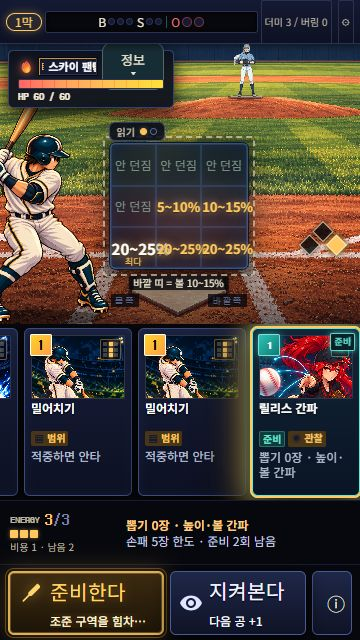
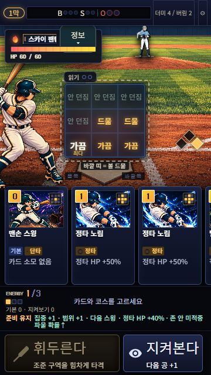

# 검증 기록 — 준비 카드 피드백 (2026-10-20)

대상: main e2aab7c 기반 `codex/preparation-feedback`. 원래 카드 원화와 전투 구성을 유지한다.

## 결과

- 실제 수급 예고: 사용 카드가 빠진 뒤 손패 빈자리, 더미·버림 더미, 사용 카드 자체 재셔플을 계산한다. 손패 6/5/4장의 일반 2장 수급 카드는 실제 0/1/2장을 예고한다. 강화/더미 부족도 실제 engine 결과와 대조했다.
- 작은 카드와 선택 플랜에는 실제 수급과 간파·생존·정타 HP 같은 본효과를 먼저 표시한다. 한도 이유는 기존 입력 안내 줄에 둔다. 사용 불가 경고가 있으면 그것이 우선한다.
- 유지 표시는 현재 battle 값에서 파생한다. 선택을 바꾸거나 저장 후 이어가도 유지되며, 이번 공/스윙/타석 경계에 맞춰 정리한다. 판정 연출 중의 만료를 미리 노출하지 않는다. 새 팝업이나 필수 조작은 없다.

## 자동 검증

- 먼저 새 UI 회귀 2개 실패 확인 → worker 관련 22개 통과.
- 복합 카드 본효과가 제한 설명에 가리는 문제 재현 → 관련 테스트 실패 확인 후 문구 분리.
- 최종 관련 4파일 **50/50**, 전체 173파일 **1030/1030** 통과.
- zone-report 10 / v9-report 30 / growth-report 2 / deck-report 1: 모두 종료 코드 0.
- production build 통과, dist **58.3 / 60MB**. 기존 chunk size 및 React act 경고는 남지만 테스트/빌드 실패는 없다.
- 엔진 규칙, 카드 효과, 저장 스키마, 아트 및 전역 CSS 변경 없음.

## 실제 브라우저

- 새 런: 연결 팩 / seed 90210 / 스카이 팬텀. 타이틀→경로→전투, 간파, 주자 연결, 지켜보기로 손패 6장, 실제 0장 예고 확인.
- 히트앤드런+집중 사용 후 다른 카드 선택/새로고침/이어하기에도 두 효과 표시. 지원 카드 두 장을 얹어 타격한 뒤 기존 주자가 1→3루, HP 48→37, 다음 타자에 유지 표시 제거 확인.
- 360×640: 단순 효과 요약 64px, focusBreath+gripTape 복합 4효과 fixture 요약 76px. 모두 문서 세로 초과 0px, 행동 버튼 하단 640px. 카드/9존/경고와 함께 표시됨.
- 손패 6장 fixture에서 scout/calm/markZone 각각 실제 0장 + 본효과 + 한도 이유 확인. 예측/안내 줄 너비 초과 없음, 신규 dialog 0개.
- PC 1440×900: 기존 세로 iframe에서 요약 64px, 문서 초과 0px. 가로→세로 복귀 정상.
- 기존 제한: fine-pointer 844×390의 세로 iframe은 main부터 최소 높이 628px라 하단 행동 버튼이 390px에 들어오지 않는다. 실제 터치 기기는 기존 세로 회전 안내 대상이다. 이번 변경에서 전역 회전/프레임 규칙은 수정하지 않았다.
- 실기기 브라우저 바/터치/롱프레스 실측, 한 런 전체 사람 완주와 재미 평가는 미실시. 게임 전체 상업적 완성도를 증명하는 검증이 아니다.

## 검수 역할

저장소 지침에 따라 gpt-6-luna/high worker 1명과 별도 gpt-6.1-sol/high reviewer를 사용했다. root가 실제 브라우저 검증과 최종 통합을 수행했다. 동일 체크아웃 동시 편집 없음.

## 게시

기존 Pages 워크플로의 격리된 브랜치 프리뷰와 draft PR을 사용한다. main 병합 없음. 실제 배포 확인은 PR의 최종 검증란에 기록한다.

추가 수동 회귀: HP 1 및 적중 코스를 고정한 별도 QA fixture에서 실제 보상 UI 진입→보상 건너뛰기→이벤트 선택/떠나기→지도→라커룸 진입/지도로→다음 경로 전환을 확인했다. 이는 한 런 전체 수동 완주와 구별한다. 최종 독립 검토는 차단 사항 없음으로 종료했다.
