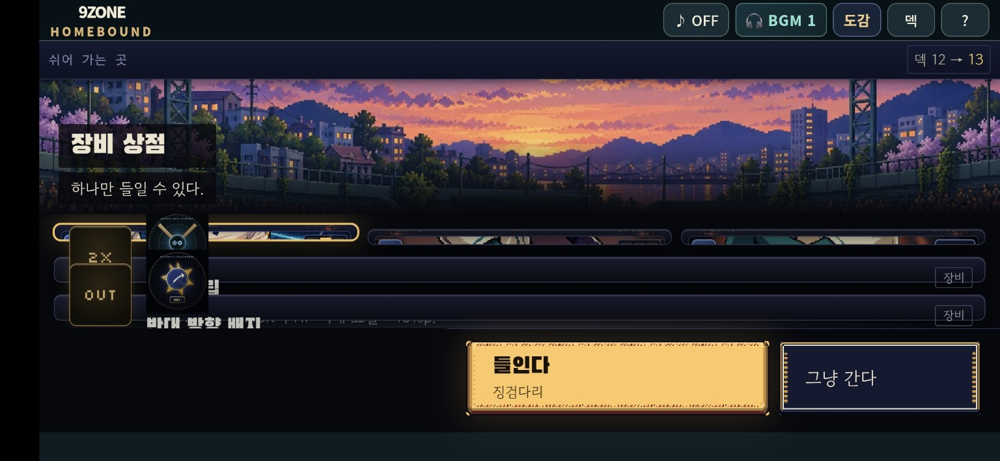
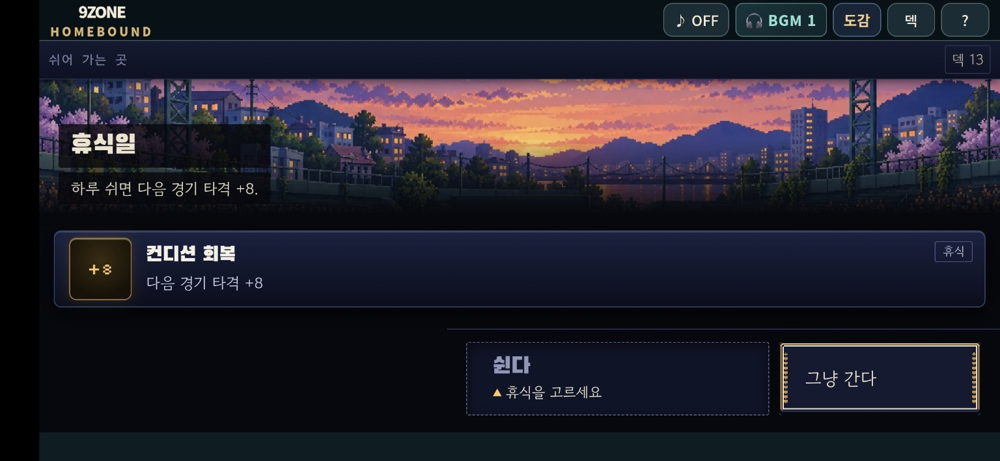
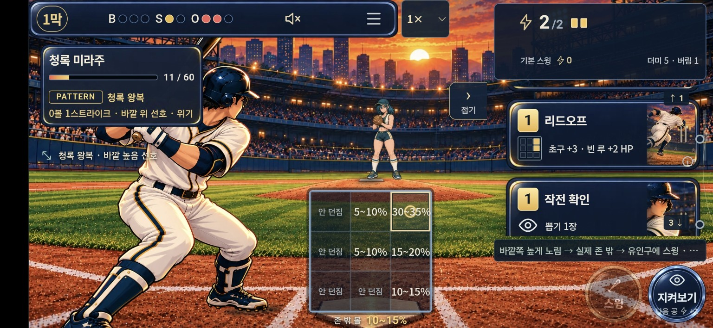

# 전투·시설 개선 계획

요청: 2026-11-09 KST · PR 정리: 2026-11-10 KST  
**상태: 계획 검토용 초안. 구현·에셋 교체·병합·수동 배포는 하지 않는다.**

사용자 요청 다섯 가지를 하나의 계획으로 정리한다. “수정 전에 PR 만들고 계획부터”라는 지시에 따라 이번 PR에는 이 문서와 제보 화면 3장만 추가한다. 조사 기준은 공식 저장소 `jbseo-commits/9-baseball`의 `08765b04c2724042bd571fd5ab628907e615335a`다. 제보 화면의 실제 배포 커밋과 CSS 뷰포트는 아직 확인하지 못했으므로 소스에서 확인한 사실과 브라우저에서 검증할 가설을 구분한다.

## 1. 목표와 구현 순서

| 순서 | 항목 | 목표 | 현재 상태 |
| --- | --- | --- | --- |
| 1 | 상점 표시 | 상품 그림·이름·효과를 온전히 읽고 스크롤·선택·확정 가능 | 제보 및 CSS 충돌 확인 |
| 2 | 휴식일 선택 | 아웃카운트 회복 또는 카드 1장 강화 중 하나 선택 | 방향 확정, 회복량은 권장안 |
| 3 | 오른쪽 손패 | 투구 중 자동 접힘, 다음 선택에서 자동 열림. 버림→필요한 섞기→한 장씩 꽂히는 드로우 | 상태·이벤트 설계 |
| 4 | 타이드베스퍼 | 몸 크기·양손·글러브·접지·공 출발점이 이어지는 투구 | 문제 포즈 구간 특정 |
| 5 | 고유 기믹 전달 | 설명창보다 징후·행동·결과를 보고 규칙을 익히는 전투 | 연출 계약과 사례 설계 |

상점/휴식일은 공유 시설 화면부터 정리한다. 손패/타이드베스퍼는 독립적으로 검증하고, 기믹 연출은 안정된 배우·카드 동작과 공개 이벤트 위에 연결한다. 후속 구현은 항목별 커밋 또는 별도 PR로 분리해 되돌릴 수 있게 한다. 본 계획 PR의 완료는 구현 완료를 의미하지 않는다.

## 2. 상점 — 상품 행 압축과 장비 아이콘 겹침

### 확인한 사실과 가설

- 제보 화면에서 카드 3개가 가느다란 띠처럼 줄고, 장비 2개는 배지·원화·이름이 행 밖으로 겹친다. 확정/넘기기 버튼은 남아 있다.
- [BallparkStop.jsx](../../../src/duel/BallparkStop.jsx) 74–98, 128–149행: 카드와 장비가 같은 `.bp-offers`에 들어간다. 장비에는 `.bp-relic-ico`와 `.bp-mark`가 함께 렌더링된다.
- **확인된 CSS 충돌:** [stop-readability.css](../../../src/duel/stop-readability.css) 109행의 `main.bp-stop.bp-choice .bp-offer.bp-tile .bp-mark { display:grid }`가 [ballpark.css](../../../src/duel/ballpark.css) 1239행의 `.bp-offer.relic.has-art .bp-mark { display:none }`보다 우선한다. 원화가 있어도 대체 배지가 남는다. 원화의 grid 위치도 보상 전용 `.bp-relic-offers`에만 지정돼 있다.
- **재현으로 확인할 가설:** 고정 화면 높이, `minmax(0,1fr)`, 큰 시설 헤더, 상품의 `min-height:0`, 암시적 grid 행이 결합해 목록의 행 자체가 압축될 가능성. 실제 computed style과 요소 높이로 확정한다.

### 수정 계획

1. 동일한 카드 3개+장비 2개 조합에서 헤더/목록/각 행/버튼 높이, `scrollHeight`, 아이콘 위치를 기록한다.
2. `stop-shop`에서 상품 행의 콘텐츠 높이를 보장한다. 공간이 부족하면 목록이 세로로 스크롤되고 하단 선택·확정 버튼은 계속 접근 가능하게 한다.
3. 장비 원화가 있으면 원화 하나, 없으면 대체 배지 하나를 표시한다. 아이콘·이름·효과·분류의 grid 위치를 명시한다.
4. 짧은 가로 화면에서는 배경 헤더 높이를 줄인다. 전역 `html/body/#root` overflow 수정으로 해결하지 않는다.
5. 선택 강조, “들인다 / 그냥 간다”, 덱 장수 미리보기와 실제 결과를 유지한다.

**합격 기준:** 모든 상품 이름·효과가 읽히고 아이콘이 겹치지 않음. 처음/마지막 상품 선택·해제·확정·넘기기 가능. 긴 문구와 원화 없는 장비도 정상. 보상·훈련·라커룸·휴식 화면의 스크롤·선택 유지.

## 3. 휴식일 — 아웃 회복 또는 카드 강화

**확정한 요구:** 새 휴식일에서 “다음 경기 타격 +8”을 없애고, 아웃카운트 회복과 강화 중 하나를 선택한다. 강화는 현재 카드 강화 체계를 활용한 **덱의 카드 1장 강화**로 제안한다.

| 선택 | 화면 제안 | 확정 시 처리 |
| --- | --- | --- |
| 아웃카운트 회복 | 아웃 아이콘과 현재→회복 후 수치 | 런에 이어지는 `runOuts` 감소, 이번 휴식일 종료 |
| 카드 강화 | 강화 가능한 카드 선택과 전후 효과 | 선택한 카드 ID 하나만 강화, 이번 휴식일 종료 |

**회복량 권장안은 1아웃(2→1, 1→0), 최소 0이다.** 사용자는 회복량을 아직 지정하지 않았다. 보스 보상 포기 시의 전체 회복(0으로 초기화)과 구분하기 위한 제안이며, 구현 전에 계획 검토에서 확정할 항목이다.

### 수정 범위

- [engine.js](../../../src/duel/engine.js) 1075–1114행의 `v10UtilityOptions / v10UtilityProblem / completeV10UtilityNode`가 현재 `{type:'rest',technique:8}`을 제공하고 다음 경기 보너스를 저장한다.
- 훈련의 `canUpgrade`, 카드 ID 검증, `applyRewardToDeck`를 재사용한다. 같은 종류의 카드가 여러 장이어도 선택한 개체 하나만 강화하고, 덱 장수와 `nextId`는 유지한다.
- 회복 대상은 누적 통계 `stats.outs`가 아닌 `runOuts`다. 다음 전투의 실제 시작 아웃까지 확인한다.
- 두 선택을 먼저 보여주고, 강화 선택→카드 선택→전후 효과 확인→확정으로 이어진다. 취소하면 두 선택 화면으로 돌아간다. 단순 선택/취소는 노드를 소모하지 않는다.
- 0아웃이면 회복을, 강화할 카드가 없으면 강화를 비활성 표시한다. “그냥 간다”는 접근 가능하게 유지한다. 한 방문에서 두 효과를 모두 얻을 수 없게 한다.
- `BallparkStop.jsx`, `App.jsx`, `BallparkMap.jsx`, `run-map.js`의 휴식 안내와 “보스에서만 아웃 회복” 문구를 함께 점검한다. 보스의 기존 보상 포기/전체 회복 규칙은 유지한다.
- [v10-storage.js](../../../src/duel/v10-storage.js)의 이전 휴식 기록을 계속 읽는다. 과거에 이미 획득한 휴식 보너스와 이벤트 출처 보너스는 임의 삭제하지 않고 기존처럼 1회 소비한다. 새 휴식 선택에서는 +8을 새로 만들지 않는다. 공용 보너스 기능 전체를 제거하지 않는다.

**합격 기준:** 아웃 0/1/2, 강화 가능/불가, 동일 종류의 특정 카드 ID, 잘못된 ID, 중복 확정, 취소/넘기기, 이전 휴식 세이브 재개, 선택 후 저장·불러오기·다음 전투 검증. 한 휴식일에는 회복/강화 중 단 하나만 적용.

## 4. 오른쪽 손패 — 자동 노출과 카드 이동

### 확인한 원인

- [BattleView.jsx](../../../src/duel/battle-vnext/BattleView.jsx)는 `handOpen=false`로 시작하고, 카드 배치 완료 및 `deciding` 이탈 때 닫는다. 다음 선택 단계에서 자동으로 여는 대응이 없다.
- [HandDock.jsx](../../../src/duel/battle-vnext/HandDock.jsx)는 덱/버림 장수를 표시한다.
- 엔진은 한 행동에서 **버리기→덱 고갈→섞기→방금 버린 동일 ID 다시 뽑기**를 처리할 수 있다. 전후 손패 집합이나 장수 차이만으로는 올바른 연출을 복원할 수 없다.

### 목표 동작

| 상황 | 패널/카드 연출 |
| --- | --- |
| 첫 전투 진입 | 덱 뒷면에서 카드가 한 장씩 오른쪽 손패 슬롯으로 들어옴 |
| 선택·조준·지원 카드 배치 | 기본적으로 열린 상태 유지. 배치만으로 강제 접지 않음 |
| 투구 확정 | 실제 사용한 본 카드/지원 카드만 버림 더미로 이동하고 패널 자동 접힘 |
| 다음 선택 가능 시점 | 자동 열림. 실제 새 카드만 한 장씩 빠르게 꽂힘 |
| 준비 카드의 즉시 드로우 | 해당 행동의 실제 버림/뽑기 순서를 표시 |
| 덱 고갈 | 실제 셔플 때만 버림→덱으로 모임→짧은 섞기→드로우 |
| 수동 접기·Escape | 현재 선택 단계에서는 사용자 의도 우선. 다음 실제 선택 턴에서 자동 흐름 복귀 |
| 저장된 전투 재개 | 이미 지난 셔플/드로우를 재연하지 않고 현재 손패 복구 |

기존 오른쪽 카드 디자인과 최종 배치는 유지한다. 덱/버림 더미를 작은 출발점·도착점으로 만들고 사용하지 않은 카드는 남긴다. 카드 배치와 실제 소비는 구분한다.

### 구현 설계

1. 성공한 엔진 행동과 같은 경로에서 순서 있는 표시용 이벤트(`discard / shuffle / draw`)를 얻는다. RNG를 다시 돌리거나 행동을 두 번 실행하지 않는다.
2. 행동 식별자·카드 개체 ID·순번·출발/도착 더미·이미 공개된 결과를 사용한다. 표시용 큐는 저장 상태에 섞지 않는다.
3. 확정 상태 위에 포인터를 받지 않는 이동 오버레이를 둔다. 숨겨진 덱 순서와 미래 카드 앞면을 미리 노출하지 않는다. **안타 조건 드로우는 착탄/결과 공개까지 카드 앞면·더미 장수·동작 시작·소리를 모두 보류**한다. 카드 ID를 정렬된 최종 손패 슬롯에 매핑하고 엔진 배열 순서와 같다고 가정하지 않는다.
4. 초기 조정값 제안: 한 장 이동 160–220ms, 연속 간격 70–100ms, 정착 반동 60–90ms. 실제 휴대폰에서 “팍팍 꽂히는” 속도를 검수하며 추가 대기로 플레이를 막지 않는다.
5. 화면 전환·회전·전투 종료·연속 입력·드래그 시작 때 오래된 연출을 취소하거나 현재 상태로 완료한다. 사라진 DOM 좌표로 이동하지 않게 한다.
6. reduced motion은 짧은 강조/즉시 정착. 음소거·포커스·스크린리더 알림을 유지하되 카드마다 과도한 알림은 피한다.

**합격 기준:** 기본 스윙/지켜보기의 가짜 버림 없음. 준비·지원 소비·다중 드로우·중간 셔플·동일 ID 재드로우·손패 상한·재고 없음·실패 행동이 실제 상태와 일치. 연출 ON/OFF에서 RNG·피해·에너지·카드 상태·저장이 같음. 매 공 토글 없이 선택→투구→다음 선택 반복 가능.

## 5. 타이드베스퍼 — 크기·손·접지 연속성

[현재 18포즈 검수 시트](../../../assets/pitcher-inbetweens-v1/review/tide-vesper.jpg)

현재 적용본은 `pitcher-inbetweens-v1`의 G024다. **18개 그림을 120틱/60fps로 재생**하며 120개 독립 원화가 아니다. [selection.json](../../../assets/pitcher-inbetweens-v1/selection.json)에 기존 포즈, 낮은 팔 각도 포즈, 회복 포즈 등 서로 다른 제작 묶음이 이어진다.

| 검수 구간 — compact drawing 번호 | 확인한 문제/위험 | 수정 기준 |
| --- | --- | --- |
| 1→2→3→4→5 | 연결 포즈의 머리·상체 크기/화풍 차이, G024 진입의 비례 변화 | 동일 머리·골반·사지 길이 기준 |
| 7→8→9 | 옆으로 뻗은 공 든 팔의 유사 포즈 뒤 릴리스 손이 급히 전진 | 팔꿈치·전완·손 이동과 빈손 전환 연결 |
| 10→11→12→13 | 별도 회복 제작본과 기존 팔로스루 사이 크기·축발 이동 위험 | 양발 역할·골반·체중 이동 연속 |
| 16→17→0 | 복귀와 원래 준비 자세 연결 | 크기·접지·손 모음의 안정된 루프 |

### 수정 계획

1. 실제 마운드 기준 1배/0.5배 재생과 프레임 정지에서 머리·어깨·골반·양손·양발·공을 대조한다. 전신 bounding box 높이만 맞추지 않는다.
2. 기존 성인 여성의 얼굴, 긴 청록 땋은 머리와 금색 장식, 남색/금색 상의, 밝은 바지, 줄무늬 양말, 갈색 글러브를 유지한다.
3. 위치 등록 오류와 원화의 해부학·손 동작 오류를 구분한다. 단순 확대/축소나 사지 변형으로 억지로 연결하지 않고 필요한 연결 포즈를 같은 카메라/체형으로 다시 제작한다.
4. 오른손 공·왼손 글러브를 유지한다. 릴리스까지 공은 하나, 이후 투구 손은 빈손. 공은 포수/카메라 쪽으로 출발한다.
5. source release tick 76, landing tick 62, 300ms 비행 및 라이브 타이밍을 보존한다. 현재 release (159,130), landing (226,244)는 새 원화의 손끝/발바닥을 재측정해 필요 시 두 렌더러에서 함께 갱신한다.
6. 원화→선택 기록→manifest→compact atlas→120틱 export→게임 등록을 일치시키고 나머지 19명은 바이트·등록 비교로 보존한다.

**합격 기준:** 모바일 실제 크기·PC·정속·반속에서 급격한 크기 변화, 손/글러브 교체, 발 미끄러짐, 공 2개, 손 밖 출발이 없음. 실제 장착 화면에서 릴리스 직전/순간/직후 확인. 접촉 정지·KO·복귀 유지. 해시 검사를 아트 품질의 증명으로 사용하지 않는다.

## 6. 고유 기믹 — 전투에서 읽히는 원인과 결과

**방향: 발동 전 징후→실제 발동→눈에 보이는 결과.** 긴 설명창/패턴 해설 문단을 읽게 하는 흐름에서 벗어난다. HP·에너지·아웃·실제 피해처럼 현재 선택에 필요한 수치는 유지한다.

[gimmick.js](../../../src/duel/gimmick.js)의 기존 기믹과 [pitcher-encounters.js](../../../src/duel/pitcher-encounters.js)의 20개 개별 패턴을 구분한다. `encounter.version`, 실험/zoneFirst 비활성 조건, HP 단계와 실제 결과를 따른다. 연출을 위해 새 규칙을 만들지 않는다.

| 실제 규칙 | 전조 | 발동/결과 연출 | 오해 방지 |
| --- | --- | --- | --- |
| 타이드: 높낮이 교대, 지켜본 다음 안타 +5 | 공개 높낮이 흐름을 물결로 반복. 지켜본 뒤 작은 잔물결 | 실제 다음 안타에 물결이 타격과 연결되고 추가 피해 반영 | 기다리기만 해도 피해가 생기는 표현 금지 |
| 제이드: 직전 안타 뒤 기본 피해 ×0.75, 연속 본 카드 정타 +8 별도 | 안타 뒤 갑피가 덮임 | 연속 정타에 갑피 균열과 추가 타격 펄스 | +8과 기본 피해 감소는 공존. 완전 방패 해제로 표현하지 않음 |
| 벌컨: 세 번째 공 취약 | 1·2구 열기 축적, 3구 배출 리듬 | 실제 3구 안타에서 틈을 뚫는 타격 | 3구 무조건 적중 표현 금지 |
| 헤일로 계열: 후퇴 수비·장타 억제 | 외야 수비가 물러서는 짧은 장면 | 실제 억제 결과와 홈런을 다른 궤적/반응으로 표현 | 후퇴 수비와 3장 겹침 피해 감소를 합치지 않음 |
| 오닉스: 세 번째 공 스택 최대 2장 | 3구 전 실제 연결 슬롯 2개만 활성 | 추가 연결 시 슬롯 반응으로 거절 | 숨겨진 투구 위치의 확정 표적 노출 금지 |

1. 첫 실제 발동/단계 전환은 짧은 컷인, 반복은 같은 모양·리듬의 간결한 이펙트로 표현한다. 매 공 긴 컷신을 반복하거나 입력 잠금을 늘리지 않는다.
2. 모든 기믹에 `공개 전조 / 실제 trigger / 타격 판정 / 피해 변화 / 해제` 대응표를 만든다. 위 사례 검증 후 현재 로스터의 활성 기믹 전체로 확장한다.
3. 전조는 공개된 `battle.intent.encounter`와 실제 합성 준비/스택 한도를, 결과는 확정된 `lastCombat.encounterPlan.rate/bonus`를 표시 모델로 연결한다. 한국어 이벤트 문자열을 파싱해 발동을 추측하지 않는다.
4. [scene-effects.js](../../../src/duel/battle-vnext/scene-effects.js)의 결과 비노출 경계를 지킨다. 공개 전에는 성향·카운트·HP 단계만 사용한다. 숨은 `pending`의 실제 코스·적중·피해로 전조를 바꾸지 않는다.
5. 색뿐 아니라 모양·동작·음향 리듬을 일관되게 쓴다. 무음/색각 차이/reduced motion에서도 식별 가능하게 하고 접근성 상태 알림은 간결하게 제공한다.
6. 기본 피해 0에서 감소 배율만으로 방어 성공 이펙트를 만들지 않는다. 후퇴 수비는 실제 deep 스타일 및 확정 결과와 연결한다.
7. 대체 연출의 전달력을 확인한 후 전투 기본 화면의 긴 패턴 설명/카운터 문장을 걷어낸다. 상세 수치·도움말은 요청할 때 보는 보조 정보로 둔다.
8. 미검수 인물/컷신을 임시로 게임에 넣지 않는다. 같은 캐릭터·경기장 화풍으로 검수된 결과만 연결한다.

**합격 기준:** 설명을 미리 읽지 않은 플레이 관찰에서 “언제 변했는지/무엇이 효과가 있었는지/다음에 무엇을 시도할지”를 유추할 수 있는지 확인. 성공/미발동/실패/단계 변경 비교. 자동 테스트만으로 학습성·아트 완성도를 통과 처리하지 않는다.

## 7. 구현 전 영향도 분석 — 9개 축

이번 PR은 문서·제보 이미지뿐이다. 아래는 **후속 구현에 대한 분석**이다.

| 축 | 영향 | 대응/검증 |
| --- | --- | --- |
| UI/레이아웃 | 있음 | 상품 높이, 휴식 선택, 손패/이펙트 가림·층 순서 |
| 입력/제스처 | 있음 | 스크롤·드래그·탭·지원·Escape 유지, 연출은 포인터 비활성 |
| 로직/밸런스 | 휴식 변경, 나머지 보존 | 회복량 별도 검토. 카드/기믹 표현은 RNG·판정·피해 불변 |
| 저장/불러오기 | 휴식 영향, 연출 비영속 | 이전 휴식/이벤트 보너스, 누적 아웃, 강화 카드 ID와 중간 세이브 호환 |
| 모바일 뷰포트 | 있음 | 568×320, 667×375, 844×390, 1280×720. 세로 회전 시 기존 안내/복귀 계약 |
| 스크롤/오버플로 | 있음 | 상점 목록과 하단 버튼, 지도·보상·검사 패널 스크롤 |
| 기존 사용자 플로우 | 있음 | 타이틀→경로→전투→보상→시설→다음 경로, 저장/이어하기 |
| 테스트/회귀 | 있음 | 재현부터 실패로 고정, 목표별 검사와 실제 화면 검증 |
| 빌드/배포 | 있음 | 아틀라스/컷신 용량·경로·성능, 기존 dist budget 유지 |

## 8. 검증 계획과 종료 조건

| 범위 | 후속 검증 |
| --- | --- |
| 타이드 | `low-slot-delivery`, `authored-inbetweens-assets`, `grounded-pitcher-runtime` + 실제 장착 릴리스 비교 |
| 손패 | `battle-folded-hand`, `battle-vnext-hand`, `thumb-hand` + 이벤트 순서/동일 ID 재드로우/RNG 불변 |
| 상점/휴식 | 상품 DOM 위치·높이, `v10-engine-map`, `run-outs`, 저장 호환과 시설 왕복 |
| 기믹 | `pitcher-encounter-ui/resolution`, `gimmick`, `spoiler-before-landing`, `battle-vnext-model/effects/scene`; 같은 공개 상태/다른 숨은 코스·roll의 영상·DOM·ARIA·음향 동일성; 버전·정속·반속·무음·reduced motion |
| 통합 | 전체 `pnpm test`, `node scripts/zone-report.js 10`, production build, `node scripts/check-dist-budget.mjs`, 프리뷰 사용자 흐름 |

- [x] 요청 5개와 현재 소스·제보 화면 대조
- [x] 별도 검토자의 계획/완료 전 검토 수행 — 구현 전제에 대한 차단 이슈 없음
- [x] 구현 변경 없이 계획 PR 준비
- [ ] 휴식 회복량 권장안 확정
- [ ] 실제 배포 버전/뷰포트와 상점 재현 확인
- [ ] 각 항목 구현 및 회귀 검사
- [ ] 타이드베스퍼·기믹 후보 아트/모션 검수
- [ ] 통합 테스트·빌드·프리뷰 검증
- [ ] 구현 결과 검토 이후 병합/배포

**현재 한계:** 코드와 정지 제보/검수 시트만 조사했다. 수정본·새 원화·실제 브라우저 재현·게임 테스트·빌드·배포 검증은 아직 없다. 이 PR에 구현 완료나 수정 확인 표시는 하지 않는다.
