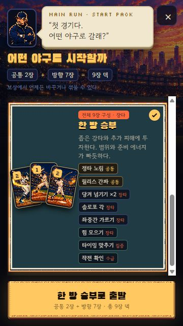
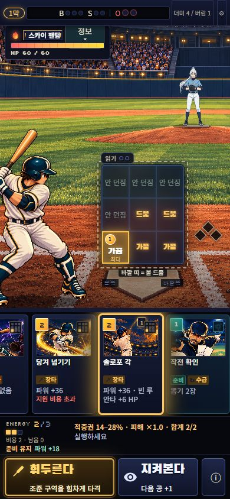
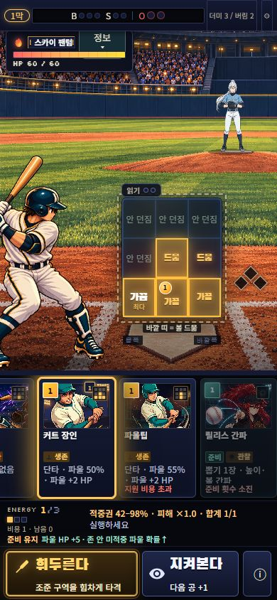

# 시작 덱 다양성 검증 (2026-10-21)

기준 main: 2f4890d. 범위는 새 런의 시작 9장 구성, 첫 경기 역할쌍 보장, 기존 선택 화면의 구성 안내다. 카드 효과·비용·확률·원화·저장 스키마는 바꾸지 않았다.

## 달라진 선택

| 방향 | 기존 카드로 구성한 반복 흐름 | 실제 비용과 제약 |
| --- | --- | --- |
| 연결 | 테이블 세터×2로 출루/카드 회수 → 주자가 있을 때 사인·진루·이어치기 지원 | 빈 루에서는 사인 사용 불가. 지원만 맞으면 메인 카드의 진루량을 받지 않는다. |
| 버티기 | 커트 장인×2와 다른 커버의 단타 → 미적중 시 파울 보험/추가 HP 피해 | 주력 공격은 단타. 준비에 쓴 에너지가 안타 때 직접 추가 피해가 되는 것은 아니다. 파울 기본 피해가 0이 된 뒤 무한 추가 피해는 없다. |
| 한 방 | 좁은 강타×2, 솔로포 각 → 힘/관찰/수급 중 에너지 투자 선택 | 힘 모으기1+강타2는 기본 에너지3을 모두 쓴다. 힘은 타격 범위를 넓혀 주지 않는다. |

공통7/방향2였던 실질 중복을 공통2(place/scout)+방향7로 줄였다. 덱 간 다중집합 중복은 2~3장이다. 새 첫패는 공격과 관련 준비/후속 역할을 하나씩 포함하되, 이미 충족하면 손패·더미·난수를 전혀 바꾸지 않는다. 나머지는 seed 셔플이며 고정 5장 프리셋이 아니다.

## 자동 검증

- 관련 3파일 18/18, 전체 174파일 **1040/1040** 통과.
- zone-report 10 / v9-report 30 / growth-report 2 / deck-report 1 모두 종료 코드0.
- production build 및 dist 예산 통과: **58.3/60MB**. 기존 React act/chunk 경고는 남으며 실패는 없다.
- 각 팩 30 seed에서 역할쌍·5장 손패·9 ID 보존·고정패가 아닌 종류 조합 다양성 검사. 같은 seed 재현성과 첫 투구/pitchSeed 불변 검사.
- origin/main 엔진을 별도로 읽어 실제 옛 3-ID 팩 저장을 만든 뒤 새 엔진으로 진입: **120개 전체 상태 deepEqual**. 새 팩의 역할쌍 기충족 **103건**은 hand/draw/seed 완전 불변. 추가 단위 테스트에 옛 seed21 손패/더미/난수 골든값 고정.
- 실제 9장 덱 안의 카드만 사용한 통제 사례: 출루 후 사인+진루로 홈인, 준비 후 미적중을 파울로 전환하며 추가 피해, 힘 준비로 동일 타격의 홈런 경계 변경. 이 사례들은 실제 브라우저 무작위 플레이와 구별한다.

## 실제 UI 플레이 — seed90210 / 스카이 팬텀 HP60

모두 새 게임→팩 선택→지도→첫 경기→보상을 UI로 진행했다. 숨겨진 공/난수나 앱 내부 상태를 읽어 선택하지 않았고 결과를 강제로 바꾸지 않았다. 동일 seed의 비교 플레이이므로 후속 실험자가 앞선 공 순서를 보았다는 학습 영향은 배제할 수 없다. 승리 속도/밸런스 순위의 근거로 쓰지 않는다.

- **연결, 6구 승리:** 첫패 테이블 세터/주자 연결/사인/작전 확인/간파. 간파 후 테이블 세터 출루로 HP60→45, 손패 보충. 주자가 생긴 뒤 사인 준비. 다음 주자 연결은 빗나가 HP44. 히트앤드런+이어치기 지원만 적중해 HP27, 기존 주자는 1→3루로 갔다(홈인으로 기록하지 않음). 순환한 주자 연결로 HP10 및 주자 해결, 다음 좁은 히트앤드런 미적중 뒤 이어치기로 승리. 단순 타격보다 주자와 카드 재등장이 다음 선택을 바꿨다.
- **버티기, 4구 승리:** 첫패 커트 장인/파울팁/투구 수 늘리기/벤치/간파. 첫 공에 투구 수+벤치 준비 후 가운데 낮게 커트로 낮은 줄 전체를 덮어 단타 HP60→48. 두 번째는 간파+다른 커트 HP34, 걷어내기 HP17, 순환한 커트로 승리. 이 경기에서는 실제 파울이 발생하지 않았으므로 파울 추가 피해 실플레이 발동을 주장하지 않는다. 낮은 공에 집중된 상대에게 넓은 커트가 유리한 점도 관찰했다.
- **한 방, 4구 승리:** 첫패 강타/솔로포 각/힘/작전 확인/간파. 정보 대신 힘1+솔로포2로 몸쪽 낮게를 노려 홈런 HP60→24. 다음에는 간파1+무료 집중+강타2를 선택했지만 한 존을 벗어나 HP23. 이후 좌중간 가르기+강타 지원으로 범위를 넓혀 지원만 적중, HP11/단타. 수급 후 바깥쪽 강타로 승리. 큰 보상, 좁은 범위 실패, 추가 카드로 범위를 사는 대안을 모두 관찰했다.

다른 두 덱과 달리 버티기의 첫 준비는 이 경기에서 안타 피해를 늘리지 않았다. 이를 유리한 결과만 편집해 소개하지 않는다. 세 덱 모두 같은 첫 투수에게 이겼다는 사실로 장기 밸런스나 재미가 입증되지는 않는다.

## 화면 / 저장 / 기존 흐름

- 390×844 및 360×640 선택: 대표3종/선택한 전체9장 구성, ×2 중복, 공통2 표시와 실제 정의 일치. 360에서 선택 팩332px, 목록352px, 시작 버튼 하단628px. 내부 목록 스크롤로 세 팩 선택 가능, 카드 이름이 테두리 밖으로 넘치지 않는다.
- PC1440×900: 기존506px 세로 iframe, 선택 목록536px/내용581px, 시작 버튼 하단888px. 카드 구성이 프레임 안에 들어간다.
- 360×640 전투: 화면640px, 행동 버튼 하단635px. 전역 CSS 수정 없음. 9존 탭, 메인/지원 선택, 더미 순환, 준비 상태 안내, 결과 HP 확인.
- 새 7-ID 기록은 PC에서 선택→휴대폰 이어하기, 연결 승리 후 재접속 보상 복원, 후속 타이드 베스퍼 전투의 회전/이어하기 후 손패 일치 확인.
- 실제 첫 경기 보상→건너뛰기→이벤트/떠나기→지도로→라커룸(최소9장 제거 불가 안내)→지도로→다음 경로/타이드 베스퍼 진입 확인. 지도에서 후속 경로 접근 가능.
- 기존 제한: fine-pointer844×390은 세로 iframe 최소높이628px/행동 버튼 하단623px로 화면390px 안에 들어오지 않는다. 프레임 전환 시 타이틀로 재진입하고 이어하기로 저장 상태 복원된다. 기존 PR50 검증 기록의 동일 제한이며 이번 범위에서 회전/전역 프레임 규칙을 수정하지 않았다. 실제 터치 기기 회전·브라우저 바·롱프레스 실측은 미실시.

## 검수와 평가 경계

저장소 지침에 따라 explorer/worker gpt-6-luna/high, 독립 reviewer gpt-6.1-sol/high. root가 통합·실제 플레이·화면 검증. 동일 체크아웃 동시 편집 없음. 최종 코드 검토에서 차단 사항 없음.

기존 봇은 V16 준비/조건부 HP/지원 효과를 충분히 평가하지 못하므로 봇 승률로 팩 순위를 매기지 않았다. 여러 seed/여러 상대의 긴 런 밸런스와 신규 사용자 재미 평가는 후속 과제다.

## 게시

`codex/starter-deck-variety`의 draft PR과 격리된 Pages 프리뷰로 게시한다. 이번 변경의 main 병합은 하지 않는다. 실제 배포와 공개 페이지 확인 결과는 PR 본문에 기록한다.

