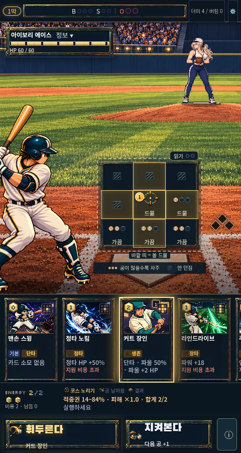

# 전투 행동 버튼의 제목·설명 정렬

기존 main `e5969b2`에서 480×900 화면으로 재현했다. 카드 검사 버튼이 나타나면
실행 아이콘의 이전 행 배치가 우선했고, 10px 행 간격과 보조문구 여백이 제목과
설명을 벌렸다. 다음 공/타자 버튼은 전체 열을 차지하는 이전 설명 규칙 때문에
세 번째 행까지 생겼다.

전투의 에셋 버튼 내부를 아이콘 1열 + 제목/설명 2행으로 고정하고 행 간격을 2px로
지정했다. 카드 검사 버튼, 준비, 비용 부족, 지켜보기, 다음 공/타자도 같은 계약이다.
버튼 외곽과 실제 행동, 카드 비용, 저장 규칙은 바꾸지 않았다.

| 수정 전 | 수정 후 |
| --- | --- |
|  |  |

추가로 900×500 PC 창은 기존 281×500 내부 화면에 628px 전투를 넣어 버튼이
아래로 밀리고 제목도 폭을 넘었다. 본편은 640px 미만의 PC 창에서만 360×640
논리 화면을 같은 바깥 9:16 크기로 축소한다. 수비 실험의 320×568 기준은 유지한다.
이 처리는 같은 iframe의 크기만 바꾸므로 선택과 저장 상태를 유지한다.

`scripts/qa-action-layout.mjs`는 320/360/390/480px 휴대폰과 일반/작은 PC에서
버튼 외곽뿐 아니라 제목·설명의 실제 위치, 여백, 아이콘과의 분리, 지켜보기
결과 문구의 잘림을 검사한다. PC 높이 700→500→640→700에서 iframe, 선택,
저장의 유지도 검사한다. 전체 흐름과 작은 PC 지도 스크롤은 별도로 확인한다.
최종 테스트·CI·공개 배포 근거는 PR에 기록한다.
