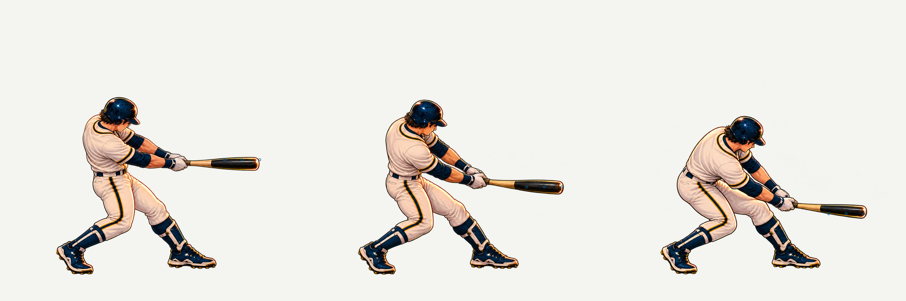

# 타격 접촉·연결 동작 추가 제작 기록

**상태: 접촉 3장·접촉 전/후 6장 정지 원화 검수 통과. 실제 게임 화면 후보는 NOT_IMPROVED로 보류. 본편에는 적용하지 않았습니다.**

추가 제작 허용 범위는 접촉 포즈3회 연장(누적6/6), 연결 포즈2회 연장(누적5/5)입니다. 한 시트에서 밀리던 중간·낮은 포즈를 각각 따로 다시 그려 발 고정 검사를 통과했습니다. 기준·타깃·배우 위치를 옮겨 맞추지 않았습니다.

- [접촉 원화 독립 검수](ATTEMPT4-6-SOURCE-SET-REVIEW.md)
- [추가 연결 원화·재생 경계 검수](BRIDGE4-5-SOURCE-REVIEW.md)
- [6개 실제 게임 화면의 블라인드 결과](blind-verdict.txt):3.49→3.50,+.01,1/8축 개선. 개선 기준 미달입니다.
- [독립 재생 문서](sequence-review/index.html): 내려받아 로컬 정적 서버로 열면3개 높이·6개 배속·시간 슬라이더를 비교할 수 있습니다. 판정·공·소리가 없는 작화 검수용이며 게임 프리뷰가 아닙니다.
- [본편 연결 후보 코드 보존](local-runtime-review/): 검토용 텍스트/패치이며 게임에서 import하지 않습니다.

정지 원화의 두 손·장비·동일 캐릭터와 고정 발 위치는 검수됐습니다. 공통 전신 캔버스만 정규화한768셀 게임 인코딩 후보도9포즈 발 검사와9개 접점 검사를 통과했습니다. 새 단일 원본은 실제1254×1254이며,1024는 가이드 준비 크기입니다. 투명 PNG의 alpha1–2 RGB를 불투명 빨강/노랑 테두리로 오해한 이전 기록은 [별도 정정](FRINGE-AND-REFERENCE-CONTROL.md)을 읽어야 합니다. 기존 상위 폴더28파일은 역사적 원본으로 그대로 보존했습니다.

남은 시각 문제는 기존 준비 동작에서 낮은 PRE로 접히는 변화와 POST에서 기존 마지막 팔로스루로 감기는 변화입니다. 발 고정·수학적 접점 합격이 연속 모션이나 물리 평면 승인, 상업 게임 품질을 의미하지 않습니다. 제안된 평면·바깥볼 방향은 아직 승인되지 않았습니다.

`sequence-review/`의 HTML은 무변형 원본 셀과 정상 source-over 합성을 시간 순서로 재생합니다. 로컬 편집·관절 회전·사지 복사로 새로운 포즈를 만들지 않았습니다. 신규 포즈는 내장 image_gen, 분할은 실제 sprite-gen, 포장은 Pillow를 사용했습니다. GIF/프레임 간 유지 재생은 새로운 중간 작화나120프레임 모션으로 표기하지 않습니다.

원본 요청 JSON·PNG·검수·검증 결과·정규화 매핑·공개된 블라인드 key/점수를 함께 보존합니다. CHECKSUMS.json은 이 확장 폴더의 파일 바이트를 검증합니다. 일부 보고서의 절대 경로는 제작 당시 원본 경로이며 아래 상대 파일이 게시본입니다. 원래 외부 워크스페이스의 중복 QA PNG/GIF는 유지하되 게시본에는 주요 경계 PNG·필름스트립·로그를 보존했습니다. renderer 복원과 겹친 늦은 실게임 검사는 증거에서 제외합니다.

원화 검증 재현에는 main PR116의 `scripts/validate-contact-art.py`와 기존 Pillow가 필요합니다. `--sheet corrected-contact-sheet.png --criteria correction4-6-criteria.json --barrels corrected-barrels.json --out /tmp/contact-review`로 실행하며, 기본 reference/contract는 저장소 루트 기준입니다. 생성된 원화를 본편에 연결하는 명령은 아닙니다.
