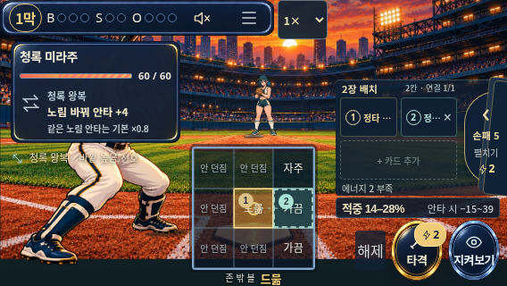

# M03 extension — default touch entry and rotation regression

Before implementation, main6bfc24f is the only source baseline. Existing seven-viewport QA deliberately forces renderers and uses mouse; it does not establish default coarse-pointer routing, touch input, or rotation with a planned multi-card action. Add a separate actual-browser regression without changing product code or the existing mouse contract. No `battleUi`/fixture query, normal Continue→map→battle, actual touch main/support placement, portrait notice→landscape preserving selection, exact durable engine result and reload. Fixed public-visible center/right adjacent aims; hidden pending is not used to select actions. Engine is an oracle for exact-state assertions, not a player policy.

9-axis impact: product UI/layout/input/game logic/balance/storage/mobile/scroll/flows unchanged; QA runs isolated browser profiles with legal engine-generated saved maps, actual taps and viewportresize. Assert default vnext/noiframe, selection and save across resize, two-card consumption/exact engine acceptance, same durable result afterreload. No claim physical device/sensor rotation, human fun, or full-run gameplay. Tests/scripts only; fullsuite/smoke/build/dist/independentcode and separate actual public source verification before publication. Existing HELD candidates remain on their local branches and are not copied into this change. New R5 test-only issue round, not a retry of M06/M07 UI.

Final scope refinement: original overlap-at4 fixture passed42/42 locally/publicly, but could miss a regression that ignores a distinct support target. Strengthen the same case to fixed main4/support5, assert board order, distinct aims and zero overlap; compare the full resulting engine state. This is QA fixture coverage, not a player strategy or balance change.

## Verified final candidate
Local and actual GitHub Pages main:42/42 each,0pageerrors. Independent read-only rerun42/42, with actual568px plan/result images inspected. All568×320,667×375,844×390 use main4/support5, ordered IDs c2/c1, zero overlap. Real coarsepointer/maxTouchPoints checked; exact saved state remains equal to the engine through formal result/release/settle/completion and reload. No renderer-forcing query or iframe.

Full244files1662tests PASS, smoke10 valid output, production buildPASS52.8/60MiB. Separate reviewer source/log reviewPASS. Initial localserver attempts failed because a Pages-base build was served with default `/` base; corrected by matching VITE_BASE=/9-baseball/ in preview. This was harness setup, not a product failure. The first overlap-at4 test was deliberately refined to distincttargets so an ignored support target would fail. No game expectation was weakened.

To run with existing Chromium/Playwright tooling (no package added):
```sh
npm run build
npm run preview -- --host 127.0.0.1
# Another terminal: point these to your existing browser/tool installation.
BASE_URL=http://127.0.0.1:4173/ PLAYWRIGHT_MODULE=/absolute/path/to/playwright/index.mjs CHROMIUM_PATH=/usr/bin/chromium node scripts/qa-default-touch-rotation.mjs
```
For a Pages-base build, use the same VITE_BASE when starting preview. Reports/screenshots default to/tmp/qa-default-touch. Public evidence is in default-touch-public-report.json; independent evidence in default-touch-independent-report.json.



This extends the previous mouse QA; it does not replace it or establish physical Android/iOS/Safari/sensor behavior, new-player comprehension, balance, fun or commercial readiness.
