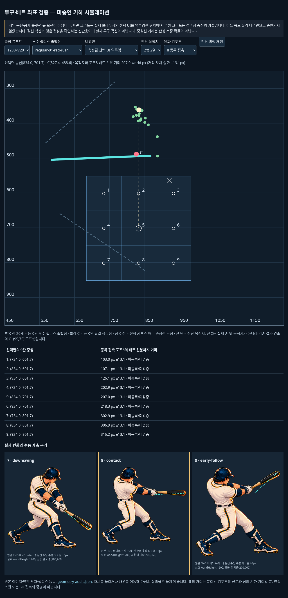
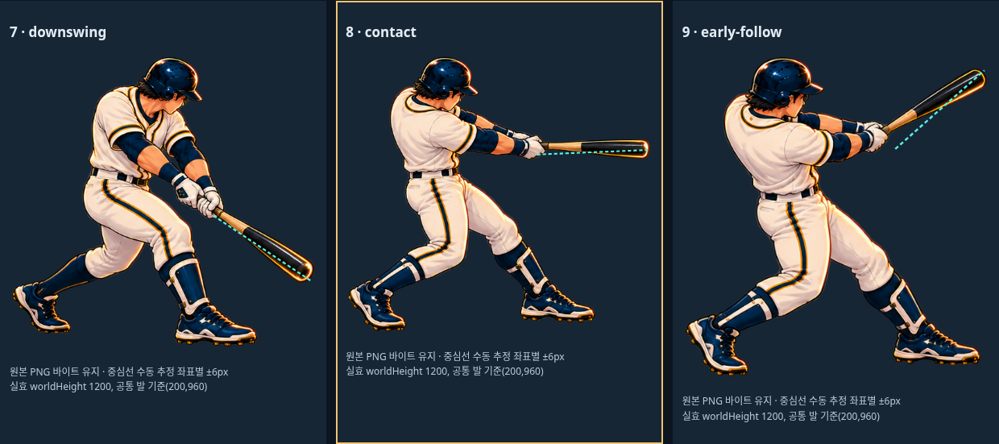

# M22-B — measured geometry and offline authoring aid

This advances the offline evidence step of the existing [remaining gates](REMAINING-GATES.md), not the production roulette. Main ed7dd2e keeps the accepted-pitch save barrier and existing single-contact flight. No new actor, nine-cell destination, flight, light, sound, judgement, or save schema is enabled.

## Repository integration impact

Before integration: UI/layout and input have no product effect; the generated standalone diagnostic has its own selects/play button. Logic/balance and storage have no product effect: no engine import in the authoring aid, no save writes or actual hit calculation. Mobile/scroll only affect this developer page, not game CSS. Existing game flows untouched. Regression: verify measured transforms, unchanged source PNG bytes and browser operation. Build/deploy: files are under docs/scripts, are not imported by runtime, and the aid defaults to `/tmp`; ensure production asset hashes and size remain unchanged. These cover the nine AGENTS impact axes. It is not scored as a replacement game screen.

## What was actually measured

Root loaded a normal engine-generated seed3 take result, fonts ready, through Chromium at four landscape sizes, read the actual `.bv-world` DOM matrix and `.bv-zone` rectangle, and inverted that matrix. Before/after result candidates have identical scene/zone geometry; the runtime battle sources are unchanged between fec892d and ed7dd2e.

| Viewport | UI center in world pixels | Registered contact C |
| --- | --- | --- |
| 568×320 | (834.00, 774.19) | (827.40, 488.56) |
| 667×375 | (834.00, 739.05) | same |
| 844×390 | (834.00, 709.75) | same |
| 1280×720 | (834.00, 701.66) | same |

The UI interaction grid is not a registered physical pitch plane. Its world Y changes under responsive layout. **Do not turn these UI-derived points directly into ball destinations**, and do not move/shrink the input grid merely to fit an old swing. The earlier static estimate incorrectly removed the rail from the scene width; that estimate was discarded after the actual full-width stage measurement.

The batter's effective layout overrides the base motion height971.09 with1200 and foot(200,960). Corrected JSON retains the base value separately. Barrel transforms use frame registration plus scale×1200/768; all three original source PNGs are embedded byte-identically. Manual handle-to-tip centerline estimates have ±6 source pixels per coordinate (about ±9.2 world pixels per coordinate; conservative Euclidean distance bound ±13.1 world pixels). They are not registered per-zone landmarks, swept collision volumes, or proof of continuous motion.

Twenty roster release origins are registered and transform consistently from each pitcher's own foot/anchor/visible height. Their extent is X818.62–888.51, Y353.59–494.02. Release sources are not pitch-plane crossings. The old C+(95,75) outside effect is a result animation offset, not an authored outside destination.




## Reproduce the authoring aid

```sh
python scripts/build-pitch-contact-audit.py --out /tmp/9zone-pitch-contact-audit
python -m http.server 5376 --bind 127.0.0.1 --directory /tmp/9zone-pitch-contact-audit
```

Open localhost5376. The file is self-contained/offline; original PNGs are embedded. It supports4 measured UI viewports,20 release sources,9 diagnostic targets and3 existing poses. A second plane,300×300 centered on C, is explicitly a **hypothesis**, not approved geometry. Its straight dotted flights, animated ball and centerline-distance table are diagnostic. They are not actual trajectory/engine hit evaluation, nor a new animation asset. No service/API key or package installation is required.

Root browser check exercised4×20×9 selections, tested endpoint arrival, inspected the actual world and source images, and observed zero page errors. Local file URLs were blocked by browser policy; the identical files passed over loopback HTTP. Source bytes were separately checked. This is geometry/authoring evidence, not a commercial quality or human fun verdict.

## Next dependency

Define a physical strike plane in the same world camera, with explicit normalized mapping from the unchanged central input UI. Then register nine physical crossings and one true outside crossing. Compare those points against the full drawn bat, not only the uncertain centerline. Reuse naturally matching poses; author missing reach/height and transition poses with planted feet, two hands, handedness and anatomical continuity. Do not stretch an actor, enable HELD#90, or hide a mismatch with a flash. Only after this evidence passes should public-only scan→LOCK→continuous ball→contact be connected. The current centerline study does not establish that nine completely new drawings are required.
