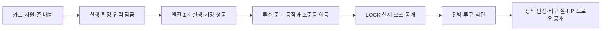

# 상업 마스터피스 격차 계획 · 2026-11-10

실제 브라우저 플레이 평가에서 나온 격차를 단계별로 닫는 계획이다. 이 문서는 계획과 근거이며,
전체 구현 승인·완료 선언이 아니다. 단계 1의 한 항목만 이 PR에서 구현했다.
사용자 추가 요청에 따라 **9존 조준등 룰렛(M-22)** 방향을 이 계획에 통합했다.
이번 추가는 문서 수정이며, 룰렛 런타임·새 에셋·메인 병합은 포함하지 않는다.

## 평가 근거

- 측정 기준: `main@08765b0` production build, 844×390(휴대폰 가로)·1280×720.
- 새 런 3회를 실제 입력으로 진행: 타이틀 → 팩 → 지도 → 전투 → 보상 → 이벤트 → 상점 → 라커룸 →
  휴식 → 1막 보스 → 2막 강적 → 패배 화면.
- 확인하지 못한 것: 소리(헤드리스), 3막·승리 엔딩, 실기기, 사람 플레이.
- 평가 뒤 `main`이 `844b0ca`로 이동했다(#97 상점, #98 휴식, #101 투수 조건 표시, #102 작은 가로 전투).
  아래 표의 "재확인" 열은 `844b0ca`에서 다시 본 항목만 표시한다. 표시가 없으면 `08765b0` 관찰이다.

## 격차 목록

| ID | 격차 | 근거 | 재확인(`844b0ca`) | 단계 |
| --- | --- | --- | --- | --- |
| M-01 | 타격 훈련·라커룸 카드가 휴대폰 가로에서 14~16px 띠로 붕괴 | `scripts/qa-facility-layout.mjs` 기준선 57건 실패 | 재현됨 → **이 PR에서 수정** | 1 |
| M-02 | 상점 카드·유물 줄 붕괴 | 844×390 캡처 | #97에서 수정됨, `qa-shop-layout.mjs` 통과 | 완료 |
| M-03 | 자동 화면 검사 `qa-shots.mjs`가 폐기된 세로(412×743·375×667)만 본다 | 스크립트 뷰포트 정의 | 미변경 | 1 |
| M-04 | 844×390에서 손패 5장 중 2장만 보이고 나머지는 스크롤 | 손패 펼친 캡처 | #102가 전투 배치를 바꿈, 재측정 필요 | 2 |
| M-05 | 상대 HUD가 타자 얼굴을 덮고, 패턴 보조 문구가 배경 없이 잘림 | 전투 캡처 | #101·#102 이후 재측정 필요 | 2 |
| M-06 | 결과 패널 문구 잘림("투수 HP −12 (60→48)") | 판정 프레임 캡처 | 재측정 필요 | 2 |
| M-07 | 정보 보기 창이 무스타일 패널 | 메뉴 캡처 | 미변경 | 2 |
| M-08 | 이벤트 문구 오타: "클럽하우시" 3곳(`events.js`), "있어 만든다", "한적이다" | 소스·화면 | 미변경 | 1 |
| M-09 | 도감에 "· high" 내부 라벨 노출, 새 저장에서 20명 전부 공개 | 도감 캡처 | 미변경 | 2 |
| M-10 | 유물 마크 `CUT`이 픽셀 폰트에서 "OUT"으로 읽힘 | 상점 캡처 | #97이 아트 있는 유물의 마크를 숨김, 아트 없는 유물은 남음 | 2 |
| M-11 | 설정에 볼륨·언어·접근성·데이터 초기화가 없고 실험·비교용 시드가 노출 | 설정 캡처 | 미변경 | 3 |
| M-12 | 화풍 4종 혼재(픽셀 배경 / 셀화 투수 / 반실사 타자·구장 / 회화풍 카드), 카드 프레임 3종 | 전 화면 캡처 | 미변경 | 4 (작가 결정) |
| M-13 | 전투 중 투수가 844×390에서 약 70px, 전 전투 같은 구장·타자 | 전투 캡처 | 미변경 | 4 (작가 결정) |
| M-14 | 보상·시설 카드 아트 크롭이 몸통·다리만 보여줌 | 보상·시설 캡처 | 미변경 | 2 |
| M-15 | 단순 정책(최빈 칸 조준 + 첫 카드)으로 1막 보스 13구 강판 | 자동 진행 로그, 표본 1 | 미재측정 | 5 (작가 결정) |
| M-16 | 상점에 화폐가 없고 런 체력은 3아웃뿐 | 상점·규칙 화면 | #98이 휴식에 회복/강화 선택을 추가 | 5 (작가 결정) |
| M-17 | 메타 진행(해금·업적·통계) 없음 | 소스 검색 | 미변경 | 5 (작가 결정) |
| M-18 | 생성 이미지 약관 미기록(O1~O5), "반격 준비" 카드 아트 간판의 스우시 형태 로고 | `COMMERCIAL-LAUNCH-BLOCKERS.md`, 상점 캡처 | 미변경 | 6 (권리자 결정) |
| M-19 | CSS 67파일·약 18,000줄·`!important` 약 2,900개 | 정적 계수 | 미변경 | 3 |
| M-20 | README·출시 차단 문서가 세로 전용을 전제로 서술 | 문서 대조 | 미변경 | 1 |
| M-21 | 사람 플레이 증거 0건 | `loop/autodev/PLAYTEST.md` | 미변경 | 5 |
| M-22 | 확률로 정해진 코스가 드러나는 과정이 약해, 카드 커버와 실제 투구의 관계·기대감을 읽기 어려움 | 사용자 제안: 카드·코스 확정 뒤 9존 불빛 이동 → 한 곳에 잠김 → 그곳으로 투구 | 현재는 시드 추첨·숨은 pending과 착탄 후 공개. 조준등은 **신규 설계, 미구현·재미 미검증** | 2, 아래 실행 계획 |

## 단계

각 단계는 항목 하나씩 별도 PR로 진행한다. 9축 영향도 분석과 회귀 검증 계약은 그대로다.

1. **휴대폰 가로 기능 결함과 검사 정합** — M-01(이 PR), M-03, M-08, M-20.
   통과 조건: 568×320·667×375·844×390에서 전 화면의 선택지가 읽히고 확정 버튼이 화면 안에 있다.
   `qa-shots.mjs`가 실제 출시 방향을 검사한다.
2. **전투·보조 화면 판독성과 코스 공개 연출** — M-04~M-07, M-09, M-10, M-14, M-22.
   먼저 `844b0ca` 이후 상태를 다시 캡처해 남은 항목만 진행한다. 수치·규칙은 건드리지 않는다.
   M-03의 가로 검사 기준을 먼저 마련한 뒤, M-22의 공개·저장 계약 → 조준등/공 경로 → 실제 플레이 검수 순으로 진행한다.
   M-05·M-06의 가림/잘림을 함께 확인하되, 기존 손패·배우 교체와 한 PR에 섞지 않는다.
3. **설정과 구조 부채** — M-11, M-19. CSS는 화면 단위로 한 파일씩 통합하며 일괄 `@layer` 래핑은 하지 않는다.
4. **아트 디렉션 통일** — M-12, M-13. 방향 결정은 작가 몫이다. 결정 전에는 비교 자료만 준비한다.
5. **깊이·재도전 동기** — M-15~M-17, M-21. 사람 3~5명의 첫 5분 관찰을 먼저 한다.
   그 전에는 밸런스 수치·경제·메타 구조를 바꾸지 않는다. 자동 정책 결과를 재미의 근거로 쓰지 않는다.
6. **권리·출시** — M-18. 권리자 결정 없이는 닫을 수 없다. 로고가 보이는 카드 아트는 교체 후보로 올린다.

## M-22 · 9존 조준등 룰렛 실행 계획

사용자 방향: **카드와 존을 확정하면 9존의 불빛이 움직이다 코스에 잠기고, 투수가 그곳으로 던진다.**
별도 원형 룰렛·수동 정지 버튼을 추가하지 않는다. 중앙 존과 자기 카드의 커버를 같은 자리에서 대조한다.
당첨 코스를 새로 뽑는 기능이 아니라, 기존 확률 판정을 읽히게 만드는 전투 연출이다.
기존 [5개 개선 계획 #96](https://github.com/jbseo-commits/9-baseball/pull/96)의 손패·배우·기믹 작업과 연결하되,
이 절을 신규 공개 시점 설계의 기준으로 삼는다. 현재 본편의 착탄 전 비노출 계약은 아직 변경하지 않았다.

### 현재 규칙과 이번에 달라지는 공개 시점

- 기준은 `main@844b0ca`다. [`engine.js`](../../../src/duel/engine.js)의 `baseIntent`가 투수·카운트·과거 행동·기믹으로 분포를 만들고,
  `dealPitch`가 `pitchSeed`로 코스를 한 번 뽑아 `battle.pending`에 둔다. 같은 시드와 행동은 재현 가능하지만 고정 코스 대본은 아니다.
- `publicProbabilities`는 일반 상태의 실제 분포 또는 간파 정보로 갱신한 조건부분포다.
  존 밖 9도 포함한다. 존 안 상대 명암(`p[z]/inZone`)을 10개 결과의 추첨 확률로 오인하지 않는다.
- 현재 [`scene-effects.js`](../../../src/duel/battle-vnext/scene-effects.js)는 착탄 전 실제 코스를 쓰지 않는 공 경로다.
  새 연출은 **액션 확정·저장 성공 → LOCK에서 코스 공개 → 그 코스로 투구 → 착탄 후 정식 결과**로 경계를 바꾼다.
  기존의 “실제 코스도 착탄 뒤에만 공개” 검사를 그대로 두고 예외를 몰래 끼워 넣지 않는다.
- **코스가 보이면 카드 커버 적중·지원 적중·존 밖 여부는 플레이어가 미리 추론할 수 있다.**
  이 예측 가능성은 이번 방향의 변화다. “안타 여부를 완전히 숨긴다”고 약속하지 않는다.
  정식 판정 표시·타구 종류/장타·정확 적중 연출·피해/HP·결과 의존 드로우/더미 수와 판정·피해·드로우에 의존한 소리는 착탄 뒤에만 공개한다.
  조준등 이동음·LOCK 잠금음은 각각 해당 공개 단계에서 허용한다.
  카드·준비 효과로 이미 공개된 수치와, 이번 실제 결과에 의존하는 수치를 구분한다.

### 플레이 흐름과 연출

1. **배치:** 기존 카드의 테트리스형 커버와 다중 카드 배치가 먼저 정착한다. 룰렛을 보기 위한 새 버튼·손패 보기 단계는 없다.
   실행 순간의 카드 개체 ID·지원 순서·노림·각 커버·비용을 `committedPlan` 표시 snapshot으로 고정한다.
   실행 후 `selected`가 비워져도 불빛과 자기 커버를 대조할 수 있어야 한다.
2. **이동:** 작은 조준등/테두리 빛이 기존 9존 안에서 이동한다. 카드 커버는 면·번호, 조준등은 윤곽·중심점으로 구분한다.
   투수의 준비·와인드업 구간을 활용한다. 초기 조정안은 1배속 이동 약450–650ms, LOCK 약80–120ms이며 확정 수치가 아니다.
   각 투수의 실제 릴리스 이전 구간에 맞춰 줄이고, 기존 카드 삽입·와인드업 시간을 중복 대기로 더하지 않는 것을 목표로 한다.
3. **LOCK:** 한 칸의 테두리·짧은 잠금음·선택적 진동으로 도착점을 읽힌다. 최종 target에 의존하기 시작한 첫 프레임/음향/ARIA가 곧 공개 시작이다.
   감속 이동에서 이미 target 방향을 암시한다면 그때부터 LOCK으로 취급한다. 공개 전 이동 경로를 결과별로 몰래 바꾸지 않는다.
4. **투구:** 조준등이 잠긴 목적지와 실제 공 도착점을 일치시킨다. 새 `lockedTarget` 공개 모델만 사용하며 렌더러가 `pending`을 직접 읽지 않는다.
   현재의 공통 접촉점 경로를 유지한 채 말로만 “그곳으로 던졌다”고 처리하지 않는다. 9칸과 존 밖을 실제 카메라/공·배트 접촉 좌표에 함께 검수한다.
   먼저 중앙 9존과 월드 투구 판정면의 투영 관계를 고정한다. 현재 타자의 고정 접촉 자세로 모든 코스를 자연스럽게 표현할 수 있는지도 확인한다.
   새 타점 자세가 필요하면 별도 원화·동작 검수 과제로 분리하고, 몸을 평행 이동하거나 공을 순간이동시켜 맞춘 것으로 처리하지 않는다.
   `#90`의 HELD 타자 후보를 가져와 해결된 것으로 간주하지 않는다. 이 의존성이 해결되지 않으면 B는 배포하지 않는다.
5. **착탄:** 실제 커버와 접촉 → 판정 → 실제 추가 효과 → HP 확인의 흐름을 유지한다.
   정확 적중·근접 실패·일반 커버·지원 적중을 실제 엔진 결과로 구별하고, 결과를 부풀리려고 가짜 한 칸 차이를 만들지 않는다.
   기존 투수 기믹 조건 표시는 실행 전 snapshot으로 유지하고, 이번 발동·피해 표시는 착탄 이후에 연결한다.

### 공정성·정보·저장 계약

| 영역 | 구현 계약 |
| --- | --- |
| 실제 추첨 | 이미 승인된 엔진 결과의 최종 코스만 사용. 재추첨·결과 보정·엔진 RNG 추가 소비·카드 커버에 맞춘 종착점 선택 금지. 표시 ON/OFF에서 다음 상태 전체·seed·pitchSeed·자원·저장이 같아야 한다. |
| 이동과 확률 | 이동은 실제 추첨기의 실시간 표본이라고 주장하지 않는다. 모든 칸을 균등 순회해 동률처럼 보이게 하지 않고, 현재 공개된 낱말·구간·허용 존으로만 리듬과 강조를 만든다. read0/1에서 raw 확률을 방문 횟수·머무는 시간·소리로 정밀 노출하지 않는다. read2도 존 안 정규화와 볼 포함 분포를 구분한다. |
| 시각 난수 | 전용 표시용 난수/seed만 사용하고 엔진 `seed`·`pitchSeed`·숨은 roll에서 파생하지 않는다. LOCK 전 경로는 동일한 공개 상태·표시 seed에서 target와 무관해야 한다. 최종 코스에 따른 마지막 정착은 공개 시작 이후만 허용한다. |
| 0%·간파 | 실제로 불가능한 칸은 점등 후보에서 제외. 간파 이후 가능한 칸/볼 정보와 현재 공개 등급을 따른다. 확정 코스라면 가짜 순회를 생략하고 바로 잠근다. |
| 볼 | 존 밖 9는 기존 볼 표식에서 끝낸다. 9칸 중 한 곳에 가짜 LOCK한 뒤 볼로 바꾸거나, 볼을 제거하고 존 안을100%로 재정규화하지 않는다. 두 번째 9존은 만들지 않는다. |
| 실행 잠금 | 유효한 스윙/지켜보기 한 번에만 동작. 공개 후 카드·지원 순서·코스·행동을 바꾸거나 수동 타이밍으로 멈출 수 없다. 연타·Escape·시각 연출 건너뛰기로 추가 엔진 행동이나 선택 복귀가 생기면 실패다. |
| 저장·복구 | [`App.act`](../../../src/duel/App.jsx)의 accepted action → `persist(next)` → presentation 순서를 보존한다. 저장 성공을 확인하기 전에 target·결과를 공개하지 않는다. 실패 시 경고만 하고 계속 재생하지 말고 미공개 상태를 유지하며, 이미 계산한 같은 `next`의 저장만 재시도한다. 이때 창을 닫으면 구세이브의 이전 선택으로 돌아갈 수 있으나 새 target/결과는 얻지 못한다. 필요한 저장 성공 신호/오류 처리 보강은 선행 영향도·회귀 검사 대상이며 저장 스키마 변경은 이번 범위가 아니다. |
| 리로드·재생 | target를 본 뒤 리로드해 원래 pending에서 카드만 다시 고르는 우회를 막는다. 이미 확정된 다음 상태/결과로 복구하고, 재실행·추가 소비·자동 재추첨은 없다. 다시 보기는 메모리에 같은 결과·표시 snapshot이 남아 있을 때만 지원한다. 리로드 뒤 snapshot이 없으면 확정 결과 화면만 복구하고 과거 동작을 임의 재구성하지 않는다. 새 전투/화면 이동 시 오래된 token·소리·진동은 취소한다. |
| 기본·지원·준비 | 기본 스윙/지켜보기에도 실제 투구면 적용하되 가짜 카드 버림 없음. 지원2·3장과 현재 실제 최대 장수도 같은 확정 커버를 보존한다. 준비는 공을 쓰지 않으므로 조준등 없음. |
| 모드 경계 | v1은 현행 일반 MAIN RUN부터. 같은 공을 재조준하는 shotMode, zoneFirst, defenseLab, 연습/시연은 별도 공개 계약 검토 전 제외한다. 구세이브·encounter 없는 규칙도 강제 활성화/재추첨 없이 기존 동작 유지하고, 실제 분포와 표시 분포의 일치 검증 후 지원 범위를 넓힌다. |
| 접근성·피로 | 기존 배속과 같은 host clock 사용. reduced motion은 순회 없이 짧은 정착, 무음은 동등한 모양·문구로 전달. 전체 화면 번쩍임·매 tick 진동·연속 ARIA 낭독 없음. 탭/포인터를 받지 않는 장식층으로9존·정보창·실행 버튼을 가리지 않는다. |

### 실제 구현의 분업과 순서

현재 PR의 시설 수정(M-01)과 룰렛 구현은 분리한다. 한 작업자만 같은 체크아웃을 편집한다.
`#99` 손패·`#100` 타이드의 HELD 및 누적 수정 한도를 유지하며, 새 기능에 묶어 우회 병합하지 않는다.

| 작업 | 담당 범위 | 산출물·완료 조건 |
| --- | --- | --- |
| M22-A · 계약·표시 모델 | Codex: `presentation-snapshot.js`, `view-model.js`, 관련 계약/정보경계 테스트 | 실행 전 커버 snapshot, 저장 성공 게이트, 공개 전 target없음/LOCK뒤 target만 있음/착탄뒤 결과. 기존 `spoiler-before-landing` 기대값을 명시적으로 분리. 엔진 계산은 유지. |
| M22-B · 조준등·공 경로 | Claude Code: A가 고정된 뒤 `BattleView`/`BattleScene`/`scene-effects.js`와 좁은 스타일·시각 에셋 | 기존 9존 위 순회→LOCK→실제 목적지 투구. 투수별 손 출발·착지·릴리스/접촉/복귀 타이밍, 커버 가독성 유지. 새 배우·무관한 카드 리디자인은 섞지 않음. |
| M22-C · 통합 검수 | 구현하지 않은 독립 코드/플레이·UX 검수자 | 같은 seed/행동/덱/뷰포트의 ON/OFF 상태 일치, 프레임·소리·ARIA 공개 경계, 실제 조작·회전·저장 실패/리로드. 수정 전후 블라인드와 시간 흐름 검수 분리. |
| M22-D · 플레이 판단 | 사람 첫 플레이·반복 플레이 관찰 후 총괄 판단 | 무엇이 정해졌는지·어디로 던졌는지·어떤 카드가 막았는지 이해하는가, 스핀을 멈출 수 있다고 오해하지 않는가, 반복 대기가 늘어 지루해지지 않는가. 사람 증거 전에는 재미·출시 완성 판정 없음. |

작업 파일은 예상 경계다. A의 공개 모델을 합의한 뒤 파일 소유를 고정하고, 겹치는 파일의 동시 편집은 하지 않는다.
M22-A~C는 코드 작성 후 각각 기존 품질·CI 게이트를 거치는 후속 구현 PR이며, 이 계획 추가로 실행 완료가 된 것은 아니다.

### 영향도와 검수 기준

| 축 | 향후 영향·확인 |
| --- | --- |
| UI·레이아웃 | 중앙 존·커버·LOCK 구별, HUD/배우/손패와 겹침 없음. M-04~M-06을 현행 main에서 재측정. |
| 입력·제스처 | 실행 전 기존 탭·드래그·지원 순서 유지, 확정 후 입력 잠금/중복 방지, 새 클릭 단계 없음. |
| 로직·밸런스 | 실제 분포·난수·안타/피해 계산 불변. 단, LOCK 뒤 커버 적중 추론이 가능해지는 정보 공개 변화는 의도된 새 계약. |
| 저장·불러오기 | 성공 확인 후 공개, 실패·리로드·복구·재생에서 같은 확정 행동 보존. 스키마 변경 없이 가능한지 A에서 검증. |
| 모바일 뷰포트 | 568×320·667×375·844×390·PC1280×720/1440×900 실제 프레임 확인, 같은 진행의 세로 회전·복귀 보존. |
| 스크롤·오버플로 | 전역 잠금 변경 없이 장식 범위 제한. 손패/정보창 끝과9존·CTA 접근, #102의 page/root scroll0 보존. |
| 기존 플로우 | 새 런→경로→전투/다음 공→KO/보상→시설→재개, 준비/지켜보기/지원·볼/삼진 및 취소·연속 입력. |
| 테스트 | 아래 공개 경계·RNG 동등성·시간 흐름·오류/모드 검증. 정지 PNG만으로 모션·소리·재미 통과 금지. |
| 빌드·배포 | 배속·재생 시 취소/타이머·자산 로딩/용량 예산, 기존 전체 테스트·smoke·build·dist·독립 검수·CI·실제 배포 확인. |

- 같은 공개 상태와 같은 시각 seed에서 숨은 target/roll만 바꿔도 **LOCK 전 DOM·경로·ARIA·소리가 같음**.
  LOCK 시작에만 허용된 target가 달라지고, 정식 결과·HP·드로우/더미·이펙트 종류는 착탄까지 동결된다.
- 엔진 추첨 함수를 연출에서 재호출하지 않음. ON/OFF 전체 다음 상태·다음 투구 시드가 일치하고,
  **target 공개 후** 취소/리로드/연타/화면 이동으로 이전 선택을 복구할 수 없음.
  저장 실패·용량 초과에서는 미공개 유지와 같은 `next` 저장 재시도(엔진 재실행 없음)를 검수한다.
  실패 후 재시작 시 구세이브 복구는 허용되지만 새 target/결과 정보가 노출되지 않았어야 한다.
- 존 밖·0%·간파 높이/볼/확정 칸, 모든20투수의 다른 공개 성향·기믹 제한,
  카드1·2·3장/현재 한도, 실제 동일 ID 재드로우·손패 상한의 결과 비노출을 함께 확인.
- 현행0.25·0.5·0.75·1·1.5·2배속, 무음, reduced motion, 프레임 지연/탭 비활성 후 복귀를 실제 타임라인으로 검수.
  LOCK 목적지와 공 도착점·단일 공·투수의 손/릴리스·배트 접촉이 어긋나면 미완료다.
- 행동 확정→착탄/다음 입력까지의 시간을 기준선과 비교한다. 초기 목표는 기존 와인드업 안에 넣어 추가 대기를 없애는 것이며,
  실제 지연이 생기면 수치와 반복 플레이 피로를 공개한다. 길게 돌리는 화려함만으로 합격하지 않는다.
- **이번 문서 수정의 검증:** 소스 계약 대조·독립 계획 검토·Markdown/링크·변경 파일 범위만 확인한다.
  룰렛 구현 테스트·영상·소리 검수·새 재미 증거는 아직 없다. 이 PR의 아래 M-01 측정값을 M-22 성과로 쓰지 않는다.

## 이 PR의 범위 (M-01)

- `src/duel/stop-readability.css`: 라커룸·타격 훈련 목록의 암시적 행에 `grid-auto-rows:max-content`를 주고,
  가로에서는 상점·휴식과 같은 "제목 옆 목록" 배치를 쓴다. 선택자는 `.stop-locker`·`.stop-training`에 한정한다.
- `scripts/qa-facility-layout.mjs`: 두 시설 × 5개 크기의 실제 브라우저 계약.
- `scripts/lib/utility-qa-state.mjs`: 라커룸 fixture용 선택 인자 `claim`(기본 동작 불변).
- `tests/stop-readability.test.jsx`: 규칙 존재와 범위 계약.

| 화면 | 크기 | 수정 전 카드 높이 | 수정 후 카드 높이 |
| --- | --- | ---: | ---: |
| 라커룸 | 568×320 | 14px | 127~150px |
| 라커룸 | 667×375 | 14px | 131~154px |
| 라커룸 | 844×390 | 14px | 156px |
| 라커룸 | 1280×720 | 81px | 199px |
| 타격 훈련 | 568×320 | 14px | 130px |
| 타격 훈련 | 667×375 | 14px | 135px |
| 타격 훈련 | 844×390 | 16px | 137px |
| 타격 훈련 | 1280×720 | 112px | 180px |

비교 이미지: [phone](facility-before-after-phone.webp) · [pc](facility-before-after-pc.webp) (각 쌍의 왼쪽이 수정 전).

한계: fixture는 엔진이 만든 상태를 저장소에 넣어 시작한다. 사람의 실제 진행·실기기 Safari 주소창 높이는 확인하지 않았다.
같은 카드 여러 장이 구별 없이 나열되는 점은 기존 동작이며 이 PR에서 바꾸지 않았다.
