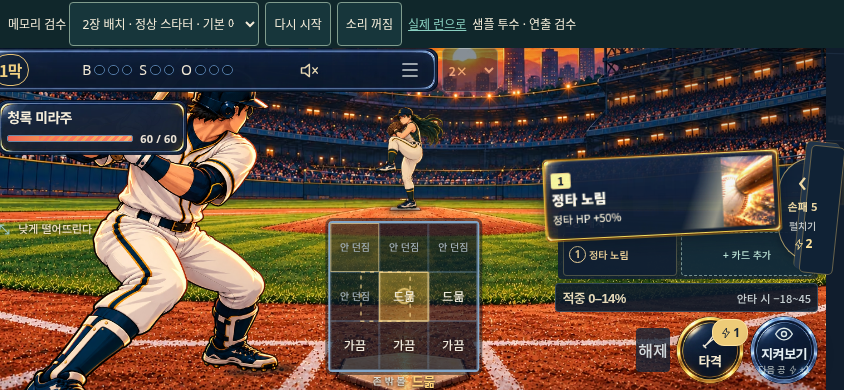
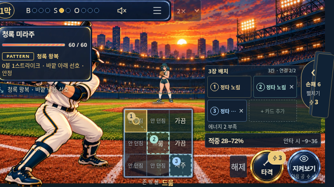
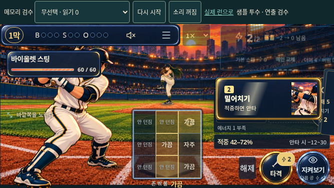

# 여러 카드로 코스 막기 복구 — 2026-11-08 KST

기준main b25c361. 사용자가 “카드 여러장써서 막는게 없어졌네”라고 보고했다. 엔진과 드래그 배치는 남아 있었지만, 새 화면의 보통 탭은 메인을 교체하고 기존 지원을 없앴다. 비용2 카드를 기본에너지2에서 고르면 추가 UI까지 전부 사라져 기능 삭제처럼 보였다.

## 이번 동작

1. 첫 카드→존→다음 카드→다른 존으로 추가된다. 존을 먼저 고른 뒤 첫 카드를 선택하는 흐름도 동일하다.
2. 배치 전 카드 비교는 유지한다. 배치 후에는 **메인 교체** 버튼으로 명시적으로 바꿀 수 있다. 기본 스윙은 언제든 명시적 교체다.
3. 에너지가 부족해도 **+ 카드 추가**와 부족 수치를 보여준다. 최대 장수/추가 타격 카드 없음과 구분한다.
4. 손패 손잡이가 열리면서 이동한 뒤 호환 클릭이 카드에 재지정되는 문제를 막았다. 다음 새 터치/키보드는 즉시 사용할 수 있다.
5. 작은 가로 화면에서 세 번째 지원 제거 버튼을 손잡이가 가리던 문제도 여백으로 해결했다.

기본에너지2/넓은 카드비용2/피해 효율/연결/최대장수/저장/RNG는 바꾸지 않았다. 따라서1비용2장은 기본에너지로,1비용3장은 실제 지켜보기 뒤에너지3에서 배치한다. 비싼 카드 여러 장을 무료로 놓을 수 있게 한 변경이 아니다.

## 근거

- [구현 전 영향도](IMPACT.md), [독립 검수와 수정 이력](independent-review.json).
- [수정 전 실제터치](before.json): 서로 다른2장을 눌렀는데 마지막1장만 남고, 비용2 메인에 추가 트레이0개.
- [실제 본편 검증](actual-play.json): 사용자와 같은 battlePlay=1,seed3의 새 격리 세션.844×390/667×375은2배속,1440×900은1배속. 각 크기2장·3장으로 총6건. 실제 지켜보기→에너지3, 계획만으로는미소비, 실행뒤에너지0·지원존·합쳐진커버·HP를 엔진 전체상태와 대조했다. 숨은 코스 정보로 행동을 고르거나 저장/덱/에너지를 주입하지 않았다.
- [화면/부족안내 검수](fixture-touch.json), [수정 전](slot-hit-before.json)/[수정 후](slot-hit-after.json) 제거 버튼 hit-test.
- [10seed smoke](zone-smoke-10.json)는 직전 main 결과와 동일하다.
- 새 회귀는11건: 탭2/3장,예산 UI,교체/거부,존우선,기본스윙,번트/인내드롭,장수/손패제한,손잡이 잔여클릭/새터치/키보드. 기존 드래그/지원 재조준/실행 테스트는 유지했다.

## 캡처

수정 전2장탭이1장으로교체: 

수정 후 본편2장: 

수정 후 작은 가로 본편3장: 

에너지부족에도 조합UI 유지: 

## 검증 범위/이력

원래4개 회귀는 수정 전4실패로 확인했다. 독립 검수에서 기본스윙/번트/인내 경계를 찾아 추가로 고쳤다. 빠른 펼침 검수 중 움직이는 손잡이의 잔여 클릭 경계를 발견해 별도 실패 테스트로 고정했다. 검수 스크립트의 잘못된 결과필드(cardCount→실제supportZones)도 교정했다. 최종 본편 검수는 펼치기 애니메이션 대기 없이 진행해6건 모두 통과했다. 물리적 휴대폰 실기 테스트는 아니며, Chromium touch/mobile viewport 검수다.

## 최종 로컬 결과

전체238파일/1,607테스트 PASS. 입력 로직 전체 검증 뒤 작은 가로 트레이 우측 여백만 보완했고, 제거 버튼 hit-test와 최종 프로덕션 본편6건으로 확인했다. build59.3/60MB PASS,10seed smoke 동일. [일반 한 경기](normal-flow.json)도2배속7투구→강판→보상→저장재개→이벤트 PASS. 기존 favicon404 콘솔 외 페이지/요청 실패는 없었다. 녹화 도구의 임시 ffmpeg 경로가 초기화된 환경 문제는 경로 복구 후 재검증했다. [전체 검증 요약](validation-summary.json).
