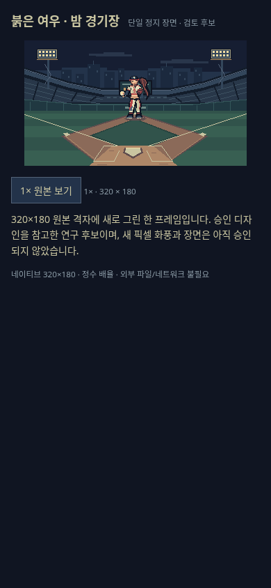
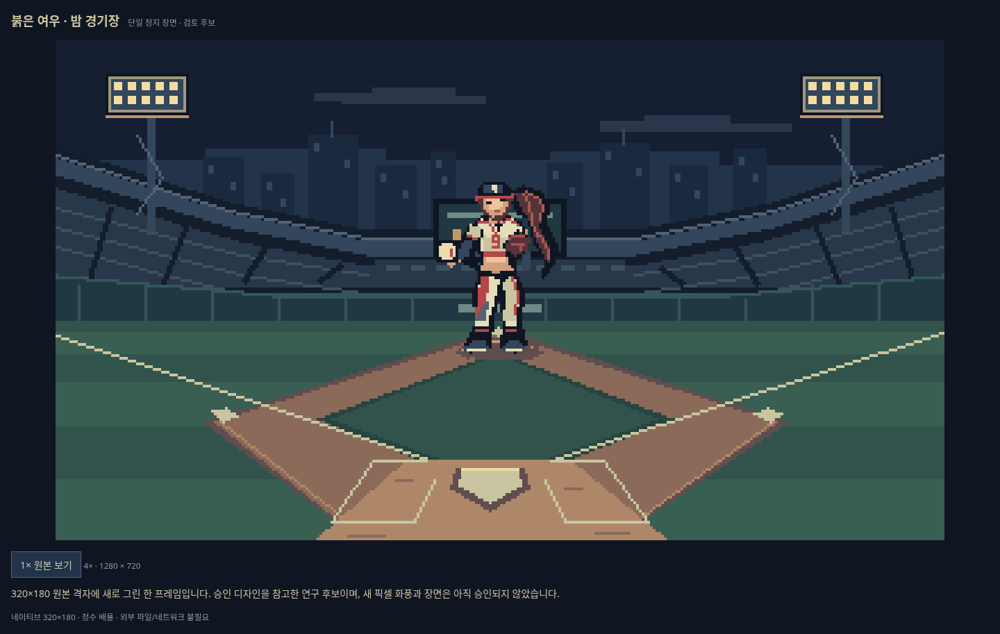
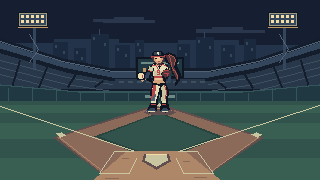

# Red Fox — one native-pixel night frame

**Review candidate, not visual approval.** This is the separately requested single static scene. Existing autonomous development remains stopped and all previous 3/3 HELD visual candidates/budgets are preserved. No animation, balance, input or live battle changes. The same single authored frame is shown at integer scales, not multiple art variants.

Open `preview.html` directly in a normal browser: all image bytes/CSS/JS are embedded, with no server, external assets or dependencies. The 1× button switches between native320×180 and integer fit. `stadium-native.png` is the original native scene (legacy filename from initial background-only preparation); `stadium-background.png` is the authored layer before the pitcher. `build_scene.py` recreates both from integer primitives and an explicit30-color palette. No input artwork, downscaling, resampling, gradient, smoothing or filter is used to generate them.

## Identity provenance and source limitation

Design approval: https://chatgpt.com/c/6acc950b-24e8-83e8-a266-d83f5761c6e4?messageId=bbb21bb6-d07a-4d87-ae7a-06bad3a57e36 — “붉은 여우 원화의 캐릭터 디자인은 승인한다. 단, 투구 모션 구도는 수정이 필요하다.”

The parent task materialized and directly inspected `libfile_3ea5017dd9e8819185c1d78ca54d2ab4` (야구 투수 캐릭터 콘셉트 시트.png), created08:07:08Z on2026-10-12, before the user's08:07:52Z positive response and08:28 design approval. Its visual audit, explicitly supplied as authoring basis, identified dark cap/crimson brim/cream9, high very long dark auburn ponytail with copper rim, offwhite cropped jersey/crimson seams/dark long inner sleeves, offwhite pants with red side stripe, dark high socks with thin bands, dark glove/red seams, dark cleats/cream toe and sole, and6–7head adult proportions. This executor did NOT directly inspect the original pixels: two permitted Library materialization attempts failed `hosted apps tools/list request failed: network`. No guessed local path or source-raster import. New output pixels WERE directly inspected here at phone/native/desktop size. Identity interpretation still requires user review; a textual/direct-parent audit is not perfect source-to-output pixel comparison.

## Camera and grid

Existing `docs/design/mockup-v1/CONTRACTS.md` world1672×941, home(815,824), mound(832,580), pitcher height310 mapped to native320×180: home(156,158), mound(159,111), pitcher60px tall. Existing `assets/production-art/mockup-rebuild/source/reference.png` was directly viewed for catcher-facing layout. Study uses fixed frame/letterboxing, not the production responsive cover renderer. It does not prove full runtime UI occlusion compatibility. Native pixel density is shared by actor, field and ball. Foot soles end at y111 over a contact shadow; one ball at viewer-left, glove viewer-right. The camera-facing 3/4 set pose is not motion approval.

## Actual techniques and skills

- Local audit: no `.agents/skills` or relevant SKILL.md in current main, PR32 head, checkout hidden directories or visible `.codex/skills`. `sprite-gen`, Aseprite and `2dimg2motion` absent from PATH. No claim of using those tools.
- Public **pixel-art-fundamentals**: https://github.com/ProkStudio/skills/blob/main/skills/game/2d/pixel-art-fundamentals/SKILL.md — read full source; applied one density, fixed material value planes, contact shadow, native-size checks and restrained background texture. Public documentation, not an installed skill.
- Public **pixel-art**: https://github.com/mandrille/pixelart/blob/master/SKILL.md — read full source; applied deterministic authored pixel source, explicit palette and native PNG plus enlarged inspection. Its CLI was neither installed nor run; Pillow integer primitives are the actual renderer. No animation workflow used.
- Saint11 cluster painting: https://saint11.art/pixel_art_articles/article2/ — applied broad connected flat regions and limited foreground detail, not third-party images.
- **openai-library:library** used for actual search and two failed supported transfers; **personal-context:personal-context** returned unavailable. **static-app-previews** read, then excluded by its repository-edit exception; normal repo/file delivery used.

## Verification and candid visual assessment

`python3 verify_scene.py` rebuilds and asserts identical PNG bytes; palette30, opaque alpha, native320×180; Chromium DPR1 at390×844,320×568,844×390,1440×900. Native canvas RGBA equals PNG; canvas screenshots equal exact nearest-neighbor integer enlargement. No smoothing, horizontal overflow, page errors or HTTP requests. 1× toggle verified. See `verification.json` and actual screenshots below. Managed Chromium blocked file:// navigation; testing loaded the exact HTML via Playwright set_content. Direct local-file navigation on an unrestricted device remains unverified. Emulated phone viewport is not physical hardware.

Direct visual finding: cap/ponytail/cream-red uniform, chest9, separate ball/glove, planted feet and catcher-view field are readable. Phone rendering is deliberately1×, with small face/equipment detail. The background is orderly but still geometric and sparse; the adult face and glove are simplified, and hair/arm separation is weaker on the dark scoreboard. The study is native pixel art, but this does NOT establish parity with Unreal X/Dimrass, beauty, commercial quality, or user acceptance. No extra visual batch is started to chase that claim.

Final full `pnpm test` rerun:248files/1706tests PASS,88.15s. `pnpm run build`, budget52.8/60MiB and smoke10 also PASS. Existing happy-dom disabled-iframe stderr and build bundle-size warnings remain. No manual full-game run was performed because src/public/gameplay remained byte-identical. Screenshots and palette tests are not gameplay or beauty approval.

Independent reviewer found the initial ball merged into the cream sleeve and hair boundary weak. One bounded corrective pass separated the ball with dark negative space and extended a copper ponytail edge; regenerated the same scene and reran the pixel/browser gate. Initial attempt retained in `attempt-01.png`; no further iteration batch. The ball is deliberately enlarged for legibility relative to realistic proportions. Current status remains VISUAL_HELD / user review required, not BAR_MET.

Read `docs/art/QUALITY-BAR.md` and viewed its user-supplied battle-landscape/map benchmarks at390CSS-pixel width in Chromium. Those have materially stronger depth, architectural density, lighting hierarchy and expressive character presence. This candidate is much sparser and more diagrammatic. No blind8-axis comparison or BAR_MET score was manufactured; UI/art-direction axes cannot all be proven by a HUD-free static study. Benchmark images remain internal and are not bundled into the deliverable.

`AUDIT.md` preserves the earlier blocked intake and superseded background-only state. This README describes the final single-frame candidate.
